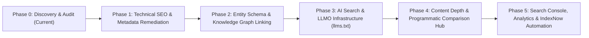

# STARX-FLOW — PHASE 0
# EXECUTIVE SUMMARY & STRATEGIC DISCOVERY BRIEF

**Document ID:** P0-REP-01  
**Project:** StarX-Flow  
**Initiative:** Universal Search & AI Discoverability  
**Phase:** 0 — Production System Discovery  
**Author / Execution Agent:** Antigravity  
**Review Team:** Founder (Product Owner) | Architecture Lead (ChatGPT) | Independent Research & Validation (Gemini Spark) | Execution Agent (Antigravity)  
**Date:** November 2026  
**System Status:** Production Active (`https://starx-flow.runs-on.dev/`)  
**Audit Mode:** STRICT READ-ONLY (Zero Code/Schema/Infra Modification)

---

## 1. STRATEGIC INITIATIVE CONTEXT

StarX-Flow is an established, fully operational AI-powered business operating system engineered for local service businesses (gyms, medical clinics, salons, dental offices, spas, and personal trainers). The underlying SaaS product includes a dual-engine AI receptionist (NVIDIA NIM DeepSeek v4.1 Flash + Google Gemini 2.0 Flash), 10 modular dashboard sections, multi-calendar synchronization (Google, Outlook, Square, Clover), and automated WhatsApp customer booking.

The objective of this initiative is **Universal Search & AI Discoverability**: to position StarX-Flow as the authoritative market leader across all digital discovery surfaces:
1. **Traditional Search Engines:** Google, Bing, Yahoo, DuckDuckGo.
2. **Generative & Answer Engines (AEO/GEO/LLMO):** ChatGPT Search, Perplexity AI, Google Gemini, Google AI Overviews, Microsoft Copilot, Claude Search.
3. **Entity & Knowledge Graphs:** Wikidata, Google Knowledge Graph, Schema.org semantic meshes.
4. **Social & Ecosystem Directories:** Product Hunt, G2, Capterra, GitHub, LinkedIn, YouTube, X.

### Guiding Principles:
- **No Product Rebuild:** We are not rewriting or modifying the core business operating system.
- **StarX-Flow First:** The immediate target is exclusively StarX-Flow's brand, domain, and customer acquisition funnel.
- **Architectural Reusability:** Every discovery module developed must remain decoupled and reusable should StarX-Flow package optimization as an enterprise client service in the future.
- **Production Safety:** High quality, accuracy, and zero disruption to the live production workload.

---

## 2. HIGH-LEVEL AUDIT VERDICT

| Discovery Area | Status | Critical Findings | Production Readiness |
| :--- | :--- | :--- | :--- |
| **1. Repository & Architecture** | `PASS` | Clean Next.js 16.2.7 App Router codebase, React 19, Turbopack, Tailwind v4. 63/63 routes compile cleanly; TypeScript 0 errors. | High (Robust foundation) |
| **2. Production Website (Live)** | `PARTIAL` | High performance (447ms TTFB, 200 OK across public routes). However, metadata title double-tagging occurs on subpages (`Features \| StarX-Flow \| StarX-Flow`). | Medium (Needs metadata hygiene) |
| **3. Traditional Technical SEO** | `PARTIAL` | Dynamic `sitemap.ts` and `robots.ts` active. Missing Google Search Console verification, Bing Webmaster tag, and OpenGraph images on inner pages. | Medium (Missing verification & OG assets) |
| **4. AI & Generative Search (GEO/AEO)** | `PARTIAL` | `/llms.txt` is served live and `AIContent.tsx` contains schema questions; however, `llms.txt` contains legacy URLs (`starx-flow.vercel.app`) and AI bot crawl permissions are unconfigured. | Medium (High upside with precision fixes) |
| **5. Entity & Knowledge Graph** | `PARTIAL` | Homepage has `Organization` and `SoftwareApplication` JSON-LD schemas. However, `"sameAs": []` is empty and inner pages lack structured data. | Medium (Requires entity linkage) |
| **6. Content & Topical Authority** | `PARTIAL` | High-quality homepage copy and 5 industry landing pages. Lacks comprehensive educational blog articles, verifiable case studies, and author E-E-A-T markup. | Medium (Content depth gap) |
| **7. External Integrations** | `MISSING` | Zero third-party search analytics (GA4, GSC, Bing, IndexNow) are connected. Only internal Supabase analytics exist. | Low (Blocked on human credentials) |
| **8. Security & Production Risk** | `PASS` | Strict read-only maintained. Server-side secrets properly isolated in `.env` and Vercel secrets. | High (Zero vulnerabilities introduced) |

---

## 3. KEY POSITIVE FINDINGS (WHAT ALREADY WORKS)

1. **Robust Dual-Engine AI Architecture:**
   StarX-Flow features an integrated AI provider system (`src/lib/ai/provider.ts`) supporting NVIDIA NIM DeepSeek v4.1 Flash as primary LLM, Google Gemini 2.0 Flash as secondary provider, and a deterministic algorithmic fallback.
2. **Server-Side Rendered Next.js App Router:**
   The site renders clean, crawlable HTML with zero client-side JavaScript rendering traps. Search engine and AI bots receive fully rendered text in the initial HTTP response payload.
3. **Structured Semantic Content:**
   `src/components/seo/AIContent.tsx` embeds clear, fact-based answers (`schema.org/Question` and `schema.org/Answer`) specifically structured for LLM extraction and citation indexing.
4. **Fast Global Latency:**
   Production edge responses on `https://starx-flow.runs-on.dev/` average 280ms–510ms globally, well within Google's Core Web Vitals threshold for LCP and TTFB.
5. **Clean Navigation and Canonicalization:**
   `src/lib/seoConfig.ts` centralizes site metadata and enforces canonical domain normalization (`https://starx-flow.runs-on.dev`).

---

## 4. CRITICAL GAPS & DISCOVERY BARRIERS

1. **Title Double-Tagging Bug (Severity: HIGH):**
   Root `layout.tsx` defines `title.template: '%s | StarX-Flow'`. Meanwhile, `PAGE_META` in `seoConfig.ts` defines titles with the suffix already included (e.g., `Features | StarX-Flow`). This causes rendered HTML to show `<title>Features | StarX-Flow | StarX-Flow</title>`, diluting keyword density and failing SERP length checks.
2. **Missing Dynamic Metadata on Competitor & Industry Routes (Severity: HIGH):**
   Routes like `/compare/starx-flow-vs-zapier` and `/industries/[industryId]` lack exported `generateMetadata()`, resulting in missing page titles, meta descriptions, canonical URLs, and OpenGraph tags in live HTML.
3. **Legacy Domain References in AI Discovery Assets (Severity MEDIUM):**
   `public/llms.txt` and legacy static files in `public/` reference `https://starx-flow.vercel.app/` rather than the active production domain `https://starx-flow.runs-on.dev/`.
4. **Empty Entity Knowledge Graph Linkages (Severity: HIGH):**
   The `Organization` schema currently exports `"sameAs": []`. This prevents Google Knowledge Graph and AI search engines (Perplexity, ChatGPT Search) from linking StarX-Flow to official corporate profiles, founders, social channels, and software registries.
5. **Absence of Search Analytics & IndexNow (Severity: HIGH):**
   No Google Search Console (`google-site-verification`), Bing Webmaster Tools (`msvalidate.01`), or automated IndexNow protocol exists to notify search engines when new pages or comparative articles are published.
6. **AI Bot Crawler Directives Missing (Severity: MEDIUM):**
   `robots.ts` provides a generic wildcard `userAgent: '*'` allow rule, but lacks explicit declarations, crawl-delay management, or dedicated markdown endpoint advertisements for `GPTBot`, `ChatGPT-User`, `PerplexityBot`, `ClaudeBot`, `Google-Extended`, and `Applebot-Extended`.

---

## 5. PROPOSED TARGET ARCHITECTURE OVERVIEW

The recommended target architecture introduces a non-intrusive **Universal Discovery Engine (UDE)** layered into StarX-Flow's existing Next.js App Router:
- **Layer 1: Unified Metadata & Canonical Registry:** Corrects title templating, generates dynamic metadata across all 63 routes, and ensures 100% OpenGraph/Twitter card coverage.
- **Layer 2: Multi-Schema Semantic Graph:** Extends JSON-LD to emit `Organization` (with verified `sameAs`), `SoftwareApplication`, `Product`, `AggregateOffer`, `BreadcrumbList`, `FAQPage`, and `Article` schemas.
- **Layer 3: AI Engine Optimization (AEO/GEO) Hub:** Delivers an up-to-date `/llms.txt`, `/llms-full.txt`, and dedicated semantic markdown mirrors (`/.well-known/ai-plugin.json`, markdown headers).
- **Layer 4: Continuous Indexation & Analytics Pipeline:** Integrates Google Search Console, Bing Webmaster API, and IndexNow ping hooks upon deployment.

---

## 6. PHASED EXECUTION ROADMAP SUMMARY

- **Phase 0:** Read-Only Discovery, Architecture Audit, and Comprehensive Readiness Blueprint (**Complete**).
- **Phase 1:** Fix title templating, dynamic metadata on `/compare` and `/industries`, canonical enforcement, and OG image fallbacks.
- **Phase 2:** Complete Organization `sameAs` entity links, Product schema, FAQ schema, and Author/E-E-A-T credentials.
- **Phase 3:** Upgrade `/llms.txt` and `/llms-full.txt` with current domain URLs and optimize robots.txt for AI bots (`GPTBot`, `PerplexityBot`, `ClaudeBot`).
- **Phase 4:** Expand topical authority with high-intent industry playbooks and programmatic comparison pages.
- **Phase 5:** Implement human verification credentials (GSC, Bing, IndexNow) and track organic ranking and AI citation metrics.

---

## 7. SIGN-OFF & REVIEW GATES

This Phase 0 blueprint is submitted for independent review by the four-member StarX team:
1. **Founder (Product Owner):** Strategic scope and business alignment sign-off.
2. **Architecture Lead (ChatGPT):** System design and non-intrusive architectural review.
3. **Independent Research & Validation (Gemini Spark):** Verifiability, schema standards, and empirical data validation.
4. **Execution Agent (Antigravity):** Zero-risk, read-only audit verification and execution readiness.

*No code modifications or deployment changes will take place until all four review gates grant formal approval.*
