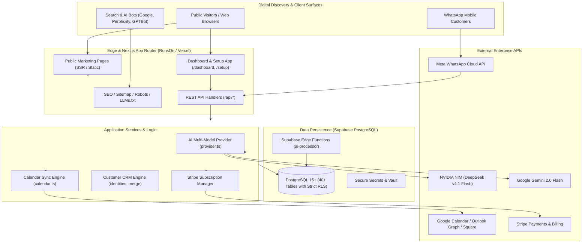
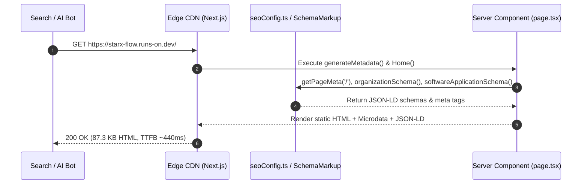
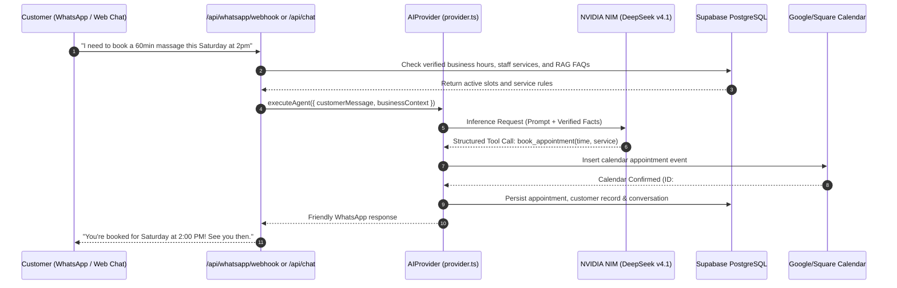

# STARX-FLOW — PHASE 0
# EXISTING SYSTEM ARCHITECTURE

**Document ID:** P0-REP-03  
**Project:** StarX-Flow  
**Initiative:** Universal Search & AI Discoverability  
**Phase:** 0 — Production System Discovery  
**Author / Execution Agent:** Antigravity  
**Review Team:** Founder | ChatGPT | Gemini Spark | Antigravity  
**Date:** November 2026  
**System Status:** Production Active  
**Audit Mode:** STRICT READ-ONLY

---

## 1. SYSTEM TOPOLOGY & ARCHITECTURE OVERVIEW

StarX-Flow is architected as an event-driven, multi-tenant AI business operating system. The front-end is hosted on a high-speed global edge network (Next.js App Router on Vercel), backed by Supabase PostgreSQL for stateful persistence, and integrated with external enterprise APIs (Meta WhatsApp Cloud API, Stripe, Google Calendar, Microsoft Graph, NVIDIA NIM, Google Gemini).

---

## 2. COMPONENT BREAKDOWN & TECHNOLOGY STACK

| Component | Technology | Version | Purpose |
| :--- | :--- | :--- | :--- |
| **Framework** | Next.js (App Router) | 16.2.7 | SSR marketing pages, client SPA dashboard, API route handlers |
| **Runtime** | React / Node.js | 19.0.0 / Node 20+ | Component tree, hooks, server-side data fetching |
| **Styling** | Tailwind CSS / PostCSS | 4.0.0 | Glassmorphic visual hierarchy, dark mode, responsive layout |
| **Client State** | Zustand | 5.0.3 | Persistent stores (`useAuthStore`, `useDashboardStore`, `useUIStore`) |
| **Database** | PostgreSQL via Supabase | 15+ | Relational schema, multi-tenant RLS, triggers, functions |
| **Primary AI LLM** | NVIDIA AI NIM | DeepSeek v4.1 Flash | Conversational booking, FAQ reasoning, sub-2s response |
| **Secondary AI LLM**| Google Gemini | 2.0 Flash | Multimodal intake analysis, high-speed fallback inference |
| **Edge Compute** | Supabase Edge Functions | Deno TypeScript | Low-latency asynchronous webhook and AI background workers |
| **Payments** | Stripe | v3 SDK | Flat subscription tiers ($29, $59, $99), webhook verification |
| **Communications**| Meta Cloud API | Graph v18.0 | Native two-way WhatsApp business messaging |

---

## 3. DATA FLOW ARCHITECTURE

### 3.1 Public Marketing & Discovery Request Flow

### 3.2 Live AI Receptionist Booking Flow

---

## 4. STANDARDIZED ARCHITECTURAL FINDINGS

### Finding ARCH-01: Decoupled AI Provider with Circuit Breaker
- **Status:** `PASS`
- **Finding:** The AI execution layer is cleanly decoupled from transport mechanisms (REST API, Webhooks, Web Simulator) and implements a 6-second timeout circuit breaker with multi-tier fallback.
- **Evidence:** `src/lib/ai/provider.ts` lines 70–112 isolate the provider logic. When NVIDIA NIM is preferred, failure or timeout triggers Gemini 2.0 Flash (`callGemini`), and failure of both triggers algorithmic fallback (`generateFallback`).
- **Source / Inspected File:** `src/lib/ai/provider.ts:67-112`
- **Severity:** `INFORMATIONAL`
- **Business Impact:** High availability for end customers. No single AI vendor outage can bring down customer service.
- **Recommended Action:** Preserve architectural isolation. Use this multi-model architecture as evidence of technical authority in GEO/AEO content.
- **Implementation Complexity:** `NOT APPLICABLE`
- **Dependencies:** None.

---

### Finding ARCH-02: ClientShell Hydration Guard Delays Marketing Portals
- **Status:** `PARTIAL`
- **Finding:** `ClientShell.tsx` contains an initial `if (!mounted) return <>{children}</>;` check before rendering `<Navbar />` and `<Footer />`.
- **Evidence:** `src/components/ClientShell.tsx` lines 43–45 renders children only during SSR, omitting navigation headers and footers from initial static HTML string until client hydration occurs.
- **Source / Inspected File:** `src/components/ClientShell.tsx:43-60`
- **Severity:** `MEDIUM`
- **Business Impact:** Web crawlers that do not execute client-side JavaScript may not discover internal navigation links contained in `<Navbar />` and `<Footer />`.
- **Recommended Action:** Move `<Navbar />` and `<Footer />` outside the `!mounted` conditional gate so that full navigation links are included in initial SSR HTML.
- **Implementation Complexity:** `LOW`
- **Dependencies:** React hydration consistency testing.

---

### Finding ARCH-03: Edge Functions Environment Configuration
- **Status:** `PASS`
- **Finding:** Supabase Edge Functions (`supabase/functions/ai-processor/index.ts`) operate in an isolated Deno environment with environment variable fallback.
- **Evidence:** `supabase/functions/ai-processor/index.ts` lines 58–62 retrieves `NVIDIA_API_KEY` and `GEMINI_API_KEY` via `Deno.env.get()`.
- **Source / Inspected File:** `supabase/functions/ai-processor/index.ts:58-62`
- **Severity:** `INFORMATIONAL`
- **Business Impact:** Edge workers maintain state independence and can execute asynchronous automation without stressing the web frontend server.
- **Recommended Action:** Maintain sync between Vercel environment variables and Supabase Edge Function secrets.
- **Implementation Complexity:** `LOW`
- **Dependencies:** Supabase CLI / Dashboard.
