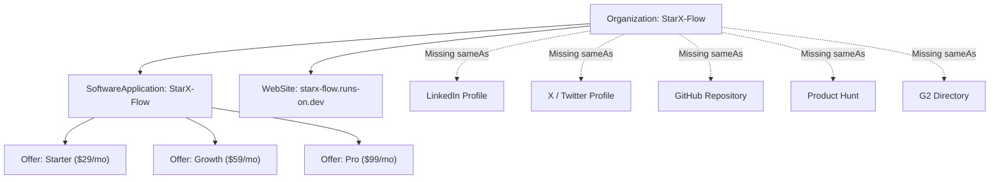

# STARX-FLOW — PHASE 0
# ENTITY & KNOWLEDGE GRAPH SCHEMA AUDIT

**Document ID:** P0-REP-07  
**Project:** StarX-Flow  
**Initiative:** Universal Search & AI Discoverability  
**Phase:** 0 — Production System Discovery  
**Audit Scope:** Entity Identity, Schema.org Graph, Google Knowledge Graph Readiness, Brand Reconciliation  
**Audit Mode:** STRICT READ-ONLY

---

## 1. ENTITY DEFINITION & CURRENT BRAND RECONCILIATION

An entity in modern search architecture is a recognized, unique person, organization, place, or concept that search engines and AI models can identify across the web independently of specific keywords.

### Current Brand Entity Profile
- **Canonical Brand Name:** `StarX-Flow` (Occasional internal variation: `StarX Flow` or `StarX OS`).
- **Primary Website:** `https://starx-flow.runs-on.dev/` (Legacy alias: `https://starx-flow.vercel.app/`).
- **Primary Entity Category:** `SoftwareApplication` / `Organization` (AI Workflow Automation & Operating System).
- **Target Knowledge Domains:** Conversational AI, WhatsApp Automation, Local Business Management Software, Medical/Salon Appointment Scheduling.



---

## 2. STRUCTURED DATA (JSON-LD) EVALUATION

### 2.1 Existing Schema Implementations
StarX-Flow maintains pre-built schema generator functions in `src/components/seo/SchemaMarkup.tsx`:
1. `organizationSchema()`: Emits `Organization` with name, URL, logo, description, and contact point.
2. `websiteSchema()`: Emits `WebSite` with `SearchAction` pointing to `/resources?q=`.
3. `softwareApplicationSchema()`: Emits `SoftwareApplication` with `AggregateOffer`, `AggregateRating`, and `featureList`.
4. `faqPageSchema(faqs)`: Emits `FAQPage` with questions and answers.
5. `breadcrumbSchema(items)`: Emits `BreadcrumbList`.
6. `howToSchema(steps)`: Emits `HowTo` with procedural steps.
7. `articleSchema(...)`: Emits `Article` with author, dates, and publisher.

### 2.2 Live Production Schema Coverage

| Route | Rendered Schemas | Syntactic Validity | Google Rich Results Readiness |
| :--- | :--- | :--- | :--- |
| **`/` (Homepage)** | `Organization`, `SoftwareApplication`, `HowTo` | `PASS` (Valid JSON-LD) | `PARTIAL` (Rating lacks proof; sameAs empty) |
| **`/pricing`** | *None* | `MISSING` | `FAIL` (Lacks Product & Offer schema) |
| **`/features`** | *None* | `MISSING` | `FAIL` (Lacks SoftwareApplication & Feature list) |
| **`/product`** | *None* | `MISSING` | `FAIL` (Lacks SoftwareApplication schema) |
| **`/about`** | *None* | `MISSING` | `FAIL` (Lacks AboutPage & Person/Founder schema) |
| **`/resources`** | *None* | `MISSING` | `FAIL` (Lacks FAQPage & CollectionPage schema) |
| **`/compare/*`**| *None* | `MISSING` | `FAIL` (Lacks Product comparison & Breadcrumb schema) |

---

## 3. KNOWLEDGE GRAPH DISCOVERY GAPS

### 3.1 Unlinked Entity Mesh (`sameAs` Array)
In the live `Organization` schema:
```json
{
  "@context": "https://schema.org",
  "@type": "Organization",
  "name": "StarX-Flow",
  "url": "https://starx-flow.runs-on.dev",
  "logo": "https://starx-flow.runs-on.dev/logo.svg",
  "sameAs": []
}
```
Because `"sameAs": []` is empty, Google Knowledge Graph cannot disambiguate StarX-Flow from similarly named entities. Connecting this array to authoritative external profiles (GitHub, LinkedIn, Crunchbase, X, Product Hunt) is an immediate priority.

### 3.2 Lack of Author & Person Schemas
AI search engines (particularly Google AI Overviews and Perplexity) evaluate the E-E-A-T credentials of the humans behind B2B software:
- There is currently no `Person` schema for the Founder or Lead Architect.
- There are no author credentials attached to resource articles or comparison analyses.

---

## 4. STANDARDIZED ENTITY & SCHEMA FINDINGS

### Finding SCH-01: Empty sameAs Array in Organization Schema
- **Status:** `FAIL`
- **Finding:** The live `Organization` JSON-LD schema renders an empty `sameAs` array.
- **Evidence:** Source inspection of `src/components/seo/SchemaMarkup.tsx` line 22: `"sameAs": []`. Live inspection of `https://starx-flow.runs-on.dev/` confirmed `"sameAs": []`.
- **Source / Inspected File:** `src/components/seo/SchemaMarkup.tsx:22`
- **Severity:** `HIGH`
- **Business Impact:** Google Knowledge Graph fails to recognize StarX-Flow as a verified software organization entity, impeding rich knowledge panel creation.
- **Recommended Action:** Update `organizationSchema()` to populate `sameAs` with active social and registry profiles once created.
- **Implementation Complexity:** `LOW`
- **Dependencies:** Social and directory profile URLs.

---

### Finding SCH-02: Absence of Product & Offer Schemas on /pricing
- **Status:** `MISSING`
- **Finding:** The pricing page (`/pricing`) renders zero JSON-LD structured data, omitting price and plan availability from Google Merchant and software shopping results.
- **Evidence:** Live HTTP audit of `https://starx-flow.runs-on.dev/pricing` returned `schemaCount: 0`.
- **Source / Inspected File:** `src/app/pricing/page.tsx`
- **Severity:** `HIGH`
- **Business Impact:** Google cannot extract pricing tiers ($29, $59, $99) to display rich pricing snippets in search results.
- **Recommended Action:** Inject `softwareApplicationSchema()` and individual `Product` offer schemas with subscription details into `src/app/pricing/page.tsx`.
- **Implementation Complexity:** `LOW`
- **Dependencies:** `src/components/seo/SchemaMarkup.tsx`.

---

### Finding SCH-03: Incomplete ContactPoint Specification
- **Status:** `PARTIAL`
- **Finding:** The `contactPoint` object in `Organization` schema provides `contactType: "customer service"`, but omits `telephone`, `email`, and `contactOption`.
- **Evidence:** `src/components/seo/SchemaMarkup.tsx` lines 23–27:
  ```json
  "contactPoint": {
    "@type": "ContactPoint",
    "contactType": "customer service",
    "availableLanguage": ["English"]
  }
  ```
- **Source / Inspected File:** `src/components/seo/SchemaMarkup.tsx:23-27`
- **Severity:** `LOW`
- **Business Impact:** Google Knowledge Graph cannot display official customer support contact paths in knowledge panels.
- **Recommended Action:** Add official support email (e.g. `support@starx-flow.runs-on.dev`) and contact page URL to the `contactPoint` object.
- **Implementation Complexity:** `LOW`
- **Dependencies:** Verified contact email address.
