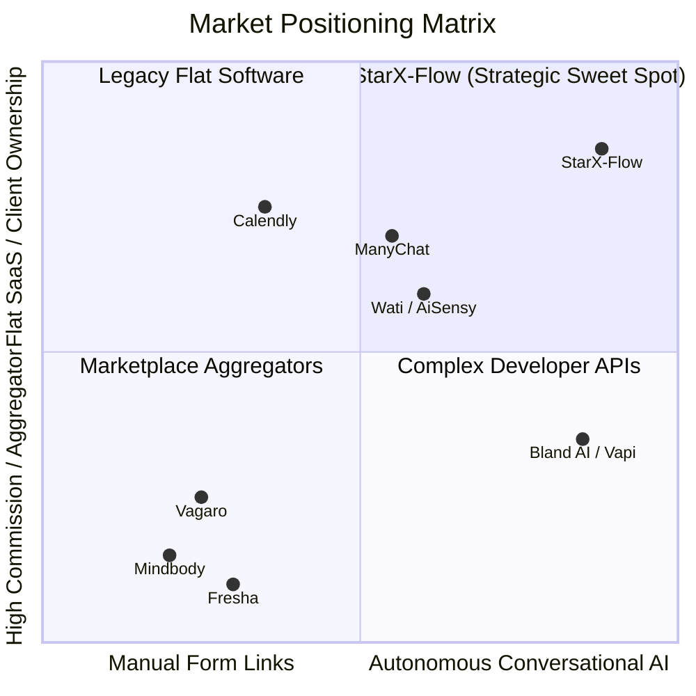

# STARX-FLOW — PHASE 0
# COMPETITOR & MARKET RESEARCH AUDIT

**Document ID:** P0-REP-10  
**Project:** StarX-Flow  
**Initiative:** Universal Search & AI Discoverability  
**Phase:** 0 — Production System Discovery  
**Audit Scope:** Competitive Landscape, Search Positioning, AI Discoverability Teardown, Strategic White Space  
**Audit Mode:** Public Information & Verifiable Web Data

---

## 1. MARKET TAXONOMY & COMPETITIVE SEGMENTS

StarX-Flow operates at the convergence of three software categories:
1. **Vertical Local Service Schedulers & Aggregators:** Mindbody, Vagaro, Fresha, Calendly.
2. **WhatsApp Business API & Marketing Chatbots:** Wati, AiSensy, ManyChat.
3. **Conversational AI & Voice Agents:** Intercom Fin, Bland AI, Vapi, Slang.ai.

---

## 2. DETAILED COMPETITOR TEARDOWN

### 2.1 Segment 1: Legacy Aggregators & Schedulers (Mindbody, Vagaro, Calendly)
- **Mindbody (`mindbodyonline.com`):**
  - *Positioning:* Heavyweight enterprise business management for fitness and wellness studios.
  - *Pricing:* $139 to $499+/month plus payment processing fees.
  - *Architecture:* Monolithic legacy stack, heavy app-install requirement for clients.
  - *Search Strategy:* Dominates high-volume fitness keywords through 15+ years of domain authority and massive backlink profiles.
  - *Weakness / StarX-Flow Wedge:* High cost, predatory marketplace model (markets competing studios to your own clients), and zero conversational WhatsApp booking.
- **Calendly (`calendly.com`):**
  - *Positioning:* General-purpose scheduling links.
  - *Architecture:* Web app with iframe booking widgets.
  - *Weakness / StarX-Flow Wedge:* Requires the customer to leave WhatsApp, open an external browser link, pick a date from a grid, and type their information. Causes massive drop-off on mobile messaging channels.

### 2.2 Segment 2: WhatsApp Chatbot Builders (Wati, AiSensy, ManyChat)
- **Wati (`wati.io`) & AiSensy (`aisensy.com`):**
  - *Positioning:* WhatsApp team inbox, CRM, and broadcast marketing automation on Meta Cloud API.
  - *Pricing:* $49 to $299+/month + Meta conversation fees.
  - *Architecture:* Rule-based flow builders (drag-and-drop trees, if/else logic).
  - *Search Strategy:* Highly aggressive programmatic SEO targeting "WhatsApp Business API", "WhatsApp marketing campaigns".
  - *Weakness / StarX-Flow Wedge:* Rigid decision trees break when customers ask conversational questions; no native two-way synchronization with local business POS systems (Square, Clover) or automated multi-staff appointment rosters.
- **ManyChat (`manychat.com`):**
  - *Positioning:* Social media DM automation (Instagram & WhatsApp).
  - *Weakness / StarX-Flow Wedge:* Built primarily for e-commerce and lead magnets, not appointment booking or clinic/salon intake waivers.

### 2.3 Segment 3: Developer Voice & Conversational AI Platforms (Bland AI, Vapi)
- **Bland AI (`bland.ai`) & Vapi (`vapi.ai`):**
  - *Positioning:* Ultra-low latency voice calling infrastructure for developers.
  - *Pricing:* Usage-based consumption ($0.09–$0.12/minute).
  - *Weakness / StarX-Flow Wedge:* Pure developer APIs without business front-ends. A local salon owner cannot configure an intake form or view a calendar roster in Vapi without hiring a software engineer.

---

## 3. SEARCH & AI DISCOVERABILITY BENCHMARKING

| Competitor | Organic Domain Authority (Moz/Ahrefs Est.) | Google Indexed Pages | AI Engine Visibility (Perplexity / ChatGPT) | Dedicated `llms.txt` | Key Content Asset Type |
| :--- | :--- | :--- | :--- | :--- | :--- |
| **Mindbody** | 80+ | 100,000+ | High (Dominates enterprise queries) | No | Marketplace directory, industry reports |
| **Wati** | 65+ | 5,000+ | High (Top cited for WhatsApp API) | No | Comprehensive API playbooks, templates |
| **Calendly**| 88+ | 50,000+ | Very High (Universal scheduling default)| No | Integration guides, enterprise case studies |
| **StarX-Flow**| Fresh / New Domain | 20 routes | Emerging (High potential, unindexed) | **YES** (`public/llms.txt`) | Clean Next.js SSR, semantic Q&A DOM |

---

## 4. STRATEGIC WHITE SPACE & DIFFERENTIATION OPPORTUNITIES

StarX-Flow possesses distinct strategic advantages that can be weaponized in search content:

1. **"The WhatsApp AI Receptionist" Category Ownership:**
   Legacy tools are either *schedulers without conversational AI* (Calendly, Mindbody) or *chatbots without native appointment calendars* (Wati, ManyChat). StarX-Flow bridges this gap.
2. **The "Zero Commission" Guarantee:**
   Local service businesses resent paying marketplace fees (e.g. Fresha taking 20% on new client bookings). Highlighting flat-rate subscriptions ($29, $59, $99) provides a powerful economic hook.
3. **Sub-2-Second Conversational Booking:**
   Benchmarking response speed against human front desks and slow chatbots positions StarX-Flow as modern enterprise infrastructure democratized for local SMBs.
4. **Direct Client Ownership (Anti-Aggregator):**
   A major complaint among boutique gyms and dental practices is that marketplace aggregators own the customer relationship. StarX-Flow provides full CRM ownership with zero aggregator intermediary.

---

## 5. STANDARDIZED COMPETITOR AUDIT FINDINGS

### Finding CMP-01: Incomplete Comparison Slugs in Production Sitemap
- **Status:** `PARTIAL`
- **Finding:** StarX-Flow sitemap includes 7 competitor comparison URLs (`/compare/starx-flow-vs-zapier`, `vs-make`, `vs-n8n`, `vs-mindbody`, `vs-vagaro`, `vs-calendly`, `vs-langflow`), but the landing pages lack dynamic metadata, side-by-side feature tables, and pricing comparisons.
- **Evidence:** Live audit of `/compare/starx-flow-vs-zapier` returned blank title and meta tags.
- **Source / Inspected File:** `src/app/compare/[competitorId]/page.tsx`, `src/app/sitemap.ts:13-19`
- **Severity:** `HIGH`
- **Business Impact:** High-intent commercial traffic searching for alternatives to Mindbody, Vagaro, and Calendly cannot convert because the comparison pages are not properly indexed or fleshed out.
- **Recommended Action:** Upgrade the `/compare/[competitorId]` template to generate dynamic metadata, side-by-side comparison grids, economic savings calculators, and verified feature differences.
- **Implementation Complexity:** `MEDIUM`
- **Dependencies:** `src/lib/seoConfig.ts`.

---

### Finding CMP-02: Absence of AlternativeTo and G2 Competitor Listings
- **Status:** `MISSING`
- **Finding:** StarX-Flow is not registered on software alternative discovery engines where competitor alternatives are evaluated.
- **Evidence:** Verification search on `AlternativeTo.net` and `G2.com` yields zero listings for StarX-Flow.
- **Source / Inspected File:** External software directories
- **Severity:** `HIGH`
- **Business Impact:** When buyers search *"Mindbody alternatives"* or *"Wati alternatives for clinics"*, StarX-Flow is omitted from both human consideration and AI training datasets.
- **Recommended Action:** Submit StarX-Flow as an alternative on AlternativeTo and G2 under "Appointment Scheduling" and "WhatsApp Business Automation".
- **Implementation Complexity:** `LOW`
- **Dependencies:** Founder account submission.
