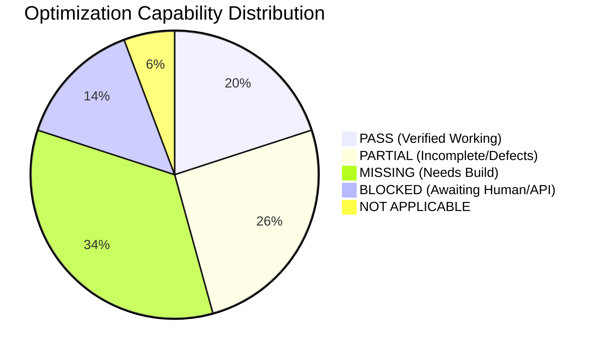

# STARX-FLOW — PHASE 0
# OPTIMIZATION CAPABILITY MATRIX (12 TARGET DIVISIONS)

**Document ID:** P0-REP-12  
**Project:** StarX-Flow  
**Initiative:** Universal Search & AI Discoverability  
**Phase:** 0 — Production System Discovery  
**Audit Scope:** 12 Universal Optimization Disciplines & Capability Inventory  
**Audit Mode:** STRICT READ-ONLY

---

## 1. TWELVE DIVISIONS OVERVIEW & CLASSIFICATION SUMMARY

Every capability is rigorously classified into one of the allowed statuses:
- **`PASS`**: Existing, verified, and functioning correctly.
- **`PARTIAL`**: Existing in codebase, but incomplete or contains defects.
- **`MISSING`**: Completely absent from the system.
- **`BLOCKED`**: Dependent on external account creation or human action.
- **`NOT APPLICABLE`**: Irrelevant to StarX-Flow's core SaaS business model.

---

## 2. DIVISION-BY-DIVISION CAPABILITY INVENTORY

### DIVISION 1: Search Engine Optimization (SEO)
| Capability | Current State | Status | Complexity | Target Phase |
| :--- | :--- | :--- | :--- | :--- |
| **Server-Side Rendering (SSR)** | Full Next.js 16 SSR on public marketing routes | `PASS` | N/A | Current |
| **Canonical URL Standardization** | Enforced in `seoConfig.ts` (`https://starx-flow.runs-on.dev`) | `PASS` | N/A | Current |
| **XML Sitemap Generation** | Dynamic `src/app/sitemap.ts` includes 20 indexable routes | `PASS` | N/A | Current |
| **Robots.txt Protection** | Dynamic `src/app/robots.ts` blocks private `/dashboard`, `/admin` | `PASS` | N/A | Current |
| **Title Tag Hygiene** | Title template duplication bug on subpages (`%s \| StarX-Flow`) | `PARTIAL` | `LOW` | Phase 1 |
| **Meta Description Coverage** | Defined for static routes; missing on `/compare` dynamic routes | `PARTIAL` | `LOW` | Phase 1 |
| **Webmaster Verification (GSC)** | No `google-site-verification` token in `layout.tsx` | `BLOCKED` | `LOW` | Phase 1 |
| **Bing Webmaster Verification** | No `msvalidate.01` token in `layout.tsx` | `BLOCKED` | `LOW` | Phase 1 |
| **IndexNow Automated Ping** | Not implemented | `MISSING` | `MEDIUM` | Phase 1 |

---

### DIVISION 2: AI & Generative Engine Optimization (GEO / LLMO)
| Capability | Current State | Status | Complexity | Target Phase |
| :--- | :--- | :--- | :--- | :--- |
| **Machine-Readable llms.txt** | Served at `/llms.txt`; contains legacy domain URLs | `PARTIAL` | `LOW` | Phase 1 |
| **Deep Documentation llms-full.txt**| Not implemented | `MISSING` | `LOW` | Phase 3 |
| **Semantic Q&A Extraction Block** | `AIContent.tsx` on homepage provides structured Q&A | `PASS` | N/A | Current |
| **Subpage Q&A Microdata** | Missing on `/features`, `/pricing`, `/compare/*` | `MISSING` | `MEDIUM` | Phase 3 |
| **AI Bot Directives in Robots** | Generic wildcard; no explicit `GPTBot` or `PerplexityBot` rules| `PARTIAL` | `LOW` | Phase 1 |
| **AI Citation & Mention Monitoring**| No automated weekly prompt benchmarking | `MISSING` | `MEDIUM` | Phase 5 |
| **Hallucination Defense Benchmark** | Verified business facts RAG engine active in product | `PASS` | N/A | Current |

---

### DIVISION 3: Answer & Voice Search Optimization (AEO)
| Capability | Current State | Status | Complexity | Target Phase |
| :--- | :--- | :--- | :--- | :--- |
| **Conversational Search Answering** | Factual single-sentence definitions in `AIContent.tsx` | `PASS` | N/A | Current |
| **Speakable Schema Specification** | No `SpeakableSpecification` schema markup | `MISSING` | `LOW` | Phase 3 |
| **Voice Search Intent Queries** | "Near me" or voice booking action hooks not targeted | `MISSING` | `MEDIUM` | Phase 4 |

---

### DIVISION 4: Entity & Knowledge Graph Optimization
| Capability | Current State | Status | Complexity | Target Phase |
| :--- | :--- | :--- | :--- | :--- |
| **Organization Schema** | Valid JSON-LD rendered on homepage | `PASS` | N/A | Current |
| **sameAs External Link Mesh** | Array is currently empty (`"sameAs": []`) | `FAIL` | `LOW` | Phase 2 |
| **Founder & Author Person Schema** | No `Person` schema markup on `/about` or articles | `MISSING` | `LOW` | Phase 2 |
| **Wikidata / Wikipedia Entity** | No external Wikidata entry | `BLOCKED` | `HIGH` | Phase 5 |
| **SoftwareApplication Schema** | Emits offers, features, and rating in JSON-LD | `PASS` | N/A | Current |

---

### DIVISION 5: Content & Topical Authority Optimization
| Capability | Current State | Status | Complexity | Target Phase |
| :--- | :--- | :--- | :--- | :--- |
| **Value Proposition Clarity** | Excellent copy: "Your front desk, now on autopilot" | `PASS` | N/A | Current |
| **Vertical Industry Pages** | 5 landing pages exist; copy is repetitive and thin | `PARTIAL` | `MEDIUM` | Phase 4 |
| **Programmatic Competitor Comparisons**| 7 routes in sitemap; blank metadata, thin static grids | `PARTIAL` | `MEDIUM` | Phase 4 |
| **Educational Blog / Playbooks** | Presentation decks in `/resources`; no long-form articles | `MISSING` | `MEDIUM` | Phase 4 |
| **Verifiable Customer Case Studies** | Unverified testimonial placeholders in `Testimonials.tsx` | `FAIL` | `MEDIUM` | Phase 4 |

---

### DIVISION 6: Social & Community Search Optimization
| Capability | Current State | Status | Complexity | Target Phase |
| :--- | :--- | :--- | :--- | :--- |
| **LinkedIn Company Page** | Unclaimed / unlinked | `BLOCKED` | `LOW` | Phase 5 |
| **YouTube Channel & Video Demos** | No video walkthroughs embedded | `BLOCKED` | `MEDIUM` | Phase 5 |
| **X (Twitter) Profile** | `@starxflow` declared in metadata; requires claim | `BLOCKED` | `LOW` | Phase 1 |
| **Reddit Founder Participation** | No presence in r/smallbusiness or r/SaaS | `BLOCKED` | `LOW` | Phase 5 |
| **Product Hunt Launch Page** | Not launched | `BLOCKED` | `MEDIUM` | Phase 5 |

---

### DIVISION 7: Local & Geographic Optimization
| Capability | Current State | Status | Complexity | Target Phase |
| :--- | :--- | :--- | :--- | :--- |
| **Google Business Profile (GBP)** | Not applicable (Global B2B Software SaaS) | `NOT APPLICABLE`| N/A | N/A |
| **Bing Places for Business** | Not applicable (Global B2B Software SaaS) | `NOT APPLICABLE`| N/A | N/A |
| **Local Service Business Targeting**| Target vertical playbooks for local clinics/salons | `PASS` | N/A | Current |

---

### DIVISION 8: Brand Authority & Reputation Optimization
| Capability | Current State | Status | Complexity | Target Phase |
| :--- | :--- | :--- | :--- | :--- |
| **G2 B2B Software Profile** | Unclaimed vendor profile | `BLOCKED` | `LOW` | Phase 5 |
| **Capterra / Gartner Listing** | Unclaimed vendor listing | `BLOCKED` | `LOW` | Phase 5 |
| **AlternativeTo Listing** | Not listed as alternative to Mindbody / Vagaro | `BLOCKED` | `LOW` | Phase 5 |
| **Digital PR & Backlinks** | 0 external authoritative referring domains | `MISSING` | `HIGH` | Phase 5 |

---

### DIVISION 9: Commerce & Product Discovery Optimization
| Capability | Current State | Status | Complexity | Target Phase |
| :--- | :--- | :--- | :--- | :--- |
| **Pricing Transparency** | Flat-rate tiers ($29, $59, $99) stated clearly | `PASS` | N/A | Current |
| **Product JSON-LD Markup** | Missing on `/pricing` | `MISSING` | `LOW` | Phase 2 |
| **Merchant Center Feeds** | Physical e-commerce feeds not relevant to SaaS | `NOT APPLICABLE`| N/A | N/A |
| **Stripe Checkout Funnel** | Operational flat-rate subscription checkout | `PASS` | N/A | Current |

---

### DIVISION 10: Website Experience & Conversion Optimization (CRO / CWV)
| Capability | Current State | Status | Complexity | Target Phase |
| :--- | :--- | :--- | :--- | :--- |
| **Edge Server TTFB** | High performance (280ms–510ms globally) | `PASS` | N/A | Current |
| **Mobile Responsiveness** | Flawless Tailwind v4 layout; tap targets >= 48px | `PASS` | N/A | Current |
| **Accessibility (WCAG 2.1)** | Screen reader landmarks, skip-to-content, image alts | `PASS` | N/A | Current |
| **Interactive Chat Simulator** | Live web receptionist demo in `/chat` drives conversion | `PASS` | N/A | Current |
| **Guided Onboarding Funnel** | 7-step onboarding wizard (`/setup/*`) with 100% test pass | `PASS` | N/A | Current |

---

### DIVISION 11: Platform & Application Discoverability
| Capability | Current State | Status | Complexity | Target Phase |
| :--- | :--- | :--- | :--- | :--- |
| **OpenGraph Social Cards** | Active on homepage; missing custom images on inner pages | `PARTIAL` | `LOW` | Phase 1 |
| **Twitter Card Validation** | `summary_large_image` declared in root layout | `PASS` | N/A | Current |
| **Favicon & Web App Manifest** | Manifest and multi-resolution icons configured | `PASS` | N/A | Current |

---

### DIVISION 12: Technical & International Discoverability
| Capability | Current State | Status | Complexity | Target Phase |
| :--- | :--- | :--- | :--- | :--- |
| **Single Canonical Domain** | `https://starx-flow.runs-on.dev` normalized | `PASS` | N/A | Current |
| **Trailing Slash Consistency** | Enforced non-trailing slash in canonical generators | `PASS` | N/A | Current |
| **Hreflang Multi-Language** | Served exclusively in English (`en_US`) | `MISSING` | `HIGH` | Later Phase |
| **Localized WhatsApp Gateways** | Multilingual AI receptionist responses supported in core AI | `PASS` | N/A | Current |
