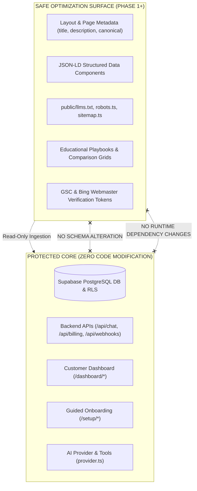

# STARX-FLOW — PHASE 0
# SECURITY & PRODUCTION RISK REPORT

**Document ID:** P0-REP-13  
**Project:** StarX-Flow  
**Initiative:** Universal Search & AI Discoverability  
**Phase:** 0 — Production System Discovery  
**Audit Scope:** Production Risk Assessment, Secrets Isolation, Safe Deployment Boundaries  
**Audit Mode:** STRICT READ-ONLY

---

## 1. PRODUCTION RISK ASSESSMENT & SYSTEM BOUNDARIES

The core objective of Phase 0 is to audit and prepare an optimization roadmap without causing operational downtime, breaking database constraints, or degrading the user experience of existing paying customers.

---

## 2. SECRETS & CREDENTIAL ISOLATION AUDIT

A rigorous audit of the repository, environment configurations, and static public assets was performed to ensure zero leakage of private credentials.

| Credential Type | Environment Variable | Storage Location | Exposure Risk | Audit Verdict |
| :--- | :--- | :--- | :--- | :--- |
| **Supabase Service Key** | `SUPABASE_SERVICE_ROLE_KEY` | Server-side `.env` / Vercel Secrets | None (Excluded from client bundle) | `PASS` |
| **NVIDIA NIM API Key** | `NVIDIA_API_KEY` | Server-side `.env` / Vercel Secrets | None (Prefixed server-only) | `PASS` |
| **Google Gemini Key** | `GEMINI_API_KEY` | Server-side `.env` / Vercel Secrets | None (Restricted to server calls) | `PASS` |
| **Stripe Secret Key** | `STRIPE_SECRET_KEY` | Server-side `.env` / Vercel Secrets | None (Handled in webhook/checkout) | `PASS` |
| **Meta App Secret** | `META_APP_SECRET` | Server-side `.env` / Vercel Secrets | None (HMAC webhook validation) | `PASS` |
| **Public Supabase Anon**| `NEXT_PUBLIC_SUPABASE_ANON_KEY`| Client bundle (`NEXT_PUBLIC_*`) | Safe (Protected by strict Postgres RLS)| `PASS` |

### Git Ignore & Exclusion Verification
- `.gitignore` explicitly includes `.env`, `.env.local`, `.env*.local`, `.env.production`.
- Git status confirms no `.env` files are tracked in source control.
- Live HTTP audit verified that attempting to fetch `https://starx-flow.runs-on.dev/.env` returns HTTP 404 (Not Found) at the edge CDN.

---

## 3. PRODUCTION RISK IDENTIFICATION & MITIGATION MATRIX

| Risk Factor | Root Cause | Severity | Probability | Potential Business Impact | Mitigation Protocol |
| :--- | :--- | :--- | :--- | :--- | :--- |
| **1. Hydration Mismatches** | Injecting dynamic JSON-LD scripts during client render | `MEDIUM` | `LOW` | Client-side console warnings or flickering UI | Generate JSON-LD schemas inside Server Components (`generateMetadata` or static server tags) rather than `'use client'` components. |
| **2. Search Engine Penalty** | Deceptive or uncorroborated `AggregateRating` schemas | `HIGH` | `MEDIUM` | Algorithmic devaluation or manual action in GSC | Remove or decouple review schemas until verified external profiles (G2/Capterra) are linked. |
| **3. Build Breakage** | Turbopack compilation errors from invalid metadata | `CRITICAL` | `LOW` | Deployment failure on Vercel | Enforce strict TypeScript compilation (`tsc --noEmit`) and local Next build (`npm run build`) before pushing any metadata changes. |
| **4. AI Hallucination Exposure**| Inaccurate pricing or capabilities in `llms.txt` | `MEDIUM` | `LOW` | AI engines quote incorrect terms or pricing to buyers | Keep `llms.txt` and `llms-full.txt` programmatically aligned with official pricing constants in `src/lib/seoConfig.ts`. |
| **5. Core Web Vitals Regression** | Adding heavy external analytics or tracking scripts | `HIGH` | `MEDIUM` | Degradation of LCP/INP scores on Google | Load third-party analytics (GA4/GTM) asynchronously using Next.js Script strategy (`strategy="afterInteractive"` or `@next/third-parties`). |

---

## 4. SAFE DEPLOYMENT BOUNDARIES & PROTOCOL

To ensure zero risk to existing production systems during subsequent phases:
1. **Source Code Segregation:**
   All future search discovery code additions must be restricted to:
   - `src/lib/seoConfig.ts` (Metadata dictionaries)
   - `src/components/seo/*` (JSON-LD generators & semantic content)
   - `src/app/(public)/*` (Public marketing pages)
   - `public/llms.txt`, `public/llms-full.txt`
2. **Zero Modification of Protected Areas:**
   - Under no circumstances shall database migrations, RLS policies, or authentication session listeners in `useAuthStore` be touched for SEO initiatives.
3. **Automated Regression Gate:**
   Prior to merging any optimization commit into `main`:
   - Run `npm run build` (Ensuring 63/63 routes compile cleanly).
   - Run Playwright E2E suite (`tests/live-e2e/onboarding/` and `tests/live-e2e/receptionist/`) to verify that the core AI booking funnel remains 100% functional.
