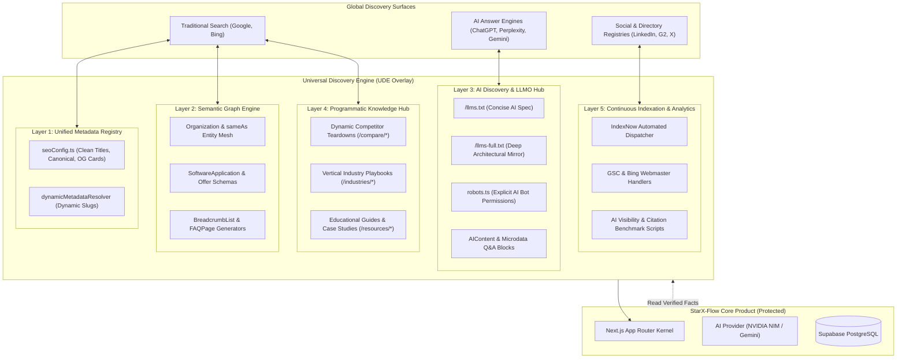

# STARX-FLOW — PHASE 0
# PROPOSED TARGET ARCHITECTURE (UNIVERSAL DISCOVERY ENGINE)

**Document ID:** P0-REP-14  
**Project:** StarX-Flow  
**Initiative:** Universal Search & AI Discoverability  
**Phase:** 0 — Production System Discovery  
**Author / Execution Agent:** Antigravity  
**Review Team:** Founder | ChatGPT | Gemini Spark | Antigravity  
**Date:** November 2026  
**System Status:** Architectural Blueprint

---

## 1. ARCHITECTURAL VISION: THE UNIVERSAL DISCOVERY ENGINE (UDE)

To achieve global discoverability across traditional search engines (Google, Bing), AI answer engines (ChatGPT Search, Perplexity, Google Gemini), and knowledge graphs without touching StarX-Flow's core SaaS logic, we propose the **Universal Discovery Engine (UDE)**.

The UDE is a decoupled, non-intrusive architectural overlay implemented natively within Next.js App Router server components.



---

## 2. DETAILED LAYER SPECIFICATIONS

### Layer 1: Unified Metadata & Canonical Registry
- **File:** `src/lib/seoConfig.ts`
- **Objective:** Fix title templating, eliminate double suffixes, enforce non-trailing-slash canonical URLs, and provide custom OpenGraph/Twitter card images for every public page.
- **Contract:** Pure TypeScript dictionary and deterministic URL cleaner. Zero dependencies on database or external network calls.

### Layer 2: Semantic Graph Engine
- **File:** `src/components/seo/SchemaMarkup.tsx`
- **Objective:** Emit rich, syntactically valid JSON-LD structured data:
  - `Organization`: Fully linked `sameAs` array connecting official social and software directory nodes.
  - `SoftwareApplication`: Verified feature list and operating system definitions.
  - `AggregateOffer`: Transparent pricing tiers ($29, $59, $99).
  - `BreadcrumbList`: Hierarchical site navigation trails for subpages.
  - `FAQPage`: Schema.org Question/Answer nodes on feature and resource pages.

### Layer 3: AI Discovery & LLMO Hub
- **Files:** `public/llms.txt`, `public/llms-full.txt`, `src/app/robots.ts`
- **Objective:** Deliver first-class discoverability to LLM agents:
  - Maintain `/llms.txt` aligned with production URLs (`starx-flow.runs-on.dev`).
  - Author `/llms-full.txt` providing deep feature comparisons, integration parameters, and prompt guardrails.
  - Configure `robots.ts` with explicit allow rules for `GPTBot`, `ChatGPT-User`, `PerplexityBot`, and `ClaudeBot`.

### Layer 4: Programmatic Knowledge Hub
- **Files:** `src/app/compare/[competitorId]/`, `src/app/industries/[industryId]/`
- **Objective:** Transform static or empty comparison and industry routes into high-converting, deeply indexed landing pages with side-by-side grids, pricing calculators, and vertical-specific workflows.

### Layer 5: Continuous Indexation & Analytics Pipeline
- **Files:** `src/app/api/cron/indexnow/route.ts`, verification meta tags
- **Objective:** Automated ping to IndexNow (Bing/Yandex) upon each deployment; seamless integration with Google Search Console, Bing Webmaster Tools, and weekly automated AI recommendation tracking scripts.

---

## 3. ARCHITECTURAL REUSABILITY & MULTI-TENANT FUTURE

While the current implementation target is **exclusively StarX-Flow's brand and domain**, the UDE is designed with a strict modular interface:

```typescript
export interface DiscoveryProfile {
  businessName: string;
  domainUrl: string;
  category: "SoftwareApplication" | "LocalBusiness" | "MedicalClinic" | "HealthClub";
  pricingPlans: Array<{ name: string; price: number; interval: string }>;
  coreCapabilities: string[];
  socialProfiles: string[];
  verifiedFAQs: Array<{ question: string; answer: string }>;
}
```

By keeping the metadata, schema, and LLMO generators dependent only on this pure configuration profile, StarX-Flow can in the future wrap this engine into an automated discoverability add-on for its local business customers with zero re-architecture required.
