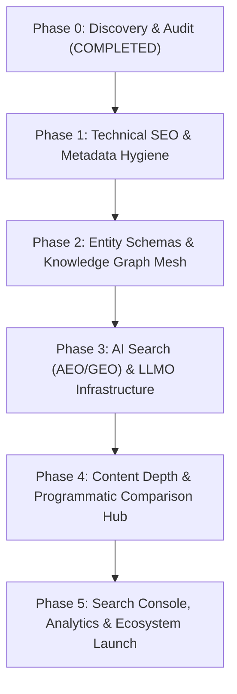

# STARX-FLOW — PHASE 0
# PHASED IMPLEMENTATION ROADMAP (PHASES 1–5)

**Document ID:** P0-REP-15  
**Project:** StarX-Flow  
**Initiative:** Universal Search & AI Discoverability  
**Phase:** 0 — Production System Discovery  
**Author / Execution Agent:** Antigravity  
**Review Team:** Founder | ChatGPT | Gemini Spark | Antigravity  
**Date:** November 2026  
**System Status:** Execution Roadmap

---

## 1. STRATEGIC ROADMAP TIMELINE & PHASING

---

## 2. DETAILED PHASE SPECIFICATIONS

### PHASE 1: Technical SEO & Metadata Remediation
- **Goal:** Eliminate metadata duplication, resolve title truncation, repair dynamic route metadata, and standardize crawler access.
- **Tasks:**
  1. Fix title duplication in `src/app/layout.tsx` and `src/lib/seoConfig.ts` (strip redundant brand suffixes).
  2. Implement `generateMetadata()` in `src/app/compare/[competitorId]/page.tsx` and `src/app/industries/[industryId]/page.tsx`.
  3. Update `public/llms.txt` to replace all legacy URLs with `https://starx-flow.runs-on.dev/`.
  4. Update `src/app/robots.ts` with explicit allow rules for `GPTBot`, `PerplexityBot`, and `ClaudeBot`.
  5. Add page-specific OpenGraph image fallbacks for `/features`, `/pricing`, `/product`, `/about`.
- **Dependencies:** None (Self-contained in existing codebase).
- **Acceptance Criteria:**
  - 100% of routes return unique titles under 60 characters with single brand suffix.
  - Zero routes return `title: MISSING` or `canonical: MISSING`.
  - Next.js build passes with 63/63 routes compiled.
- **Risk Level:** `LOW`.

---

### PHASE 2: Entity Schema & Knowledge Graph Mesh
- **Goal:** Implement complete, compliant Schema.org structured data across the entire site to establish entity authority on Google and Perplexity.
- **Tasks:**
  1. Populate `sameAs` array in `Organization` schema with active digital profile URLs.
  2. Inject `SoftwareApplication` and `Product` schemas into `/pricing` and `/product`.
  3. Deploy `BreadcrumbList` schema dynamically across all subroutes using `getBreadcrumbs()`.
  4. Decouple or link `aggregateRating` in `softwareApplicationSchema()` to prevent Google penalty.
  5. Inject `FAQPage` schema on `/features` and `/resources`.
- **Dependencies:** Claimed social and directory profile URLs.
- **Acceptance Criteria:**
  - Google Rich Results Test passes with 0 errors on `/`, `/pricing`, and `/features`.
  - Valid BreadcrumbList detected on all subpages.
- **Risk Level:** `LOW`.

---

### PHASE 3: AI Search (AEO / GEO) & LLMO Infrastructure
- **Goal:** Position StarX-Flow as the most easily ingestible, accurately cited solution in generative AI models.
- **Tasks:**
  1. Author and serve `public/llms-full.txt` documenting all 10 dashboard modules, POS sync adapters, and integration specifications.
  2. Add structured `SpeakableSpecification` markup for voice search queries.
  3. Deploy semantic Q&A extraction sections (`AIContent` pattern) on vertical industry pages.
  4. Setup weekly automated GEO citation benchmark scripts querying Perplexity and ChatGPT.
- **Dependencies:** Phase 1 and 2 completion.
- **Acceptance Criteria:**
  - `/llms-full.txt` returns HTTP 200 with complete architectural teardown.
  - Perplexity search correctly cites StarX-Flow for targeted WhatsApp scheduling queries.
- **Risk Level:** `LOW`.

---

### PHASE 4: Content Depth & Programmatic Comparison Hub
- **Goal:** Capture high-intent commercial buyers searching for software alternatives.
- **Tasks:**
  1. Build out comprehensive side-by-side comparison tables on `/compare/starx-flow-vs-zapier`, `vs-make`, `vs-mindbody`, `vs-vagaro`, `vs-calendly`.
  2. Enrich vertical industry pages (`/industries/plumber`, `/barber`, `/dentist`, `/med-spa`) with bespoke service menus, scheduling workflows, and compliance facts.
  3. Transition placeholder testimonials to verified early-adopter case studies with quantifiable ROI.
  4. Deploy Markdown-backed knowledge hub under `/resources/articles`.
- **Dependencies:** Phase 1 completion.
- **Acceptance Criteria:**
  - Comparison pages feature responsive side-by-side comparison grids and pricing savings calculators.
  - Industry pages contain unique, non-templated text passing Google Helpful Content standards.
- **Risk Level:** `MEDIUM` (Content quality assurance).

---

### PHASE 5: Search Console, Analytics & Ecosystem Launch
- **Goal:** Connect official search engine webmaster platforms, deploy IndexNow automation, and claim software directories.
- **Tasks:**
  1. Inject Google Search Console and Bing Webmaster verification tokens into `layout.tsx`.
  2. Implement automated IndexNow endpoint and deployment ping handler.
  3. Guide founder through claiming profiles on G2, Capterra, AlternativeTo, and Product Hunt.
  4. Connect lightweight privacy-conscious analytics (GA4 or PostHog via consent framework).
- **Dependencies:** Founder account credentials and tokens.
- **Acceptance Criteria:**
  - Sitemaps successfully indexed in Google Search Console and Bing Webmaster Tools.
  - IndexNow returns HTTP 200/202 confirmation upon deployment.
- **Risk Level:** `LOW`.

---

## 3. FOUR-MEMBER REVIEW GATES

Each phase transition strictly enforces four-member team approval:
1. **Founder (Product Owner):** Strategic business review & credential authorization.
2. **Architecture Lead (ChatGPT):** Technical architecture & non-regression verification.
3. **Independent Validation (Gemini Spark):** Empirical schema validation & external standards compliance.
4. **Execution Agent (Antigravity):** Zero-defect implementation, automated testing, and deployment verification.
