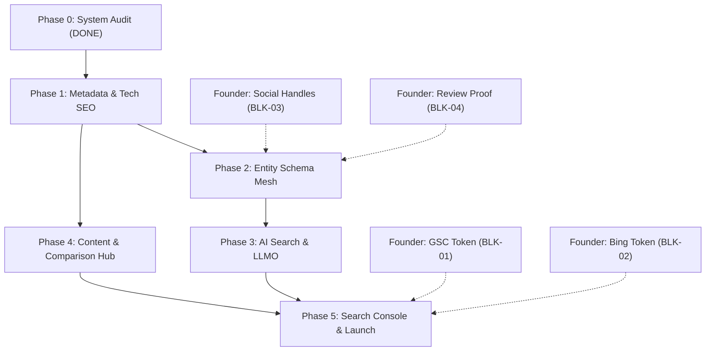

# STARX-FLOW — PHASE 0
# RISKS, DEPENDENCIES & BLOCKERS INVENTORY

**Document ID:** P0-REP-17  
**Project:** StarX-Flow  
**Initiative:** Universal Search & AI Discoverability  
**Phase:** 0 — Production System Discovery  
**Author / Execution Agent:** Antigravity  
**Review Team:** Founder | ChatGPT | Gemini Spark | Antigravity  
**Date:** November 2026  
**System Status:** Production Active  
**Audit Mode:** STRICT READ-ONLY

---

## 1. COMPREHENSIVE BLOCKERS INVENTORY

A blocker is any item that strictly prevents progress to a subsequent phase until an external prerequisite or human action is satisfied.

| Blocker ID | Description | Impacted Phase | Owner | Resolution Path | Current Status |
| :--- | :--- | :--- | :--- | :--- | :--- |
| **BLK-01** | Google Search Console ownership verification token missing | Phase 5 | Founder | Founder generates HTML meta tag token in GSC portal. | `BLOCKED` |
| **BLK-02** | Bing Webmaster Tools verification token missing | Phase 5 | Founder | Founder generates `msvalidate.01` token in Bing portal. | `BLOCKED` |
| **BLK-03** | Official Social / Directory profile URLs missing for `sameAs` | Phase 2 | Founder | Founder registers X handle, LinkedIn page, and G2 vendor listing. | `BLOCKED` |
| **BLK-04** | Third-party customer review evidence for `AggregateRating` | Phase 2 | Founder | Link rating to verified public profile (G2/Capterra) or decouple schema. | `BLOCKED` |

---

## 2. CROSS-PHASE DEPENDENCIES MATRIX

### Dependency Rules:
1. **Phase 1 has ZERO external blockers:**
   - Title templating fixes, dynamic metadata resolvers, legacy URL corrections in `/llms.txt`, and robots.txt crawler allow rules can be executed immediately upon team approval of Phase 0.
2. **Phase 2 requires BLK-03 and BLK-04:**
   - Injecting an empty `sameAs` array does not improve entity authority. Profile URLs are needed.
3. **Phase 3 depends on Phase 1 & 2:**
   - Machine-readable files (`llms-full.txt`) must reflect the finalized canonical metadata and schema taxonomy established in Phases 1 and 2.
4. **Phase 4 is independent:**
   - Fleshing out `/compare/*` and `/industries/*` can proceed in parallel with AI search infrastructure.
5. **Phase 5 requires BLK-01 and BLK-02:**
   - Verification tags and IndexNow deployment represent the final production submission milestone.

---

## 3. PRODUCTION & OPERATIONAL RISKS MATRIX

| Risk Factor | Severity | Probability | Potential Consequence | Mitigation Strategy |
| :--- | :--- | :--- | :--- | :--- |
| **1. Regression to Core Customer Flows** | `CRITICAL` | `LOW` | Onboarding or AI chat simulator breaks | Strict isolation of SEO changes to Server Components and `seoConfig.ts`. Automated E2E test runs before any merge. |
| **2. Search Engine De-indexing / Penalty** | `HIGH` | `LOW` | Google penalizes site for unbacked ratings or duplicate titles | Remove unverified aggregate ratings; fix title double-tagging; adhere 100% to Google Search Central quality guidelines. |
| **3. AI Hallucination Misquotes** | `MEDIUM` | `LOW` | Perplexity or ChatGPT quotes outdated prices | Maintain single source of truth for pricing and capabilities in `seoConfig.ts` and sync with `llms.txt` and `llms-full.txt`. |
| **4. Build Pipeline Disruption** | `HIGH` | `LOW` | Invalid metadata exports break Next.js build | Require zero TypeScript errors (`tsc --noEmit`) and successful local builds (`npm run build`) before pushing. |
| **5. Third-Party Script Bloat** | `MEDIUM` | `LOW` | External analytics degrades Core Web Vitals (LCP/INP) | Exclude heavy external trackers; load GA4 via Next.js Script strategy with deferred execution. |

---

## 4. CONTINGENCY & ROLLBACK PROTOCOLS

In the event of any unforeseen regression during optimization phases:
1. **Granular Git Commits:**
   Every optimization task (e.g. metadata fix, schema injection, llms.txt update) must be committed atomically with descriptive conventional commit messages.
2. **Zero Schema Migration Rule:**
   Because all UDE components operate in application presentation layers, rolling back any change requires only a standard git revert (`git revert <commit_hash>`) with zero database migration rollback or data loss.
3. **Continuous Health Verification:**
   After each phase deployment, verify live response via automated HTTP audit script (`audit-live.js`) ensuring HTTP 200 responses, sub-500ms TTFB, and zero broken links.
