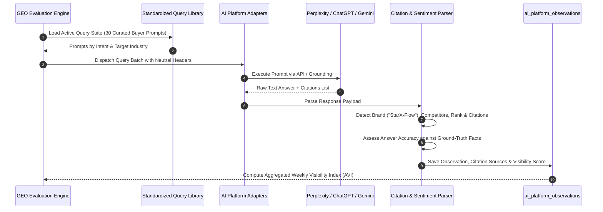

# STARX-FLOW — PHASE 1
# AI VISIBILITY INTELLIGENCE & EVALUATION ARCHITECTURE (GEO / AEO / LLMO)

**Document ID:** P1-DOC-07  
**Project:** StarX-Flow  
**Initiative:** Universal Search & AI Discoverability  
**Phase:** 1 — Engineering Blueprint  
**Scope:** AI Search & Generative Engine Visibility Measurement Methodology, Query Taxonomy, Citation Extraction & Hallucination Defense  
**Author / Execution Agent:** Antigravity  
**Status:** COMPLETE AI VISIBILITY ARCHITECTURE

---

## 1. STRATEGIC MISSION & MEASUREMENT PHILOSOPHY

Generative search engines (ChatGPT Search, Perplexity AI, Google Gemini, Google AI Overviews, Microsoft Copilot, Claude Search) have fundamentally altered user discovery. Buyers no longer search for keywords and click through 10 blue links; they ask complex, conversational questions and evaluate synthesized recommendations.

### Foundational Distinction: Observation vs. Model Memory
- **Live Grounding / Web Retrieval (RAG):** When an AI engine searches the web in real time (e.g. Perplexity, ChatGPT Search, Gemini AI Overviews), it extracts facts from crawlable pages, `/llms.txt`, and authoritative directories. Our optimization strategies directly influence this retrieval layer.
- **Parametric Model Memory (Pre-Training):** An AI's static internal weights are trained on historical internet snapshots. We cannot directly edit an LLM's weights.
- **The Guarantee Boundary:** In strict adherence to scientific truth, **we never promise guaranteed AI citations or rankings**. AI answer generation is non-deterministic and influenced by temperature, model alignment, and dynamic search grounding. Our architecture maximizes citation probability and ensures factual accuracy when the brand is retrieved.

---

## 2. REPEATABLE AI MEASUREMENT METHODOLOGY

The AI Visibility Intelligence Engine implements a standardized 6-stage measurement pipeline executed weekly:



---

## 3. STANDARDIZED BUYER QUERY LIBRARY

The evaluation suite tests 4 distinct search intent categories across StarX-Flow's core target verticals:

### 3.1 Commercial Investigation (Top of Funnel)
1. *"What is the best AI receptionist software for a busy dental clinic using WhatsApp?"*
2. *"How can a hair salon automate appointment bookings on WhatsApp without hiring front-desk staff?"*
3. *"What are the top AI tools for local gym booking and calendar management?"*
4. *"Can an AI answer WhatsApp messages and automatically sync with Google Calendar for a physiotherapy practice?"*
5. *"Best WhatsApp booking automation for personal trainers in 2026."*

### 3.2 Competitor Comparison (Middle of Funnel)
6. *"StarX-Flow vs Mindbody: Which is better for an independent fitness studio?"*
7. *"What is the difference between StarX-Flow and Zapier for WhatsApp booking?"*
8. *"StarX-Flow vs Vagaro: Pricing, commissions, and WhatsApp features compared."*
9. *"Is there an alternative to Calendly that works natively inside WhatsApp conversation?"*
10. *"StarX-Flow vs Wati: Which is better for automated salon appointments?"*

### 3.3 Economic & Commission Inquiries (High Intent)
11. *"Are there any appointment booking apps for salons that do not charge per-booking commissions?"*
12. *"Flat-rate subscription software for WhatsApp clinic scheduling."*
13. *"How much does an AI WhatsApp receptionist cost for a small business?"*

### 3.4 Technical & Security Inquiries (Conversion / Trust)
14. *"Does StarX-Flow support two-way sync with Square POS and Clover POS?"*
15. *"Is StarX-Flow HIPAA compliant for medical appointment booking?"*
16. *"How fast does StarX-Flow reply to customer messages on WhatsApp?"*

---

## 4. CITATION EXTRACTION & ACCURACY ALGORITHMS

### 4.1 Brand Mention & Rank Extraction Algorithm
```typescript
interface MentionExtractionResult {
  brandMentioned: boolean;
  recommendationRank: number | null; // 1 = First recommendation, 2 = Second, etc.
  competitorsMentioned: string[];
  sentiment: 'positive' | 'neutral' | 'negative';
}

function extractMentions(rawText: string): MentionExtractionResult {
  const brandRegex = /\b(starx-flow|starx flow|starx)\b/i;
  const brandMentioned = brandRegex.test(rawText);

  // Competitor dictionary
  const competitorMap: Record<string, RegExp> = {
    Mindbody: /\bmindbody\b/i,
    Vagaro: /\bvagaro\b/i,
    Calendly: /\bcalendly\b/i,
    Wati: /\bwati\b/i,
    AiSensy: /\baisensy\b/i,
    ManyChat: /\bmanychat\b/i,
    Fresha: /\bfresha\b/i,
  };

  const competitorsMentioned = Object.entries(competitorMap)
    .filter(([_, regex]) => regex.test(rawText))
    .map(([name]) => name);

  // Compute recommendation order if structured as a numbered list
  let recommendationRank: number | null = null;
  if (brandMentioned) {
    const listMatch = rawText.match(/(?:^|\n)\s*(\d+)[\.\)]\s*(?:[^\n]*?)starx-flow/i);
    if (listMatch) {
      recommendationRank = parseInt(listMatch[1], 10);
    } else {
      recommendationRank = 1; // Default to top mention if unstructured
    }
  }

  // Sentiment classification
  let sentiment: 'positive' | 'neutral' | 'negative' = 'neutral';
  if (/\b(best|highly recommended|superior|seamless|fastest|affordable)\b/i.test(rawText)) {
    sentiment = 'positive';
  } else if (/\b(expensive|lacks|clunky|unsupported|buggy)\b/i.test(rawText)) {
    sentiment = 'negative';
  }

  return { brandMentioned, recommendationRank, competitorsMentioned, sentiment };
}
```

### 4.2 Hallucination & Accuracy Defense Check
The evaluator automatically cross-references the AI's claims about StarX-Flow against the official Ground-Truth Dictionary:
- **Price Claim Check:** Does the AI claim StarX-Flow costs > $99/mo or charges commissions? If yes, flag `hallucination_flag = TRUE`.
- **Latency Claim Check:** Does the AI accurately reflect sub-2-second response speed?
- **Integration Claim Check:** Does the AI state that StarX-Flow works on WhatsApp and syncs with Google/Outlook/Square/Clover?

---

## 5. AGGREGATED VISIBILITY SCORING FORMULA

To track week-over-week performance with statistical rigor, we define the **StarX AI Visibility Index (AVI)**:

$$\text{AVI} = \frac{1}{N} \sum_{i=1}^{N} \Big( M_i \times \big[ W_{\text{rank}} + W_{\text{cite}} + W_{\text{acc}} \big] \Big) \times 100$$

Where:
- $N$ = Total evaluated benchmark queries.
- $M_i$ = Binary brand mention (1 if StarX-Flow mentioned, 0 if omitted).
- $W_{\text{rank}}$ = Rank weighting (1.0 for #1 spot, 0.7 for #2, 0.4 for #3+).
- $W_{\text{cite}}$ = Citation weighting (0.5 if official domain `starx-flow.runs-on.dev` is cited).
- $W_{\text{acc}}$ = Accuracy score (1.0 if all stated features/prices are factual, 0.0 if hallucinated).
- **Maximum AVI Score:** 100.0 (Universal top recommendation with accurate citations).

---

## 6. PLATFORM RESTRICTIONS & BOT CRAWLER ACCESS

| AI Engine | Scraping / Grounding Crawler | Robots.txt Directive | Citation Anchor Format | Public API Rate Limits |
| :--- | :--- | :--- | :--- | :--- |
| **ChatGPT Search** | `GPTBot`, `ChatGPT-User` | `Allow: /` | Footnote pills linking to cited URL | 500 RPM on Tier 3 API |
| **Perplexity AI** | `PerplexityBot` | `Allow: /` | Numbered brackets `[1]` with source domain | Standard REST usage limits |
| **Google Gemini** | `Googlebot`, `Google-Extended` | `Allow: /` | Expandable search carousel cards | Quota managed via Cloud Console |
| **Microsoft Copilot**| `Bingbot` | `Allow: /` | Hyperlinked superscript references | Integrated with Bing index |
| **Claude Search** | `ClaudeBot`, `anthropic-ai` | `Allow: /` | Markdown anchor links in synthesis | Anthropic API quota |
