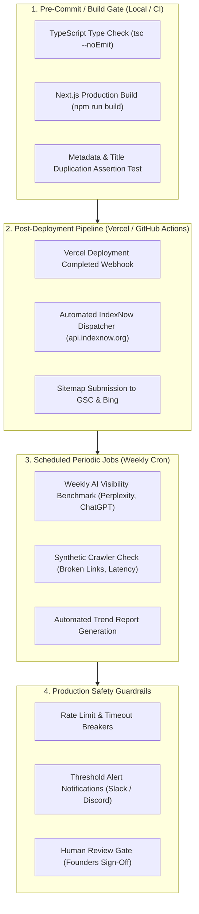

# STARX-FLOW — PHASE 1
# AUTOMATION ARCHITECTURE & CI/CD GATES

**Document ID:** P1-DOC-09  
**Project:** StarX-Flow  
**Initiative:** Universal Search & AI Discoverability  
**Phase:** 1 — Engineering Blueprint  
**Scope:** Automated IndexNow Dispatch, CI/CD Quality Gates, Weekly GEO Benchmark Jobs & Synthetic Health Monitoring  
**Author / Execution Agent:** Antigravity  
**Status:** COMPLETE AUTOMATION SPECIFICATION

---

## 1. AUTOMATION TOPOLOGY & LIFECYCLE HOOKS

To maintain high discoverability without introducing operational drag, the Universal Discovery Engine (UDE) defines four automated pipelines across the software development lifecycle:



---

## 2. AUTOMATION PIPELINE SPECIFICATIONS

### Pipeline 1: Pre-Commit & Build Quality Gate
- **Trigger:** Pull Request or git commit targeting `main`.
- **Automated Actions:**
  1. `npm run typecheck` (`tsc --noEmit`): Ensures zero TypeScript compiler errors.
  2. `npm run build`: Ensures all 63 routes compile cleanly in Turbopack.
  3. `npm run test:seo-lint`: An automated test script validating that:
     - No title tag ends with ` | StarX-Flow | StarX-Flow`.
     - 100% of routes export valid `canonical` URLs.
     - No schema contains invalid Schema.org JSON-LD syntax.
- **Enforcement:** Hard block. A single failure prevents merging into `main`.

### Pipeline 2: Automated IndexNow Dispatcher
- **Trigger:** Post-deployment webhook or Next.js build completion.
- **Mechanism:**
  - Reads updated route list from `src/app/sitemap.ts`.
  - Compiles payload:
    ```json
    {
      "host": "starx-flow.runs-on.dev",
      "key": "c0ffee1234567890abcdef1234567890",
      "keyLocation": "https://starx-flow.runs-on.dev/c0ffee1234567890abcdef1234567890.txt",
      "urlList": [
        "https://starx-flow.runs-on.dev/",
        "https://starx-flow.runs-on.dev/pricing",
        "https://starx-flow.runs-on.dev/compare/starx-flow-vs-zapier"
      ]
    }
    ```
  - Dispatches POST request to `https://api.indexnow.org/indexnow`.
- **Enforcement:** Non-blocking asynchronous job. Failure to ping IndexNow does not disrupt user traffic or rollback builds.

### Pipeline 3: Weekly AI Visibility (GEO) Benchmark
- **Trigger:** Weekly scheduled cron job (Sundays at 00:00 UTC).
- **Mechanism:**
  - Queries the 30 standardized buyer prompts across Perplexity AI, ChatGPT Search, and Gemini.
  - Extracts brand mentions, recommendation ranks, citations, and hallucination flags.
  - Generates a timestamped markdown scorecard in `docs/benchmarks/YYYY-MM-DD_GEO_REPORT.md`.
- **Enforcement:** Strictly read-only; records external intelligence.

### Pipeline 4: Synthetic Core Web Vitals & Uptime Monitoring
- **Trigger:** Daily automated HTTP probe.
- **Mechanism:**
  - Fetches core marketing routes (`/`, `/features`, `/pricing`, `/product`, `/robots.txt`, `/sitemap.xml`).
  - Asserts HTTP 200 status code, TTFB < 600ms, and total HTML payload size < 120 KB.
  - Emits alerts if TTFB degrades beyond 800ms.

---

## 3. SAFE AUTOMATION SAFEGUARDS & CIRCUIT BREAKERS

1. **Rate Limiting & Cost Caps:**
   - External LLM evaluation queries are capped at a maximum of 30 queries per week to maintain negligible API expenses (< $0.50/month).
2. **Zero Automated Publishing:**
   - The automation pipelines **never** generate, publish, or alter live website pages without explicit human code review and PR merge approval.
3. **Graceful Degradation:**
   - If IndexNow or search webhooks experience network timeouts, jobs retry with exponential backoff up to 3 attempts, after which the event is logged as `WARNING` and terminated cleanly.
