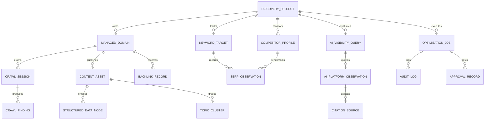

# STARX-FLOW — PHASE 1
# SHARED DATA ARCHITECTURE & LOGICAL DATA MODEL

**Document ID:** P1-DOC-05  
**Project:** StarX-Flow  
**Initiative:** Universal Search & AI Discoverability  
**Phase:** 1 — Engineering Blueprint  
**Scope:** Logical Data Model, Relational Entity Schema, Indexing Strategy, Retention Policies & Multi-Tenant Data Isolation  
**Author / Execution Agent:** Antigravity  
**Status:** COMPLETE LOGICAL DATA MODEL SPECIFICATION  
**Execution Note:** STRICT DESIGN SPECIFICATION (No Database Migrations Executed Automatically)

---

## 1. DATA MODEL OVERVIEW & ARCHITECTURAL PRINCIPLES

To support both **StarX-Flow’s own global discoverability** and future **multi-tenant optimization capabilities for business clients**, the Universal Discovery Engine (UDE) defines a normalized, relational data architecture.

### Core Data Principles:
1. **Separation of Operational vs. Intelligence Data:**
   The optimization data model lives independently from customer transaction tables (`appointments`, `conversations`, `customers`). Under no circumstance does an optimization query lock or degrade operational customer workflows.
2. **Deterministic Foreign Keys & Cascading Isolation:**
   All intelligence records belong to a `discovery_projects` root entity. When operating for StarX-Flow, `project_id = 'starx-flow-core'`.
3. **Temporal Snapshots & Time-Series Observations:**
   AI visibility scores, SERP ranks, and crawl observations are recorded as append-only time-series snapshots to track historical trends without mutating past records.

---

## 2. LOGICAL ENTITY-RELATIONSHIP MODEL



---

## 3. RELATIONAL SCHEMA SPECIFICATIONS

### 3.1 Project & Domain Hierarchy

```sql
-- 1. Root Discovery Projects (Multi-Tenant Ready)
CREATE TABLE discovery_projects (
    id UUID PRIMARY KEY DEFAULT gen_random_uuid(),
    organization_id UUID NOT NULL REFERENCES organizations(id) ON DELETE CASCADE,
    project_slug VARCHAR(64) UNIQUE NOT NULL, -- e.g. 'starx-flow-core'
    brand_name VARCHAR(128) NOT NULL,        -- 'StarX-Flow'
    primary_domain VARCHAR(255) NOT NULL,     -- 'https://starx-flow.runs-on.dev'
    target_locale VARCHAR(10) DEFAULT 'en_US',
    created_at TIMESTAMPTZ DEFAULT NOW(),
    updated_at TIMESTAMPTZ DEFAULT NOW()
);

-- 2. Managed Domains & URLs
CREATE TABLE managed_urls (
    id UUID PRIMARY KEY DEFAULT gen_random_uuid(),
    project_id UUID NOT NULL REFERENCES discovery_projects(id) ON DELETE CASCADE,
    pathname VARCHAR(512) NOT NULL,          -- e.g. '/features', '/compare/starx-flow-vs-zapier'
    canonical_url VARCHAR(1024) NOT NULL,
    route_type VARCHAR(32) NOT NULL,         -- 'core', 'comparison', 'industry', 'article'
    is_indexable BOOLEAN DEFAULT TRUE,
    sitemap_priority NUMERIC(2,1) DEFAULT 0.8,
    last_crawled_at TIMESTAMPTZ,
    last_status_code INTEGER,
    created_at TIMESTAMPTZ DEFAULT NOW(),
    UNIQUE(project_id, pathname)
);
```

### 3.2 Crawl Sessions & Quality Findings

```sql
-- 3. Crawl Sessions
CREATE TABLE crawl_sessions (
    id UUID PRIMARY KEY DEFAULT gen_random_uuid(),
    project_id UUID NOT NULL REFERENCES discovery_projects(id) ON DELETE CASCADE,
    triggered_by VARCHAR(64) NOT NULL,       -- 'github_action', 'manual', 'scheduled'
    pages_crawled INTEGER DEFAULT 0,
    errors_encountered INTEGER DEFAULT 0,
    duration_ms INTEGER,
    created_at TIMESTAMPTZ DEFAULT NOW()
);

-- 4. Crawl Findings & Technical Defects
CREATE TABLE crawl_findings (
    id UUID PRIMARY KEY DEFAULT gen_random_uuid(),
    session_id UUID NOT NULL REFERENCES crawl_sessions(id) ON DELETE CASCADE,
    url_id UUID NOT NULL REFERENCES managed_urls(id) ON DELETE CASCADE,
    finding_type VARCHAR(64) NOT NULL,       -- 'title_duplicate', 'missing_meta', 'schema_invalid', 'slow_ttfb'
    severity VARCHAR(16) NOT NULL,           -- 'CRITICAL', 'HIGH', 'MEDIUM', 'LOW'
    evidence_text TEXT NOT NULL,
    resolved BOOLEAN DEFAULT FALSE,
    created_at TIMESTAMPTZ DEFAULT NOW()
);
```

### 3.3 AI Visibility & Generative Engine Benchmarks (GEO / AEO)

```sql
-- 5. AI Evaluation Queries
CREATE TABLE ai_visibility_queries (
    id UUID PRIMARY KEY DEFAULT gen_random_uuid(),
    project_id UUID NOT NULL REFERENCES discovery_projects(id) ON DELETE CASCADE,
    prompt_text TEXT NOT NULL,               -- e.g. 'What is the best AI receptionist for a dental clinic using WhatsApp?'
    intent_category VARCHAR(32) NOT NULL,    -- 'commercial_investigation', 'product_comparison', 'direct_navigational'
    target_persona VARCHAR(64) NOT NULL,     -- 'dental_clinic_owner', 'salon_manager'
    is_active BOOLEAN DEFAULT TRUE,
    created_at TIMESTAMPTZ DEFAULT NOW()
);

-- 6. AI Platform Observations (Time-Series)
CREATE TABLE ai_platform_observations (
    id UUID PRIMARY KEY DEFAULT gen_random_uuid(),
    query_id UUID NOT NULL REFERENCES ai_visibility_queries(id) ON DELETE CASCADE,
    platform_name VARCHAR(32) NOT NULL,      -- 'chatgpt_search', 'perplexity', 'gemini_pro', 'claude_search'
    model_version VARCHAR(64) NOT NULL,      -- 'gpt-4o', 'sonar-medium', 'gemini-2.0-flash'
    raw_response_text TEXT NOT NULL,
    brand_mentioned BOOLEAN NOT NULL,
    recommendation_rank INTEGER,             -- 1 if first recommended, 2 if second, NULL if omitted
    sentiment VARCHAR(16),                   -- 'positive', 'neutral', 'negative'
    hallucination_flag BOOLEAN DEFAULT FALSE,
    citation_present BOOLEAN DEFAULT FALSE,
    observed_at TIMESTAMPTZ DEFAULT NOW()
);

-- 7. Citation Sources Extracted from AI Answers
CREATE TABLE ai_citation_sources (
    id UUID PRIMARY KEY DEFAULT gen_random_uuid(),
    observation_id UUID NOT NULL REFERENCES ai_platform_observations(id) ON DELETE CASCADE,
    cited_url VARCHAR(1024) NOT NULL,
    domain_name VARCHAR(255) NOT NULL,       -- 'starx-flow.runs-on.dev', 'g2.com', 'reddit.com'
    is_first_party BOOLEAN NOT NULL,         -- TRUE if starx-flow.runs-on.dev
    anchor_or_context TEXT
);
```

### 3.4 Entity Graph & Structured Data Registry

```sql
-- 8. Structured Data Nodes (Schema.org Registry)
CREATE TABLE structured_data_nodes (
    id UUID PRIMARY KEY DEFAULT gen_random_uuid(),
    url_id UUID NOT NULL REFERENCES managed_urls(id) ON DELETE CASCADE,
    schema_type VARCHAR(64) NOT NULL,        -- 'Organization', 'SoftwareApplication', 'Product', 'BreadcrumbList'
    raw_json_ld JSONB NOT NULL,
    validation_status VARCHAR(16) NOT NULL,  -- 'PASS', 'WARNING', 'FAIL'
    validation_errors TEXT[],
    last_verified_at TIMESTAMPTZ DEFAULT NOW()
);
```

### 3.5 Automation Jobs & Governance Audit Logs

```sql
-- 9. Optimization Jobs (IndexNow, Benchmarks, Scrapes)
CREATE TABLE optimization_jobs (
    id UUID PRIMARY KEY DEFAULT gen_random_uuid(),
    project_id UUID NOT NULL REFERENCES discovery_projects(id) ON DELETE CASCADE,
    job_type VARCHAR(64) NOT NULL,           -- 'indexnow_ping', 'geo_weekly_eval', 'schema_audit'
    status VARCHAR(32) NOT NULL,             -- 'queued', 'running', 'completed', 'failed'
    payload JSONB,
    result_summary TEXT,
    started_at TIMESTAMPTZ,
    completed_at TIMESTAMPTZ
);

-- 10. Audit Logs & Approval Records
CREATE TABLE discovery_audit_logs (
    id UUID PRIMARY KEY DEFAULT gen_random_uuid(),
    project_id UUID NOT NULL REFERENCES discovery_projects(id) ON DELETE CASCADE,
    action_type VARCHAR(64) NOT NULL,        -- 'metadata_remediated', 'llms_txt_updated', 'gsc_token_injected'
    actor_id VARCHAR(64) NOT NULL,           -- 'antigravity_agent', 'founder'
    details JSONB,
    created_at TIMESTAMPTZ DEFAULT NOW()
);
```

---

## 4. INDEXING STRATEGY & QUERY PERFORMANCE

To maintain sub-millisecond query performance across large observation datasets:
1. **`managed_urls`:**
   - Composite unique index on `(project_id, pathname)`.
   - Index on `(project_id, is_indexable)`.
2. **`ai_platform_observations`:**
   - Composite index on `(query_id, platform_name, observed_at DESC)`.
   - Partial index on `(brand_mentioned)` WHERE `brand_mentioned = TRUE`.
3. **`crawl_findings`:**
   - Index on `(session_id, severity)` WHERE `resolved = FALSE`.
4. **`structured_data_nodes`:**
   - GIN index on `raw_json_ld` using `jsonb_path_ops` for high-speed schema property lookups.

---

## 5. DATA RETENTION & RETIREMENT POLICIES

| Table Name | Retention Duration | Retirement / Purge Policy | Storage Impact |
| :--- | :--- | :--- | :--- |
| **`crawl_findings`** | 90 Days | Auto-purged after 90 days; resolved findings purged after 30 days. | Low (< 5 MB) |
| **`ai_platform_observations`** | 365 Days | Retained for 1 year to evaluate model update cycles; aggregated to monthly averages thereafter. | Medium (~50 MB) |
| **`ai_citation_sources`** | 365 Days | Cascades with parent observation. | Low (~10 MB) |
| **`discovery_audit_logs`** | Indefinite | Retained permanently for compliance and security auditing. | Very Low (< 2 MB) |

---

## 6. DATA OWNERSHIP & SECURITY ENFORCEMENT

- **Data Isolation:** All queries strictly filter by `project_id`. When multi-tenancy is activated, Supabase PostgreSQL Row Level Security (RLS) policies enforce that tenants can only read and write observations where `organization_id = auth.uid()`.
- **Zero Schema Mutation in Phase 1:** This relational data model is currently preserved as a structural engineering blueprint. No database migrations will be applied to the live production database until approved for Phase 5 data persistence.
