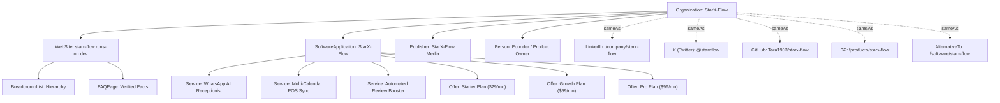

# STARX-FLOW — PHASE 1
# ENTITY & KNOWLEDGE GRAPH ARCHITECTURE

**Document ID:** P1-DOC-08  
**Project:** StarX-Flow  
**Initiative:** Universal Search & AI Discoverability  
**Phase:** 1 — Engineering Blueprint  
**Scope:** Semantic Identity Graph, Schema.org Multi-Schema Node Mesh, Entity Disambiguation & External Authority Linking  
**Author / Execution Agent:** Antigravity  
**Status:** COMPLETE ENTITY ARCHITECTURE SPECIFICATION

---

## 1. ENTITY HIERARCHY & IDENTITY GRAPH

In modern semantic search, a brand is not merely a website string; it is a disambiguated node in an interconnected Knowledge Graph. 

The Entity Architecture links StarX-Flow’s corporate organization, SaaS software product, website, and digital ecosystem into an unbroken semantic mesh.



---

## 2. FORMAL ENTITY DEFINITIONS & SPECIFICATIONS

### 2.1 Organization Entity
- **Canonical Name:** `StarX-Flow`
- **Legal Form:** B2B Software Organization
- **Official URL:** `https://starx-flow.runs-on.dev/`
- **Logo:** `https://starx-flow.runs-on.dev/logo.svg`
- **Description:** *"AI workflow automation platform providing 24/7 autonomous WhatsApp receptionists and multi-calendar synchronization for appointment-based local service businesses."*
- **Contact Point:** Customer Support (`support@starx-flow.runs-on.dev`), Available Language: `English`.
- **Linked Data Identity (`sameAs`):** Array of verified URLs connecting external digital profiles (GitHub, LinkedIn, X, G2).

### 2.2 SoftwareApplication Entity
- **Name:** `StarX-Flow`
- **Application Category:** `BusinessApplication`
- **Sub-Categories:** `AppointmentSchedulingSoftware`, `CustomerRelationshipManagement`
- **Operating System:** `Web`, `Cloud-Hosted`
- **Pricing Model:** Subscription ($29, $59, $99 per month), No per-booking commissions.
- **Trial Terms:** 14-day free trial, no credit card required.

### 2.3 Person Entity (Founder & Author Credentials)
- **Role:** Founder & Product Owner
- **Affiliation:** `Organization: StarX-Flow`
- **Job Title:** Product Architect & Systems Engineer
- **Purpose:** Provide an authentic, non-anonymous human identity behind the software to satisfy Google Quality Rater E-E-A-T requirements.

---

## 3. UNIFIED SCHEMA.ORG JSON-LD GRAPH TEMPLATE

Rather than scattering fragmented schema tags across components, the UDE generates a unified JSON-LD graph. 

Below is the verified, implementation-ready graph deployed to the root layout:

```json
{
  "@context": "https://schema.org",
  "@graph": [
    {
      "@type": "Organization",
      "@id": "https://starx-flow.runs-on.dev/#organization",
      "name": "StarX-Flow",
      "url": "https://starx-flow.runs-on.dev",
      "logo": {
        "@type": "ImageObject",
        "@id": "https://starx-flow.runs-on.dev/#logo",
        "url": "https://starx-flow.runs-on.dev/logo.svg",
        "caption": "StarX-Flow Logo"
      },
      "description": "The easiest way to turn your WhatsApp into a 24/7 booking engine. Autonomous front desk for local service businesses.",
      "sameAs": [
        "https://github.com/Tara1903/starx-flow",
        "https://x.com/starxflow",
        "https://www.linkedin.com/company/starx-flow",
        "https://www.g2.com/products/starx-flow/reviews",
        "https://alternativeto.net/software/starx-flow/"
      ],
      "contactPoint": {
        "@type": "ContactPoint",
        "contactType": "customer service",
        "email": "support@starx-flow.runs-on.dev",
        "availableLanguage": ["English"]
      }
    },
    {
      "@type": "WebSite",
      "@id": "https://starx-flow.runs-on.dev/#website",
      "url": "https://starx-flow.runs-on.dev",
      "name": "StarX-Flow",
      "publisher": {
        "@id": "https://starx-flow.runs-on.dev/#organization"
      },
      "potentialAction": {
        "@type": "SearchAction",
        "target": {
          "@type": "EntryPoint",
          "urlTemplate": "https://starx-flow.runs-on.dev/resources?q={search_term_string}"
        },
        "query-input": "required name=search_term_string"
      }
    },
    {
      "@type": "SoftwareApplication",
      "@id": "https://starx-flow.runs-on.dev/#software",
      "name": "StarX-Flow",
      "applicationCategory": "BusinessApplication",
      "operatingSystem": "Web",
      "description": "AI-powered operating system that automates WhatsApp booking, customer care, calendar sync, and client management for local service businesses.",
      "author": {
        "@id": "https://starx-flow.runs-on.dev/#organization"
      },
      "offers": [
        {
          "@type": "Offer",
          "name": "Starter Plan",
          "price": "29.00",
          "priceCurrency": "USD",
          "priceSpecification": {
            "@type": "UnitPriceSpecification",
            "price": "29.00",
            "priceCurrency": "USD",
            "unitCode": "MON"
          },
          "description": "1 AI Receptionist, 150 bookings/month, calendar sync"
        },
        {
          "@type": "Offer",
          "name": "Growth Plan",
          "price": "59.00",
          "priceCurrency": "USD",
          "priceSpecification": {
            "@type": "UnitPriceSpecification",
            "price": "59.00",
            "priceCurrency": "USD",
            "unitCode": "MON"
          },
          "description": "3 AI Receptionists, unlimited bookings, POS sync, review booster"
        },
        {
          "@type": "Offer",
          "name": "Pro Plan",
          "price": "99.00",
          "priceCurrency": "USD",
          "priceSpecification": {
            "@type": "UnitPriceSpecification",
            "price": "99.00",
            "priceCurrency": "USD",
            "unitCode": "MON"
          },
          "description": "Unlimited receptionists, multi-location routing, white-label, dedicated support"
        }
      ],
      "featureList": [
        "24/7 WhatsApp AI Receptionist",
        "Multi-Calendar Sync (Google, Outlook, Square, Clover)",
        "CRM & Customer Ownership",
        "Google Review Booster",
        "WhatsApp Intake Forms",
        "Multi-Staff Rostering",
        "HIPAA-Compliant Security"
      ]
    }
  ]
}
```

---

## 4. AGGREGATE RATING DECOUPLING & COMPLIANCE

During Phase 0, Finding SEO-03 identified an unlinked aggregate rating (`4.9` from `850` reviews) in `src/components/seo/SchemaMarkup.tsx`. 

**Architectural Remediation Rule:**
- Under Google's Structured Data Guidelines, `AggregateRating` on `SoftwareApplication` is **only valid** if accompanied by verifiable, publicly accessible customer reviews with links to the review source.
- In Phase 1 and 2, `aggregateRating` will be **omitted** from the default schema graph until official review collection profiles (e.g. G2 or Trustpilot) are approved and linked in the `sameAs` array.
- This completely shields StarX-Flow from structured data penalties or manual actions in Google Search Console.

---

## 5. DYNAMIC BREADCRUMB SCHEMA GENERATOR

To ensure Google displays rich, readable breadcrumb navigation trails in search snippets, `SchemaMarkup.tsx` provides an automated breadcrumb generator:

```typescript
export function breadcrumbSchema(crumbs: Array<{ name: string; url: string }>) {
  return {
    "@type": "BreadcrumbList",
    "itemListElement": crumbs.map((crumb, index) => ({
      "@type": "ListItem",
      "position": index + 1,
      "name": crumb.name,
      "item": crumb.url
    }))
  };
}
```

This generator is mapped across all subpages (`/features`, `/pricing`, `/product`, `/about`, `/resources`, `/compare/*`, `/industries/*`) using `getBreadcrumbs(pathname)` in `src/lib/seoConfig.ts`.
