# STARX-FLOW — PHASE 1
# DEPENDENCY-AWARE IMPLEMENTATION BACKLOG

**Document ID:** P1-DOC-11  
**Project:** StarX-Flow  
**Initiative:** Universal Search & AI Discoverability  
**Phase:** 1 — Engineering Blueprint  
**Scope:** Actionable Workstream Backlog Across Must-Have, Should-Have, Could-Have & Future Tiers  
**Author / Execution Agent:** Antigravity  
**Status:** COMPLETE BACKLOG SPECIFICATION

---

## 1. BACKLOG STRUCTURE & PRIORITY TIERS

The implementation backlog organizes all remediation and capability tasks into four priority tiers:
1. **Tier 1: MUST-HAVE (Immediate Execution Gate — Phase 2):** Critical metadata bug fixes, dynamic slug metadata, AI bot crawler allow rules, and `/llms.txt` URL corrections. Zero external blockers.
2. **Tier 2: SHOULD-HAVE (Core Entity & AI Infrastructure — Phase 3):** Schema.org entity mesh (`sameAs` array), Product schemas, `BreadcrumbList`, and deep `/llms-full.txt` architectural specification.
3. **Tier 3: COULD-HAVE (Content Depth & Comparison Hub — Phase 4):** Programmatic competitor comparison grids (`vs-zapier`, `vs-mindbody`, `vs-calendly`), enriched industry playbooks, and verified customer case studies.
4. **Tier 4: FUTURE EXPANSION (Ecosystem Launch & Webmaster Consoles — Phase 5):** GSC and Bing Webmaster token injection, automated IndexNow pipeline, and B2B software directory profiles.

```mermaid
flowchart TD
    subgraph Tier1["Tier 1: Must-Have (Phase 2)"]
        T01["TASK-01: Fix Title Double-Suffix Bug"]
        T02["TASK-02: Dynamic Metadata on /compare & /industries"]
        T03["TASK-03: Update public/llms.txt Domain URLs"]
        T04["TASK-04: Explicit AI Bot Rules in robots.ts"]
        T05["TASK-05: Page-Specific OpenGraph Image Fallbacks"]
    end

    subgraph Tier2["Tier 2: Should-Have (Phase 3)"]
        T06["TASK-06: Populate Organization sameAs Entity Mesh"]
        T07["TASK-07: Deploy Product & Offer Schemas on /pricing"]
        T08["TASK-08: Dynamic BreadcrumbList Schema Across Subroutes"]
        T09["TASK-09: Author & Deploy public/llms-full.txt"]
        T10["TASK-10: Decouple Unverified AggregateRating Schema"]
    end

    subgraph Tier3["Tier 3: Could-Have (Phase 4)"]
        T11["TASK-11: Programmatic Comparison Grids (/compare/*)"]
        T12["TASK-12: Enrich Vertical Industry Playbooks (/industries/*)"]
        T13["TASK-13: Transition Testimonials to Verified Beta Proof"]
        T14["TASK-14: Educational Knowledge Hub (/resources/articles)"]
    end

    subgraph Tier4["Tier 4: Future Expansion (Phase 5)"]
        T15["TASK-15: Inject GSC & Bing Verification Meta Tokens"]
        T16["TASK-16: Deploy Automated IndexNow Webhook Pipeline"]
        T17["TASK-17: Claim & Optimize G2 & AlternativeTo Profiles"]
        T18["TASK-18: Weekly GEO Automated Visibility Evaluation"]
    end

    Tier1 --> Tier2
    Tier2 --> Tier3
    Tier3 --> Tier4
```

---

## 2. DETAILED TASK SPECIFICATIONS

### TIER 1: MUST-HAVE (PHASE 2 EXECUTION)

#### TASK-01: Remediate Title Double-Suffix Bug
- **Task ID:** `TASK-01`
- **Module:** `M1: Search Intelligence`
- **Description:** Remove redundant ` | StarX-Flow` from all entries in `PAGE_META` dictionary in `src/lib/seoConfig.ts`. Allow `src/app/layout.tsx` title template (`%s | StarX-Flow`) to append brand suffix cleanly.
- **Business Impact:** Eliminates SERP title truncation on Google and Bing; improves search snippet CTR.
- **Technical Complexity:** `LOW`
- **Dependencies:** None.
- **Priority:** `MUST-HAVE`
- **Acceptance Criteria:** Live fetch on `/features`, `/pricing`, `/product` returns titles with exactly one brand suffix.
- **Required External Actions:** None.
- **Estimated Effort:** 0.5 hours.

#### TASK-02: Implement Dynamic Metadata for Comparison & Industry Slugs
- **Task ID:** `TASK-02`
- **Module:** `M1: Search Intelligence`
- **Description:** Export `generateMetadata()` in `src/app/compare/[competitorId]/page.tsx` and `src/app/industries/[industryId]/page.tsx` utilizing dynamic slug parameters.
- **Business Impact:** Unlocks search engine indexability for high-intent competitor comparison and industry vertical landing pages.
- **Technical Complexity:** `LOW`
- **Dependencies:** `TASK-01`.
- **Priority:** `MUST-HAVE`
- **Acceptance Criteria:** HTTP GET on `/compare/starx-flow-vs-zapier` and `/industries/plumber` returns valid title, description, and canonical link.
- **Required External Actions:** None.
- **Estimated Effort:** 1.0 hour.

#### TASK-03: Remediate Legacy Domain References in public/llms.txt
- **Task ID:** `TASK-03`
- **Module:** `M3: AI Visibility Intelligence`
- **Description:** Replace all occurrences of `https://starx-flow.vercel.app/` with `https://starx-flow.runs-on.dev/` in `public/llms.txt`.
- **Business Impact:** Ensures AI engines (Perplexity, ChatGPT Search) ingest and cite the active production domain rather than legacy redirect URLs.
- **Technical Complexity:** `LOW`
- **Dependencies:** None.
- **Priority:** `MUST-HAVE`
- **Acceptance Criteria:** `curl https://starx-flow.runs-on.dev/llms.txt` contains zero references to `vercel.app`.
- **Required External Actions:** None.
- **Estimated Effort:** 0.25 hours.

#### TASK-04: Configure Explicit AI Bot Directives in robots.ts
- **Task ID:** `TASK-04`
- **Module:** `M2: Technical Intelligence`
- **Description:** Update `src/app/robots.ts` to explicitly declare allow rules for `GPTBot`, `ChatGPT-User`, `PerplexityBot`, and `ClaudeBot`, and advertise `/llms.txt`.
- **Business Impact:** Directly invites AI crawlers to ingest machine-readable documentation and priority pages.
- **Technical Complexity:** `LOW`
- **Dependencies:** None.
- **Priority:** `MUST-HAVE`
- **Acceptance Criteria:** `robots.txt` output contains explicit user-agent sections for `GPTBot` and `PerplexityBot`.
- **Required External Actions:** None.
- **Estimated Effort:** 0.5 hours.

#### TASK-05: Deploy Page-Specific OpenGraph Social Card Fallbacks
- **Task ID:** `TASK-05`
- **Module:** `M1: Search Intelligence`
- **Description:** Ensure subroutes (`/features`, `/pricing`, `/product`, `/about`) export `og:image` and `twitter:image` metadata referencing valid 1200x630 assets.
- **Business Impact:** Eliminates blank preview cards when links are shared on LinkedIn, X, and WhatsApp chats.
- **Technical Complexity:** `LOW`
- **Dependencies:** None.
- **Priority:** `MUST-HAVE`
- **Acceptance Criteria:** Live fetch on `/features` returns valid `og:image` URL.
- **Required External Actions:** None.
- **Estimated Effort:** 0.5 hours.

---

### TIER 2: SHOULD-HAVE (PHASE 3 EXECUTION)

#### TASK-06: Populate Organization sameAs Entity Mesh
- **Task ID:** `TASK-06`
- **Module:** `M4: Entity Intelligence`
- **Description:** Populate `sameAs` array in `organizationSchema()` in `SchemaMarkup.tsx` with claimed social profiles (GitHub, LinkedIn, X, G2).
- **Business Impact:** Establishes Google Knowledge Graph entity recognition and Perplexity domain authority corroboration.
- **Technical Complexity:** `LOW`
- **Dependencies:** External social profiles claimed by Founder.
- **Priority:** `SHOULD-HAVE`
- **Acceptance Criteria:** Rendered homepage JSON-LD contains non-empty `sameAs` array with verified URLs.
- **Required External Actions:** Founder claims profile URLs.
- **Estimated Effort:** 0.5 hours.

#### TASK-07: Deploy Product & Offer Schemas on /pricing
- **Task ID:** `TASK-07`
- **Module:** `M4: Entity Intelligence`
- **Description:** Inject `SoftwareApplication` and individual `Product` offer schemas ($29, $59, $99) into `src/app/pricing/page.tsx`.
- **Business Impact:** Enables rich pricing snippets and currency display in Google search results.
- **Technical Complexity:** `LOW`
- **Dependencies:** `SchemaMarkup.tsx`.
- **Priority:** `SHOULD-HAVE`
- **Acceptance Criteria:** Google Rich Results Test detects valid `Product` and `Offer` structured data on `/pricing`.
- **Required External Actions:** None.
- **Estimated Effort:** 1.0 hour.

#### TASK-08: Deploy Dynamic BreadcrumbList Schema Across All Subroutes
- **Task ID:** `TASK-08`
- **Module:** `M4: Entity Intelligence`
- **Description:** Call `breadcrumbSchema(getBreadcrumbs(pathname))` across all public subpage components.
- **Business Impact:** Replaces raw, ugly URLs with hierarchical breadcrumb trails in Google SERP snippets.
- **Technical Complexity:** `LOW`
- **Dependencies:** `src/lib/seoConfig.ts`.
- **Priority:** `SHOULD-HAVE`
- **Acceptance Criteria:** BreadcrumbList schema detected on `/features`, `/pricing`, `/about`, and `/compare/*`.
- **Required External Actions:** None.
- **Estimated Effort:** 1.0 hour.

#### TASK-09: Author & Deploy public/llms-full.txt
- **Task ID:** `TASK-09`
- **Module:** `M3: AI Visibility Intelligence`
- **Description:** Author an in-depth machine-readable architectural specification covering all 10 dashboard modules, calendar sync adapters, and integration workflows.
- **Business Impact:** Allows deep research models (OpenAI o1/o3-mini, Claude Sonnet) to understand and recommend StarX-Flow during comprehensive enterprise evaluations.
- **Technical Complexity:** `LOW`
- **Dependencies:** Verified feature specifications.
- **Priority:** `SHOULD-HAVE`
- **Acceptance Criteria:** `https://starx-flow.runs-on.dev/llms-full.txt` returns HTTP 200 with complete architectural specification.
- **Required External Actions:** None.
- **Estimated Effort:** 2.0 hours.

#### TASK-10: Decouple Unverified AggregateRating Schema
- **Task ID:** `TASK-10`
- **Module:** `M4: Entity Intelligence`
- **Description:** Temporarily remove unlinked 850-review rating from `softwareApplicationSchema()` until verified external review profiles are linked.
- **Business Impact:** Prevents Google manual action penalties for unbacked structured data claims.
- **Technical Complexity:** `LOW`
- **Dependencies:** None.
- **Priority:** `SHOULD-HAVE`
- **Acceptance Criteria:** Zero structured data warnings in Google Search Console.
- **Required External Actions:** None.
- **Estimated Effort:** 0.25 hours.

---

### TIER 3: COULD-HAVE (PHASE 4 EXECUTION)

#### TASK-11: Programmatic Competitor Comparison Grids
- **Task ID:** `TASK-11`
- **Module:** `M5: Content Intelligence`
- **Description:** Build rich side-by-side comparison tables, commission savings calculators, and feature grids for 7 competitors (`vs-zapier`, `vs-make`, `vs-mindbody`, `vs-vagaro`, `vs-calendly`, etc.).
- **Business Impact:** Directly intercepts buyers actively considering switching from expensive legacy schedulers.
- **Technical Complexity:** `MEDIUM`
- **Dependencies:** `TASK-02`.
- **Priority:** `COULD-HAVE`
- **Acceptance Criteria:** Interactive side-by-side grids rendered on all 7 comparison slugs.
- **Required External Actions:** None.
- **Estimated Effort:** 3.0 hours.

#### TASK-12: Enrich Vertical Industry Playbooks
- **Task ID:** `TASK-12`
- **Module:** `M5: Content Intelligence`
- **Description:** Expand copy on `/industries/plumber`, `/barber`, `/dentist`, `/med-spa`, `/personal-trainer` with vertical-specific service menus, scheduling rules, and compliance data.
- **Business Impact:** Establishes topical authority and prevents Google Helpful Content deduplication penalties.
- **Technical Complexity:** `MEDIUM`
- **Dependencies:** None.
- **Priority:** `COULD-HAVE`
- **Acceptance Criteria:** Every industry page contains > 600 words of unique, non-templated copy and bespoke FAQs.
- **Required External Actions:** None.
- **Estimated Effort:** 3.0 hours.

#### TASK-13: Transition Testimonials to Verified Beta Proof
- **Task ID:** `TASK-13`
- **Module:** `M6: Authority Intelligence`
- **Description:** Update `src/components/Testimonials.tsx` to feature real early-adopter businesses or transparent beta cohort benchmark metrics.
- **Business Impact:** Strengthens E-E-A-T and builds authentic buyer trust.
- **Technical Complexity:** `LOW`
- **Dependencies:** Founder customer outreach.
- **Priority:** `COULD-HAVE`
- **Acceptance Criteria:** Testimonials link to live websites or declare transparent cohort metrics.
- **Required External Actions:** Founder provides customer permissions.
- **Estimated Effort:** 1.0 hour.

#### TASK-14: Deploy Markdown Educational Knowledge Hub
- **Task ID:** `TASK-14`
- **Module:** `M5: Content Intelligence`
- **Description:** Create `/resources/articles/` directory with Markdown-rendered educational playbooks (e.g. *"How to Connect WhatsApp to Square POS"*).
- **Business Impact:** Captures top-of-funnel informational search queries and generates inbound natural backlinks.
- **Technical Complexity:** `MEDIUM`
- **Dependencies:** None.
- **Priority:** `COULD-HAVE`
- **Acceptance Criteria:** Indexable blog/articles section live with clean typography and social sharing meta.
- **Required External Actions:** None.
- **Estimated Effort:** 4.0 hours.

---

### TIER 4: FUTURE EXPANSION (PHASE 5 EXECUTION)

#### TASK-15: Inject GSC & Bing Verification Meta Tokens
- **Task ID:** `TASK-15`
- **Module:** `M2: Technical Intelligence`
- **Description:** Inject Founder-provided tokens (`google-site-verification` and `msvalidate.01`) into `metadata.verification` in `src/app/layout.tsx`.
- **Business Impact:** Unlocks official Google Search Console and Bing Webmaster analytics and sitemap indexing.
- **Technical Complexity:** `LOW`
- **Dependencies:** Founder account generation.
- **Priority:** `FUTURE EXPANSION`
- **Acceptance Criteria:** Verification passes on Google Search Console and Bing Webmaster portals.
- **Required External Actions:** Founder provides tokens.
- **Estimated Effort:** 0.5 hours.

#### TASK-16: Deploy Automated IndexNow Webhook Pipeline
- **Task ID:** `TASK-16`
- **Module:** `M2: Technical Intelligence`
- **Description:** Deploy static route handler `src/app/[key].txt/route.ts` and post-build automated URL ping to `api.indexnow.org`.
- **Business Impact:** Accelerates Bing and Copilot URL indexation from weeks to seconds.
- **Technical Complexity:** `MEDIUM`
- **Dependencies:** Production deployment access.
- **Priority:** `FUTURE EXPANSION`
- **Acceptance Criteria:** HTTP 200/202 confirmation from `api.indexnow.org` upon new deployment.
- **Required External Actions:** None.
- **Estimated Effort:** 1.5 hours.

#### TASK-17: Claim & Optimize G2 and AlternativeTo Profiles
- **Task ID:** `TASK-17`
- **Module:** `M6: Authority Intelligence`
- **Description:** Guide Founder through submitting StarX-Flow to G2, Capterra, and AlternativeTo.
- **Business Impact:** Establishes critical third-party authority required for AI recommendation engines.
- **Technical Complexity:** `LOW` (Administrative)
- **Dependencies:** Founder account actions.
- **Priority:** `FUTURE EXPANSION`
- **Acceptance Criteria:** Live vendor profile on G2 and listing on AlternativeTo.
- **Required External Actions:** Founder registration.
- **Estimated Effort:** 1.0 hour.

#### TASK-18: Weekly GEO Automated Visibility Evaluation
- **Task ID:** `TASK-18`
- **Module:** `M3: AI Visibility Intelligence`
- **Description:** Set up automated weekly script querying Perplexity and ChatGPT with the 30 standardized buyer prompts and saving reports to `docs/benchmarks/`.
- **Business Impact:** Provides continuous empirical feedback on whether generative search optimization tactics are working.
- **Technical Complexity:** `MEDIUM`
- **Dependencies:** External LLM API keys.
- **Priority:** `FUTURE EXPANSION`
- **Acceptance Criteria:** Automated weekly benchmark report generated with AVI score.
- **Required External Actions:** Founder API tokens.
- **Estimated Effort:** 2.5 hours.
