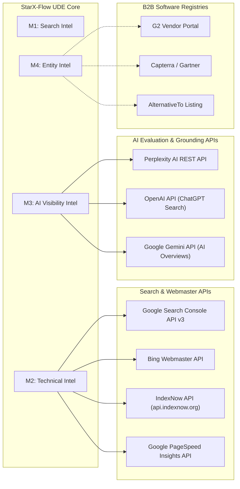

# STARX-FLOW — PHASE 1
# EXTERNAL INTEGRATION ARCHITECTURE

**Document ID:** P1-DOC-06  
**Project:** StarX-Flow  
**Initiative:** Universal Search & AI Discoverability  
**Phase:** 1 — Engineering Blueprint  
**Scope:** Third-Party Search APIs, Webmaster Consoles, AI Platform APIs, IndexNow Protocol & Evaluation Connectors  
**Author / Execution Agent:** Antigravity  
**Status:** COMPLETE INTEGRATION SPECIFICATION

---

## 1. INTEGRATION ECOSYSTEM OVERVIEW

The Universal Discovery Engine (UDE) connects to third-party search engines, webmaster platforms, and AI reasoning providers to automate indexation, extract real-world search impressions, and measure generative engine citations.

---

## 2. DETAILED INTEGRATION SPECIFICATIONS

### 2.1 Google Search Console (GSC) Integration
- **Purpose:** Monitor index coverage, submit XML sitemaps, inspect URL indexing state, and track real search impressions, clicks, and average CTR by query.
- **Official API Availability:** Official Google Search Console API v3 (Search Analytics and Sitemaps endpoints).
- **Authentication:** Service Account JSON Key or OAuth 2.0 Client with scope `https://www.googleapis.com/auth/webmasters.readonly`.
- **Pricing & Quotas:** Free; standard rate limit is 1,200 requests/minute.
- **Data Returned:** Query, Page URL, Country, Device, Impressions, Clicks, CTR, Average Position.
- **Data Retention:** 16 months historical data in GSC API.
- **Fallback Provider:** In-app manual CSV export from Search Console UI.
- **Human Actions Required:** Founder must add `https://starx-flow.runs-on.dev/` as a domain property in Google Search Console and authorize the service account or inject HTML meta verification tag.

### 2.2 Microsoft Bing Webmaster Tools & IndexNow
- **Purpose:** Immediate URL discovery on Bing and Microsoft Copilot; retrieval of Bing search analytics.
- **Official API Availability:** Official Bing Webmaster API and IndexNow Open Protocol (`api.indexnow.org`).
- **Authentication:**
  - **Bing Webmaster API:** API Key generated from Bing Webmaster Dashboard.
  - **IndexNow:** Random 32-character hexadecimal key hosted statically at `https://starx-flow.runs-on.dev/[key].txt`.
- **Pricing & Quotas:** Free; IndexNow allows up to 10,000 URLs per submission.
- **Data Returned:**
  - IndexNow: HTTP 200/202 confirmation code.
  - Bing API: Page clicks, impressions, crawled URL list, crawl errors.
- **Data Retention:** 6 months historical data in Bing API.
- **Fallback Provider:** XML Sitemap auto-polling.
- **Human Actions Required:** Founder imports site from GSC into Bing Webmaster Tools.

### 2.3 Google PageSpeed Insights & Lighthouse API
- **Purpose:** Automated CI/CD performance testing; tracking real-user Core Web Vitals (LCP, INP, CLS) across desktop and mobile form factors.
- **Official API Availability:** Google PageSpeed Insights REST API v5.
- **Authentication:** Public Google Cloud API key (standard developer key).
- **Pricing & Quotas:** Free; 25,000 queries/day.
- **Data Returned:** Lab metrics (LCP, FCP, CLS, TBT, Speed Index) and Field data from Chrome User Experience Report (CrUX).
- **Data Retention:** Ephemeral; logged to internal `crawl_findings` table.
- **Fallback Provider:** Local headless Lighthouse execution via Playwright.
- **Human Actions Required:** None (Antigravity can utilize existing developer API keys).

### 2.4 Perplexity AI Search API Connector
- **Purpose:** Benchmark whether StarX-Flow is recommended when users query Perplexity with high-intent conversational buyer prompts.
- **Official API Availability:** Official Perplexity API (`https://api.perplexity.ai/chat/completions`) using online search models (`sonar-medium`, `sonar-small`).
- **Authentication:** Bearer API Token (`PERPLEXITY_API_KEY`).
- **Pricing & Quotas:** Usage-based billing ($0.005 per search request).
- **Data Returned:** Model generated answer text, raw citations list with source URLs (`starx-flow.runs-on.dev`, `g2.com`, etc.).
- **Data Retention:** Logged to `ai_platform_observations` and `ai_citation_sources`.
- **Fallback Provider:** Headless browser evaluation of public Perplexity web interface.
- **Human Actions Required:** Founder provides Perplexity API token if automated benchmarking is activated.

### 2.5 OpenAI ChatGPT Search Evaluation Connector
- **Purpose:** Evaluate whether OpenAI search features (GPT-4o search / Responses API) recommend StarX-Flow and cite official URLs.
- **Official API Availability:** OpenAI REST API (`https://api.openai.com/v1/chat/completions`).
- **Authentication:** Bearer API Token (`OPENAI_API_KEY`).
- **Pricing & Quotas:** Usage-based token pricing.
- **Data Returned:** Model output, citation links when search tool is invoked.
- **Data Retention:** Stored in `ai_platform_observations`.
- **Fallback Provider:** Manual prompt spot-checks by the review team.
- **Human Actions Required:** Founder provides OpenAI developer key.

### 2.6 B2B Software Registries (G2, Capterra, AlternativeTo)
- **Purpose:** External entity corroboration, authority backlinks, and third-party software buyer reviews.
- **Official API Availability:**
  - G2: Partner API available exclusively for paid enterprise tiers ($5,000+/year).
  - Capterra / Gartner: No public REST API; management is via vendor portal UI.
  - AlternativeTo: No public API; listing submission is via community moderation.
- **Authentication:** Web session logins.
- **Pricing:** Free basic vendor profiles; paid PPC tiers optional.
- **Data Returned:** Web traffic referral links, review star ratings.
- **Fallback Provider:** Regular web scraping / crawl observation of public vendor profile pages.
- **Human Actions Required:** Founder manually claims and fills out basic vendor profiles using the copy provided in [`16_HUMAN_ACTION_AND_CREDENTIALS_CHECKLIST.md`](file:///c:/Web%20Apps/starx-flow/docs/phase0/16_HUMAN_ACTION_AND_CREDENTIALS_CHECKLIST.md).

---

## 3. INTEGRATION FAULT TOLERANCE & SECRETS ISOLATION

1. **Strict Secrets Decoupling:**
   All external API keys (`PERPLEXITY_API_KEY`, `OPENAI_API_KEY`, `BING_API_KEY`) must reside exclusively in server-side environment variables or Vercel Secret Vault. Under no circumstance shall any external API key be exposed in client-side bundles or public markdown repositories.
2. **Circuit Breakers & Graceful Degradation:**
   If an external integration API times out or exhausts its rate limit, the UDE logger flags a non-blocking warning. Marketing page rendering, customer onboarding, and live AI receptionist chats are **never** blocked by external search or analytics API failures.
3. **Mock Fallback Adapters:**
   Every external integration client defines an interface with an accompanying `MockAdapter` so automated CI/CD builds (`npm test`, `npm run build`) execute cleanly in offline or sandboxed environments without requiring live network calls.
