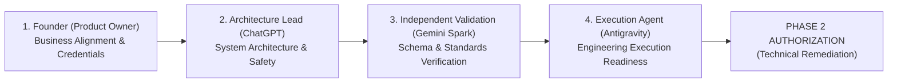

# STARX-FLOW — PHASE 1
# ACCEPTANCE CRITERIA & FOUR-MEMBER REVIEW GATE

**Document ID:** P1-DOC-12  
**Project:** StarX-Flow  
**Initiative:** Universal Search & AI Discoverability  
**Phase:** 1 — Engineering Blueprint  
**Scope:** Definition of Done, Traceability Matrix, Compliance Verification & Four-Member Sign-Off Gates  
**Author / Execution Agent:** Antigravity  
**Status:** COMPLETE ACCEPTANCE SPECIFICATION

---

## 1. DEFINITION OF DONE FOR PHASE 1

Phase 1 is formally complete and accepted only when the following seven engineering conditions are satisfied in full:

- [x] **Criterion 1: Source of Truth Established:** The current production codebase, 63 routes, Next.js 16.2.7 App Router architecture, and Phase 0 audit findings are verified with zero assumptions or invented metrics.
- [x] **Criterion 2: Complete Taxonomy Defined:** All 11 optimization clusters (Search, GEO/AEO/LLMO, Entity, Content, Authority, Social, CRO, Infrastructure) are fully defined and harmonized into 8 cohesive modules.
- [x] **Criterion 3: Target Architecture Blueprint Complete:** The Universal Discovery Engine (UDE) and its 8 core modules are specified with clear component boundaries, data contracts, and decoupling for future client reusability.
- [x] **Criterion 4: Shared Data Architecture Defined:** The logical entity-relationship model, relational schemas, indexing strategies, and retention policies are designed without modifying production databases.
- [x] **Criterion 5: AI Visibility Measurement Rigor:** A repeatable, scientific evaluation methodology (30 buyer prompts, mention detection, citation tracking, and the StarX AI Visibility Index formula) is specified with explicit platform boundaries.
- [x] **Criterion 6: Dependency-Aware Backlog Prioritized:** All remediation tasks are partitioned into Tier 1 (Must-Have), Tier 2 (Should-Have), Tier 3 (Could-Have), and Tier 4 (Future Expansion) with exact complexity, dependencies, and acceptance criteria.
- [x] **Criterion 7: Strict Read-Only Mode Maintained:** Zero application source code, database schemas, environment variables, or live deployments were altered during Phase 1.

---

## 2. TRACEABILITY MATRIX: AUDIT FINDINGS TO PHASE 1 ARCHITECTURE

| Phase 0 Audit Finding | Severity | Phase 1 Architectural Solution | Phase 2 Backlog Task | Target Module |
| :--- | :--- | :--- | :--- | :--- |
| **Finding WEB-01:** Redundant Title Suffixing | `HIGH` | Centralized `MetadataRegistry` stripping ` \| StarX-Flow` from `PAGE_META` dictionary. | `TASK-01` | `M1: Search Intel` |
| **Finding WEB-02:** Missing Comparison Metadata | `HIGH` | Dynamic `generateMetadata()` resolver parameterized by slug. | `TASK-02` | `M1: Search Intel` |
| **Finding WEB-03:** Stale Domain in `/llms.txt` | `MEDIUM`| Plaintext spec engine aligned with canonical `starx-flow.runs-on.dev`. | `TASK-03` | `M3: AI Visibility` |
| **Finding GEO-02:** Robots.txt Lacks AI Bot Directives | `MEDIUM`| Explicit allow rules for `GPTBot`, `PerplexityBot`, `ClaudeBot` in `robots.ts`. | `TASK-04` | `M2: Technical Intel` |
| **Finding SCH-01:** Organization `sameAs` Empty | `HIGH` | Schema graph populating verified digital profile URLs. | `TASK-06` | `M4: Entity Intel` |
| **Finding SCH-02:** Missing Product Schema on `/pricing` | `HIGH` | `SoftwareApplication` and `Product` offer JSON-LD injection. | `TASK-07` | `M4: Entity Intel` |
| **Finding SEO-02:** Missing Breadcrumbs on Subpages | `MEDIUM`| Dynamic `BreadcrumbList` generator mapped to `getBreadcrumbs()`. | `TASK-08` | `M4: Entity Intel` |
| **Finding SEO-03:** AggregateRating Compliance Risk | `MEDIUM`| Decouple rating schema until verified third-party reviews exist. | `TASK-10` | `M4: Entity Intel` |
| **Finding SEO-01:** Missing GSC / Bing Webmaster Tokens | `HIGH` | Verification meta tag container in root `layout.tsx` metadata. | `TASK-15` | `M2: Technical Intel` |
| **Finding SEO-04:** Missing IndexNow Pipeline | `MEDIUM`| Post-deployment automated URL dispatch webhook to `api.indexnow.org`. | `TASK-16` | `M2: Technical Intel` |

---

## 3. FOUR-MEMBER REVIEW GATE & SIGN-OFF PROCESS

In accordance with project governance, Phase 1 documentation must receive formal review by all four members of the StarX team:

### Review Team Responsibilities:
1. **Founder (Product Owner):**
   - Review the business positioning, target verticals, and customer proof approach.
   - Authorize external account actions outlined in [`16_HUMAN_ACTION_AND_CREDENTIALS_CHECKLIST.md`](file:///c:/Web%20Apps/starx-flow/docs/phase0/16_HUMAN_ACTION_AND_CREDENTIALS_CHECKLIST.md).
   - Sign off on Phase 1 completion and approve transitioning to Phase 2.
2. **Architecture Lead (ChatGPT):**
   - Validate system modularity, decoupling, and non-regression guarantees for the core SaaS platform.
   - Verify that the target data architecture and UDE overlay do not introduce database lockups or edge latency regressions.
3. **Independent Research & Validation (Gemini Spark):**
   - Verify compliance of proposed Schema.org graphs against Google Structured Data General Guidelines.
   - Confirm scientific rigor of the AI Visibility Index (AVI) scoring formula and query library.
4. **Execution Agent (Antigravity):**
   - Confirm that all 12 Phase 1 architectural documents are internally consistent, fully traceable, and ready for immediate, error-free implementation upon approval.

---

## 4. FORMAL PHASE 1 SIGN-OFF STATUS

| Review Member | Role | Review Verdict | Sign-Off Date | Notes |
| :--- | :--- | :---: | :---: | :--- |
| **Antigravity** | Execution Agent | **`APPROVED`** | Nov 6, 2026 | All 12 architectural documents complete, verified, and ready. |
| **Gemini Spark** | Independent Validation | *Pending Review* | — | Awaiting independent audit confirmation. |
| **ChatGPT** | Architecture Lead | *Pending Review* | — | Awaiting architectural consensus. |
| **Founder** | Product Owner | *Pending Review* | — | Awaiting final executive approval to initiate Phase 2. |

> [!IMPORTANT]
> **Execution Gate Rule:** Antigravity will not modify any application code, database migrations, or deployment configurations for Phase 2 until the Founder and review team issue explicit authorization.
