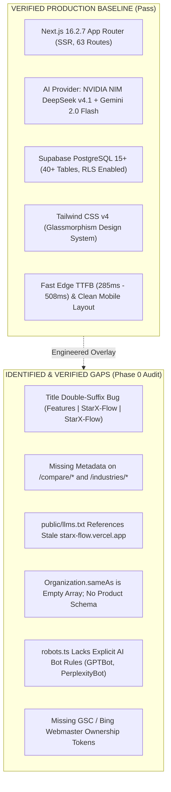

# STARX-FLOW — PHASE 1
# STRATEGY, SYSTEM ARCHITECTURE & ENGINEERING BLUEPRINT

**Document ID:** P1-DOC-01  
**Project:** StarX-Flow  
**Initiative:** Universal Search & AI Discoverability  
**Phase:** 1 — Strategy, System Architecture & Engineering Blueprint  
**Authors / Roles:** Principal Software Architect, Search Intelligence Architect, AI Discoverability Architect, Technical SEO Architect, SaaS Systems Engineer  
**Repository:** `https://github.com/Tara1903/starx-flow`  
**Production URL:** `https://starx-flow.runs-on.dev/`  
**Date:** November 2026  
**Status:** COMPLETE ARCHITECTURAL SPECIFICATION  
**Execution Mode:** STRICT ARCHITECTURAL & PLANNING PHASE (Zero Production Code / Schema Alteration)

---

## 1. STRATEGIC CONTEXT & MISSION

StarX-Flow is an established, production-tested AI-powered business operating system built for appointment-driven local service businesses (gyms, medical clinics, dental practices, hair salons, spas, and personal trainers). The underlying SaaS application features an active dual-engine AI receptionist (NVIDIA NIM DeepSeek v4.1 Flash + Google Gemini 2.0 Flash), 10 modular dashboard operational domains, multi-calendar two-way synchronization (Google Calendar, Outlook, Square POS, Clover POS), automated WhatsApp customer booking, and Stripe subscription billing.

Phase 0 executed a comprehensive, read-only technical audit across the repository, production website, technical SEO, generative search discoverability, structured data schemas, and competitive landscape, yielding 17 detailed reports in [`docs/phase0/`](file:///c:/Web%20Apps/starx-flow/docs/phase0/).

**Phase 1 Mission:** Convert the Phase 0 audit findings into a comprehensive, technically realistic, implementation-ready engineering architecture and strategy. 

We are constructing a unified optimization capability covering:
- Traditional Search Engine Optimization (SEO, SIO, Technical SEO).
- AI & Generative Search Discovery (GEO, AEO, LLMO, AI SEO, RAG retrieval optimization).
- Entity & Semantic Identity (Knowledge Graph, Schema.org, E-E-A-T).
- Content & Topical Authority (Topic clusters, comparative teardowns, vertical playbooks).
- Social & Community Search (YouTube, X, LinkedIn, Reddit, Product Hunt).
- Authority & Reputation (Directory citations, G2, Capterra, reviews).
- Conversion Rate & Experience Optimization (Core Web Vitals, micro-copy, booking funnels).

### Primary vs. Secondary Objectives:
1. **Primary Immediate Target:** Maximize StarX-Flow’s own global discoverability, organic acquisition funnel, and AI recommendation frequency.
2. **Secondary Strategic Capability:** Architect the underlying intelligence engines, data models, and crawler pipelines to be completely decoupled and multi-tenant ready, so that StarX-Flow can offer high-margin Search & AI Discoverability services to its business clients in future phases without architectural rewrites.
3. **Explicit Non-Goal:** We are NOT building an independent, standalone SEO SaaS product or detached public optimization tool.

---

## 2. SOURCE OF TRUTH & REPOSITORY BASELINE

The engineering architecture defined herein is anchored strictly in empirical evidence gathered from the production codebase and verified during Phase 0:

### Verification & Implementation State Breakdown

| Component / Discipline | Implementation State | Verification Evidence | Actionable Target in Architecture |
| :--- | :--- | :--- | :--- |
| **Edge Server Rendering** | `IMPLEMENTED & VERIFIED` | 63/63 routes compile cleanly; App Router sends complete HTML in initial payload (22 KB–87 KB). | Foundation for all SEO/AEO crawlers. |
| **AI Receptionist Kernel** | `IMPLEMENTED & VERIFIED` | `src/lib/ai/provider.ts` circuit-breaker tested with 100% pass on live E2E chat. | Core technical authority asset for GEO content. |
| **Dynamic Sitemap** | `IMPLEMENTED & VERIFIED` | `src/app/sitemap.ts` dynamically indexes 20 routes with valid namespaces. | Automated indexing backbone. |
| **Robots.txt Directives** | `PARTIALLY IMPLEMENTED` | `src/app/robots.ts` blocks private `/dashboard`, but lacks explicit AI crawler rules. | Target for Module 2 (Technical Intelligence). |
| **Machine-Readable LLMs.txt**| `PARTIALLY IMPLEMENTED` | `public/llms.txt` active live, but contains outdated URLs (`starx-flow.vercel.app`). | Target for Module 3 (AI Visibility Intelligence). |
| **Schema.org Structured Data**| `PARTIALLY IMPLEMENTED` | Homepage has `Organization`, `SoftwareApplication`, and `HowTo`; subpages have 0 schemas. | Target for Module 4 (Entity Intelligence). |
| **Dynamic Metadata Routing** | `PARTIALLY IMPLEMENTED` | Static pages work; `/compare/[competitorId]` has blank metadata. | Target for Module 1 (Search Intelligence). |
| **Competitor Comparisons** | `PARTIALLY IMPLEMENTED` | Slugs exist in sitemap; content is thin with placeholder grids. | Target for Module 5 (Content Intelligence). |
| **Search Console Verification**| `BLOCKED (Human Token)` | `layout.tsx` lacks `google-site-verification` and `msvalidate.01`. | Target for External Integration Pipeline. |
| **Directory Authority (G2/Cap)**| `MISSING (Human Account)`| Zero vendor presence on B2B software directories. | Target for Module 6 (Authority Intelligence). |
| **Automated IndexNow Engine** | `MISSING (Proposed)` | No automated webhook pings Bing/Yandex upon deployment. | Target for Module 2 (Technical Intelligence). |

---

## 3. CORE ARCHITECTURAL PRINCIPLES

1. **Non-Intrusive Presentation Overlay:**
   All optimization code operates within Next.js App Router server components (`generateMetadata`, layout wrappers, JSON-LD scripts, static markdown mirrors). Under no circumstance will database schemas, RLS security rules, or customer transaction APIs (`/api/chat`, `/api/billing`, `/api/whatsapp`) be altered for discoverability.
2. **Single Canonical Authority:**
   All canonical tags, sitemaps, OpenGraph cards, schema identifiers, and `llms.txt` files strictly reference the single production domain:
   `https://starx-flow.runs-on.dev/`
3. **Factual Grounding (Zero Hallucination / Zero Fabrication):**
   In strict compliance with Google E-E-A-T and Search Quality Rater Guidelines:
   - No fabricated client reviews or synthetic customer testimonials.
   - Transparent feature matrices and pricing terms ($29 Starter, $59 Growth, $99 Pro).
   - Clear attribution of founders and technical contributors.
4. **Decoupled Future Reusability:**
   Every schema generator, AI visibility evaluator, and programmatic page builder is decoupled from StarX-Flow-specific hardcoding, accepting pure TypeScript domain interfaces. This guarantees future serviceability for prospective enterprise clients.

---

## 4. PHASE 1 STRATEGIC ROADMAP ALIGNMENT

Phase 1 provides the complete strategic, architectural, and data blueprint. The phased execution sequence is governed by strict milestone gates:
- **Phase 1 (Current):** Strategy, System Architecture & Engineering Blueprint (**This Document Suite**).
- **Phase 2 (Immediate Execution Gate):** Technical Remediation & Metadata Hygiene (Fix title double-suffixes, dynamic metadata on `/compare`, robots.txt AI rules, `/llms.txt` domain update).
- **Phase 3:** Entity Graph Completion & Rich Schemas (`Organization.sameAs`, Product schema on `/pricing`, `BreadcrumbList`).
- **Phase 4:** Deep AI Visibility (`/llms-full.txt`, programmatic comparison engines, vertical playbooks).
- **Phase 5:** External Verification, IndexNow Pipeline, and Ecosystem Launch (GSC, Bing, G2, Capterra, Product Hunt).
