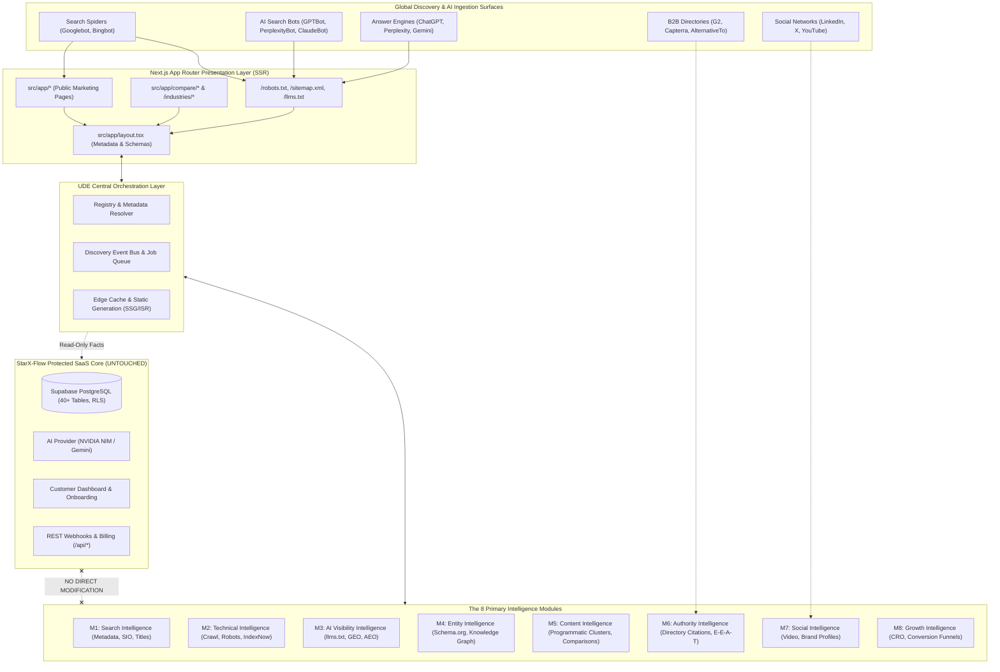

# STARX-FLOW — PHASE 1
# TARGET SYSTEM ARCHITECTURE & INTEGRATED ENGINE

**Document ID:** P1-DOC-03  
**Project:** StarX-Flow  
**Initiative:** Universal Search & AI Discoverability  
**Phase:** 1 — Engineering Blueprint  
**Scope:** Universal Discovery Engine (UDE) Architecture, 8 Core Modules, Orchestration Layer & Shared Services  
**Author / Execution Agent:** Antigravity  
**Status:** COMPLETE ARCHITECTURAL SPECIFICATION

---

## 1. ARCHITECTURAL TOPOLOGY: THE UNIVERSAL DISCOVERY ENGINE (UDE)

The **Universal Discovery Engine (UDE)** is architected as an event-driven, decoupled intelligence overlay embedded natively within StarX-Flow's Next.js App Router server runtime. It bridges traditional search spiders, AI answer engines, and external social/directory ecosystems directly to StarX-Flow’s verified product capabilities without touching the core SaaS database or customer transaction kernels.



---

## 2. THE 8 PRIMARY INTELLIGENCE MODULES

The UDE partitions all discoverability responsibilities into 8 specialized modules:

| Module Identifier | Module Name | Primary Architectural Responsibility | Key Code Components |
| :--- | :--- | :--- | :--- |
| **M1** | **Search Intelligence** | Title tag hygiene, meta descriptions, canonical enforcement, OpenGraph and Twitter social cards. | `src/lib/seoConfig.ts`, `generateMetadata()` resolvers |
| **M2** | **Technical Intelligence** | Server response latency, XML sitemap updates, robots.txt bot rules, automated IndexNow API pings. | `src/app/sitemap.ts`, `src/app/robots.ts`, IndexNow webhook |
| **M3** | **AI Visibility Intelligence**| Machine-readable endpoints (`/llms.txt`, `/llms-full.txt`), semantic Q&A DOM blocks, GEO benchmarking. | `public/llms.txt`, `public/llms-full.txt`, `AIContent.tsx` |
| **M4** | **Entity Intelligence** | Schema.org JSON-LD graph generation, `sameAs` entity links, Product and Breadcrumb schemas. | `src/components/seo/SchemaMarkup.tsx` |
| **M5** | **Content Intelligence** | Programmatic competitor comparisons (`/compare/*`), vertical industry playbooks, topic clusters. | `src/app/compare/[competitorId]/`, `/industries/[industryId]/` |
| **M6** | **Authority Intelligence** | Directory listings (G2, Capterra), third-party corroboration, verified customer case studies. | External directory profiles, `Testimonials.tsx` audit |
| **M7** | **Social Intelligence** | Social ecosystem discoverability, YouTube video walkthrough embeds, official social link mesh. | `src/components/Footer.tsx`, social card assets |
| **M8** | **Growth Intelligence** | Conversion Rate Optimization (CRO), interactive chat simulator (`/chat`), Core Web Vitals monitoring. | `src/components/CTA.tsx`, `/setup/*` onboarding funnel |

---

## 3. CENTRAL ORCHESTRATION LAYER & SHARED SERVICES

The Central Orchestration Layer governs inter-module communication, ensures single-source-of-truth consistency, and prevents circular dependencies:

### 3.1 Registry & Metadata Resolver (`seoConfig.ts`)
- Serves as the immutable single source of truth for:
  - Canonical domain normalization (`https://starx-flow.runs-on.dev`).
  - Brand identity constants (`StarX-Flow`, `@starxflow`, primary logo).
  - Clean page titles and meta descriptions without duplicate suffixes.
  - Pricing constants ($29, $59, $99).

### 3.2 Dynamic Route Metadata Resolver
- Automatically resolves metadata for dynamic routes (`/compare/[competitorId]`, `/industries/[industryId]`) by matching slug patterns against structured datasets. If a slug is unrecognized, it falls back gracefully to high-intent default templates rather than returning blank HTML tags.

### 3.3 Semantic Schema Dispatcher
- Consolidates all JSON-LD schemas into a unified graph array rendered server-side in `src/app/layout.tsx` or individual page roots. Prevents script tag collisions and ensures strict KaTeX and HTML-entity compliance.

### 3.4 Automated Indexation Webhook (IndexNow Pipeline)
- A lightweight post-build handler that compiles a list of modified or added routes and pushes them to `https://api.indexnow.org/indexnow` with the project's verification key.

---

## 4. ARCHITECTURAL DECOUPLING & FUTURE MULTI-TENANCY

To fulfill the strategic requirement that StarX-Flow's discoverability architecture must remain **reusable as a future paid service for clients**, all 8 modules are strictly decoupled from hardcoded StarX-Flow strings:

```typescript
// Shared domain configuration contract
export interface EnterpriseOptimizationConfig {
  tenantId: string;
  brandName: string;
  canonicalUrl: string;
  category: "BusinessApplication" | "MedicalClinic" | "HealthClub" | "BeautySalon";
  operatingSystem: string;
  socialNodes: {
    linkedin?: string;
    twitter?: string;
    github?: string;
    youtube?: string;
    g2?: string;
  };
  pricingTiers: Array<{
    name: string;
    price: number;
    currency: string;
    features: string[];
  }>;
  frequentlyAskedQuestions: Array<{
    question: string;
    answer: string;
  }>;
  competitors: Array<{
    slug: string;
    name: string;
    keyDifferences: string[];
  }>;
}
```

By abstracting the intelligence engines to consume this interface, StarX-Flow can instantly deploy this exact same discoverability architecture for any local business client in future phases simply by supplying their business profile.
