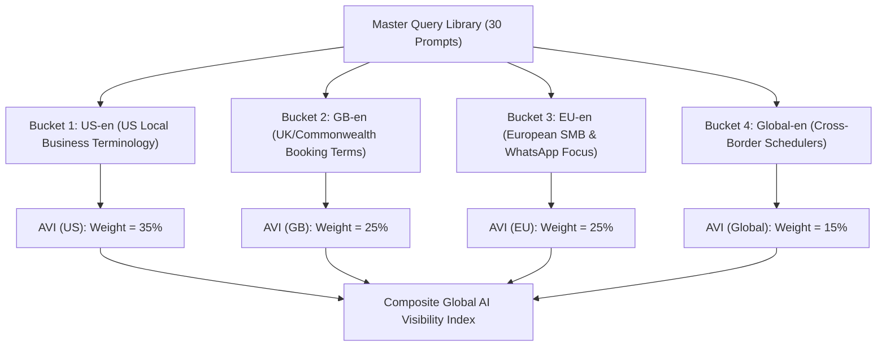

# STARX-FLOW — PHASE 1.1
# AI VISIBILITY INDEX (AVI) SCORING & METHODOLOGY REVIEW

**Document ID:** P1.1-VAL-03  
**Project:** StarX-Flow  
**Initiative:** Universal Search & AI Discoverability  
**Phase:** 1.1 — Architectural Validation  
**Scope:** AVI Mathematical Formulation, Component Scoring Ranges, Missing-Data Normalization, Confidence Metrics, Multi-Region Segmentation & Competitor Share of Voice  
**Author / Roles:** Principal Search Intelligence Architect, AI Discoverability Specialist  
**Status:** COMPLETE SCORING MODEL SPECIFICATION

---

## 1. EVALUATION OBJECTIVE & SCIENTIFIC GROUNDING

Measuring generative search visibility requires a fundamentally different mathematical approach than traditional organic SERP rank tracking. In Google, rank 1 is a fixed position; in an AI engine (Perplexity, ChatGPT Search, Gemini AI Overviews), answers are synthesized dynamically from probabilistic models using live web grounding.

### Core Scientific Rules:
1. **Raw Observation Independence:** Raw API responses, timestamps, model versions, and extracted text must be stored immutably in `ai_platform_observations` before any scoring is derived. Derived scores are re-computable; raw empirical outputs are irreplaceable.
2. **Strict Distinction:** We distinguish **Observed Empirical Mentions** (what the model actually generated) from **Derived Visibility Scores** (our mathematical index).
3. **Bounded Metric Scale:** The **StarX AI Visibility Index (AVI)** must strictly scale from **0.0 to 100.0**, where 0.0 indicates complete invisibility and 100.0 indicates universal, accurate, top-ranked recommendation across all tested buyer prompts.

---

## 2. REFINED AVI MATHEMATICAL FORMULATION

In Phase 1, the preliminary formula lacked a normalizer denominator. In Phase 1.1, the formula is rigorously defined with component bounds:

$$\text{AVI} = \frac{1}{N_{\text{valid}}} \sum_{i=1}^{N_{\text{valid}}} \left( \frac{M_i \times \big[ W_{\text{rank}}(i) + W_{\text{cite}}(i) + W_{\text{acc}}(i) \big]}{2.5} \right) \times 100$$

### Component Definitions & Value Ranges

| Component | Symbol | Value Range | Exact Definition & Weighting Rationale |
| :--- | :---: | :---: | :--- |
| **Brand Mention** | $M_i$ | $\{0, 1\}$ | **0** if StarX-Flow is omitted from the answer; **1** if StarX-Flow is explicitly named. If $M_i = 0$, the prompt score is 0. |
| **Recommendation Rank** | $W_{\text{rank}}$ | $[0.0, 1.0]$ | **1.0** = #1 Recommended solution. **0.7** = #2 Recommended solution. **0.4** = #3+ Recommended solution. **0.2** = Mentioned in passing or general list without clear ranking. |
| **Citation Source** | $W_{\text{cite}}$ | $[0.0, 0.5]$ | **0.50** = Primary domain (`starx-flow.runs-on.dev`) is cited as a source link. **0.25** = An official authority profile (e.g. StarX-Flow G2, LinkedIn, GitHub) is cited. **0.00** = No citation link provided. |
| **Factual Accuracy** | $W_{\text{acc}}$ | $[0.0, 1.0]$ | **1.0** = 100% factual agreement with Ground-Truth (price, WhatsApp-native, latency). **0.5** = Minor inaccuracy (e.g. slight pricing rounding, omitted POS type). **0.0** = Critical hallucination (e.g. claims StarX takes 20% cut, costs > $150, or does not support WhatsApp). |
| **Normalizer** | $2.5$ | Constant | Sum of maximum possible weights: $\max(W_{\text{rank}} + W_{\text{cite}} + W_{\text{acc}}) = 1.0 + 0.5 + 1.0 = 2.5$. Guarantees the term inside parentheses scales strictly between $0.0$ and $1.0$. |

---

## 3. MISSING-DATA & API FAILURE TREATMENT

In real-world testing, AI provider APIs experience transient rate limits (HTTP 429), gateway timeouts (HTTP 504), or regional outages:
- **Treatment Rule:** A failed evaluation request must **never** be assigned a score of 0. Treating a network timeout as an absence of brand mention corrupts historical trend lines.
- **Handling Protocol:**
  1. Failed queries are logged with `raw_response_text = 'TIMEOUT'` or `HTTP_ERROR_[code]`.
  2. The observation is excluded from $N_{\text{valid}}$.
  3. The evaluation suite reports a mandatory **Statistical Confidence Indicator ($C$)**:

$$C = \frac{N_{\text{valid}}}{N_{\text{total}}} \times 100\%$$

- **Validity Threshold:** If $C < 80\%$, the weekly benchmark run is flagged as `STATISTICALLY COMPROMISED` and a re-run is scheduled after an exponential backoff delay.

---

## 4. GEOGRAPHIC & LANGUAGE SEGMENTATION

AI model outputs vary significantly depending on geographic routing and prompt phrasing. The query library establishes 4 segmented observation buckets:

---

## 5. COMPETITIVE SHARE OF MODEL RECOMMENDATIONS (SOV)

In addition to StarX-Flow’s absolute AVI score, the engine computes competitive **Share of Model Recommendations (SMR)** across the 7 tracked competitors (Mindbody, Vagaro, Calendly, Wati, AiSensy, ManyChat, Fresha):

$$\text{SMR}_{\text{competitor}} = \frac{\text{Mentions}_{\text{competitor}}}{\sum \text{All Mentions Across Benchmark Suite}} \times 100\%$$

This allows the executive team to monitor whether generative search algorithms are actively shifting recommendation volume from legacy market aggregators (Mindbody) toward StarX-Flow.

---

## 6. HISTORICAL COMPARABILITY ACROSS LLM BASE MODEL SHIFTS

When AI providers release major model version upgrades (e.g. OpenAI transitioning from GPT-4o to o1/o3-mini, or Perplexity updating its Sonar retrieval pipeline), baseline recommendation frequencies can experience sudden step-function changes.

### Comparability Guardrails:
1. **Explicit Model Tagging:** Every observation record strictly preserves `platform_name` (`perplexity`, `chatgpt_search`, `gemini`) and exact `model_version` (`gpt-4o-2024-11-20`, `sonar-medium`).
2. **Versioned Trend Lines:** When an AI provider deprecates a model, the AVI dashboard marks a **Structural Baseline Shift** vertical line on historical charts, preventing false conclusions regarding optimization effectiveness.
