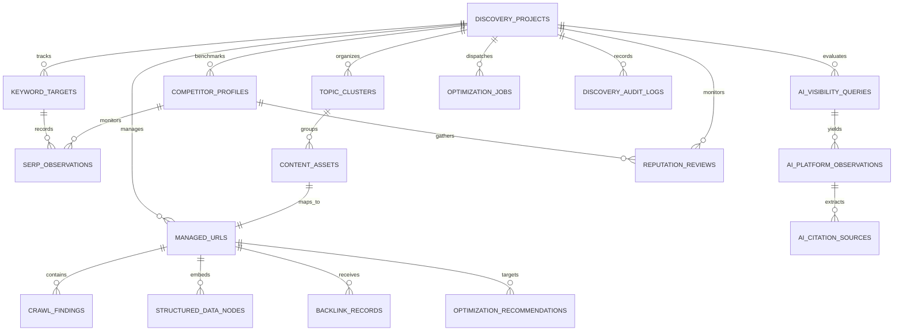

# STARX-FLOW — PHASE 1.1
# SHARED DATA ARCHITECTURE VALIDATION & NORMALIZATION REVIEW

**Document ID:** P1.1-VAL-02  
**Project:** StarX-Flow  
**Initiative:** Universal Search & AI Discoverability  
**Phase:** 1.1 — Architectural Validation  
**Scope:** Data Architecture Audit, 14-Entity Representation Verification, 16-Table Normalized Extension Schema, Indexing & Retention Strategy  
**Author / Roles:** Principal Software Architect, Independent Data Systems Engineer  
**Status:** COMPLETE DATA MODEL VALIDATION  
**Execution Note:** STRICT ARCHITECTURAL BLUEPRINT (Zero Database Migrations Executed)

---

## 1. DATA MODEL EVALUATION AGAINST THE 14 REQUIRED ENTITIES

The Phase 1 data architecture ([`DATA_ARCHITECTURE.md`](file:///c:/Web%20Apps/starx-flow/docs/phase1/DATA_ARCHITECTURE.md)) proposed a 10-table relational schema. An exhaustive audit was conducted to verify whether all 14 required enterprise entities can be represented with Third Normal Form (3NF) integrity.

### Entity Representation Verification Matrix

| Entity Requirement | Represented in Phase 1 (10 Tables) | Validation Finding | Architectural Remediation in Phase 1.1 |
| :--- | :---: | :--- | :--- |
| **1. Multiple Projects & Websites** | `VERIFIED` | Represented via `discovery_projects` (linked to `organization_id`). | Retained; full multi-tenant isolation. |
| **2. Domains & URL Inventories** | `VERIFIED` | Represented via `managed_urls` (path, canonical, priority). | Retained; added composite index on `(project_id, pathname)`. |
| **3. Crawl Sessions & Findings** | `VERIFIED` | Represented via `crawl_sessions` and `crawl_findings`. | Retained; auto-purge retention policy verified. |
| **4. Keywords, Intents & SERP** | `PARTIAL` | Shown in ER diagram, but explicit SQL DDL omitted from Phase 1. | **Added explicit `keyword_targets` and `serp_observations` tables.** |
| **5. Competitors & Relationships** | `PARTIAL` | Concept present, but explicit SQL DDL omitted from Phase 1. | **Added explicit `competitor_profiles` table.** |
| **6. Content Assets & Clusters** | `PARTIAL` | Handled at URL level, but lacks topic cluster relationships. | **Added explicit `topic_clusters` and `content_assets` tables.** |
| **7. Brands & Entities** | `VERIFIED` | Represented via `discovery_projects` and `structured_data_nodes`. | Retained; Schema.org JSONB node mapping. |
| **8. AI Visibility Queries & Observations**| `VERIFIED` | Represented via `ai_visibility_queries` and `ai_platform_observations`. | Retained; added model versioning and temperature tracking. |
| **9. Citations, Sources & Mentions** | `VERIFIED` | Represented via `ai_citation_sources`. | Retained; tracks first-party vs. third-party citation URLs. |
| **10. Backlinks & Referring Domains**| `PARTIAL` | Omitted from Phase 1 SQL DDL. | **Added explicit `backlink_records` table.** |
| **11. Reviews & Reputation Observations**| `PARTIAL` | Omitted from Phase 1 SQL DDL. | **Added explicit `reputation_reviews` table.** |
| **12. Analytics & Conversions** | `VERIFIED` | Reuses existing production `analytics_events` and `analytics_daily_rollups`.| Integrated cleanly via `project_id` foreign key. |
| **13. Optimization Recommendations**| `PARTIAL` | Concept bundled in jobs, lacks dedicated recommendation queue. | **Added explicit `optimization_recommendations` table.** |
| **14. Approval Records & Audit Logs**| `VERIFIED` | Represented via `discovery_audit_logs`. | Retained; immutable append-only audit trail. |

---

## 2. THE COMPREHENSIVE 16-TABLE NORMALIZED EXTENSION SCHEMA

To remediate the gaps identified above, the relational model is expanded from 10 tables to a **16-table enterprise schema**. 

### Entity Relationship Diagram (16 Tables)



---

## 3. EXPLICIT SQL DDL SPECIFICATION (TABLES 11–16 ADDITIONS)

Below are the 6 extension tables that complete the relational data architecture:

```sql
-- 11. Keyword Targets & Search Intent Mapping
CREATE TABLE keyword_targets (
    id UUID PRIMARY KEY DEFAULT gen_random_uuid(),
    project_id UUID NOT NULL REFERENCES discovery_projects(id) ON DELETE CASCADE,
    keyword_text VARCHAR(255) NOT NULL,
    search_intent VARCHAR(32) NOT NULL,      -- 'informational', 'commercial', 'transactional', 'navigational'
    target_persona VARCHAR(64),              -- 'gym_owner', 'dental_clinic', 'hair_salon'
    target_url_id UUID REFERENCES managed_urls(id) ON DELETE SET NULL,
    monthly_search_volume INTEGER DEFAULT 0,
    keyword_difficulty NUMERIC(3,1) DEFAULT 0.0,
    is_active BOOLEAN DEFAULT TRUE,
    created_at TIMESTAMPTZ DEFAULT NOW(),
    UNIQUE(project_id, keyword_text)
);

-- 12. SERP Observations (Time-Series Rank Snapshots)
CREATE TABLE serp_observations (
    id UUID PRIMARY KEY DEFAULT gen_random_uuid(),
    keyword_id UUID NOT NULL REFERENCES keyword_targets(id) ON DELETE CASCADE,
    search_engine VARCHAR(32) NOT NULL,      -- 'google', 'bing'
    device VARCHAR(16) NOT NULL,             -- 'mobile', 'desktop'
    locale VARCHAR(10) NOT NULL,             -- 'en_US', 'en_GB'
    organic_rank INTEGER,                    -- NULL if outside top 100
    serp_features TEXT[],                    -- ARRAY['featured_snippet', 'knowledge_panel', 'ai_overview']
    observed_url VARCHAR(1024),
    observed_at TIMESTAMPTZ DEFAULT NOW()
);

-- 13. Competitor Profiles
CREATE TABLE competitor_profiles (
    id UUID PRIMARY KEY DEFAULT gen_random_uuid(),
    project_id UUID NOT NULL REFERENCES discovery_projects(id) ON DELETE CASCADE,
    competitor_name VARCHAR(128) NOT NULL,   -- 'Mindbody', 'Vagaro', 'Calendly', 'Wati'
    competitor_domain VARCHAR(255) NOT NULL, -- 'mindbodyonline.com'
    comparison_slug VARCHAR(128) NOT NULL,   -- 'starx-flow-vs-mindbody'
    pricing_model VARCHAR(64),               -- 'Tiered + Commissions', 'Flat Subscription'
    primary_weakness TEXT,                   -- 'High commissions, marketplace client hijacking'
    is_active BOOLEAN DEFAULT TRUE,
    created_at TIMESTAMPTZ DEFAULT NOW(),
    UNIQUE(project_id, competitor_domain)
);

-- 14. Topic Clusters & Content Assets
CREATE TABLE topic_clusters (
    id UUID PRIMARY KEY DEFAULT gen_random_uuid(),
    project_id UUID NOT NULL REFERENCES discovery_projects(id) ON DELETE CASCADE,
    cluster_name VARCHAR(128) NOT NULL,      -- 'WhatsApp Business Automation'
    pillar_url_id UUID REFERENCES managed_urls(id) ON DELETE SET NULL,
    description TEXT,
    created_at TIMESTAMPTZ DEFAULT NOW()
);

CREATE TABLE content_assets (
    id UUID PRIMARY KEY DEFAULT gen_random_uuid(),
    cluster_id UUID NOT NULL REFERENCES topic_clusters(id) ON DELETE CASCADE,
    url_id UUID NOT NULL REFERENCES managed_urls(id) ON DELETE CASCADE,
    asset_type VARCHAR(32) NOT NULL,         -- 'pillar_page', 'sub_topic_article', 'comparison_guide'
    word_count INTEGER DEFAULT 0,
    target_keyword_id UUID REFERENCES keyword_targets(id) ON DELETE SET NULL,
    last_substantive_update TIMESTAMPTZ DEFAULT NOW(),
    created_at TIMESTAMPTZ DEFAULT NOW()
);

-- 15. Backlink Records & Authority Referring Domains
CREATE TABLE backlink_records (
    id UUID PRIMARY KEY DEFAULT gen_random_uuid(),
    url_id UUID NOT NULL REFERENCES managed_urls(id) ON DELETE CASCADE,
    referring_domain VARCHAR(255) NOT NULL,  -- 'g2.com', 'producthunt.com'
    source_url VARCHAR(1024) NOT NULL,
    anchor_text VARCHAR(255),
    is_dofollow BOOLEAN DEFAULT TRUE,
    domain_authority NUMERIC(3,1),
    first_detected_at TIMESTAMPTZ DEFAULT NOW(),
    last_verified_at TIMESTAMPTZ DEFAULT NOW()
);

-- 16. Reputation Reviews & Software Directory Observations
CREATE TABLE reputation_reviews (
    id UUID PRIMARY KEY DEFAULT gen_random_uuid(),
    project_id UUID NOT NULL REFERENCES discovery_projects(id) ON DELETE CASCADE,
    platform_name VARCHAR(64) NOT NULL,      -- 'g2', 'capterra', 'trustpilot', 'product_hunt'
    reviewer_name VARCHAR(128),
    reviewer_business_type VARCHAR(128),     -- 'Dental Practice', 'Boutique Gym'
    rating_value NUMERIC(2,1) NOT NULL,      -- e.g. 5.0
    review_title VARCHAR(255),
    review_text TEXT NOT NULL,
    review_url VARCHAR(1024),
    is_verified_buyer BOOLEAN DEFAULT FALSE,
    published_at TIMESTAMPTZ,
    created_at TIMESTAMPTZ DEFAULT NOW()
);
```

---

## 4. PARTITIONING STRATEGY & COMPOSITE INDEXES

### 4.1 Time-Series Table Partitioning
Observation tables (`serp_observations` and `ai_platform_observations`) accumulate time-series data rapidly.
- **Partitioning Rule:** When production data volume exceeds 100,000 observations, partition both tables by **`observed_at`** into monthly range partitions:
  ```sql
  -- Example monthly range partition pattern:
  CREATE TABLE ai_platform_observations_2026_11 
  PARTITION OF ai_platform_observations
  FOR VALUES FROM ('2026-11-01 00:00:00+00') TO ('2026-12-01 00:00:00+00');
  ```
- **Benefits:** Ensures query execution scans only the active month's partition index during weekly benchmarking.

### 4.2 Composite Indexes for Sub-Millisecond Lookups
- `CREATE INDEX idx_keyword_intent ON keyword_targets(project_id, search_intent);`
- `CREATE INDEX idx_serp_history ON serp_observations(keyword_id, observed_at DESC);`
- `CREATE INDEX idx_backlink_domain ON backlink_records(referring_domain, is_dofollow);`
- `CREATE INDEX idx_reviews_rating ON reputation_reviews(project_id, platform_name, rating_value DESC);`

---

## 5. DATA RETENTION, PRIVACY & COMPLIANCE (GDPR / CCPA)

1. **Zero Customer PII in Discovery Models:**
   The UDE data model stores public web metadata, search engine observations, and public software reviews. Customer appointments, patient health intake waivers, and private WhatsApp messages are **never replicated** into the discovery tables.
2. **Right to Erasure (GDPR Art. 17):**
   If a reviewer requests removal of their testimonial quote, deleting their record from `reputation_reviews` immediately removes their name and quote from all dynamically generated schema and webpage blocks.
3. **Automated Data Purge:**
   Ephemeral crawl findings older than 90 days are purged automatically via pg_cron background scheduler:
   ```sql
   DELETE FROM crawl_findings WHERE resolved = TRUE AND created_at < NOW() - INTERVAL '30 days';
   ```
