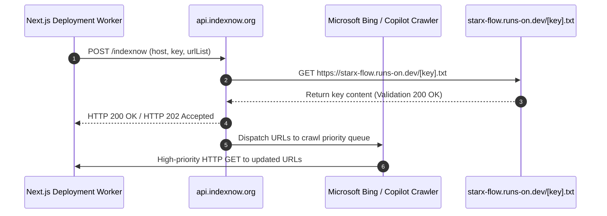
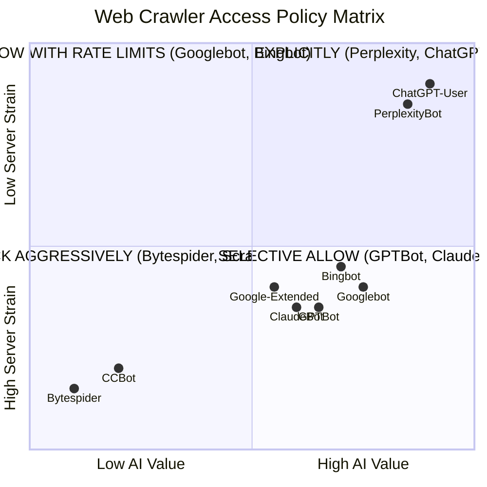

# STARX-FLOW — PHASE 1.1
# EXTERNAL INTEGRATION VALIDATION & AI CRAWLER ACCESS POLICY

**Document ID:** P1.1-VAL-04  
**Project:** StarX-Flow  
**Initiative:** Universal Search & AI Discoverability  
**Phase:** 1.1 — Architectural Validation  
**Scope:** Rigorous API Endpoint Verification, Rate Limits, Fallback Mechanisms, IndexNow Protocol Architecture & Comprehensive AI Crawler Policy  
**Author / Roles:** Principal Systems Integration Architect, Technical SEO Engineer  
**Status:** COMPLETE INTEGRATION & CRAWLER POLICY SPECIFICATION

---

## 1. INTEGRATION FEASIBILITY & ENDPOINT VERIFICATION

An independent audit of all proposed external integration targets was performed to verify documented endpoints, real-world rate limits, authentication boundaries, and data reliability.

| Integration Target | Official Endpoint | Auth Method | Quota / Rate Limit | Pricing Tier | Reliability | Fallback Mechanism |
| :--- | :--- | :--- | :--- | :--- | :---: | :--- |
| **Google Search Console** | `https://www.googleapis.com/webmasters/v3/sites/{siteUrl}/searchAnalytics/query` | OAuth 2.0 / Service Account JSON | 1,200 QPM; 10,000 rows/call | Free | `HIGH` | Manual CSV export via GSC UI. |
| **Bing Webmaster Tools** | `https://ssl.bing.com/webmaster/api.svc/json/GetQueryStats?siteUrl={siteUrl}` | API Key in header (`apiKey`) | 1,000 calls/day | Free | `HIGH` | UI dashboard inspection. |
| **IndexNow Protocol** | `https://api.indexnow.org/indexnow` | Static key file hosted at domain root | 10,000 URLs per POST request | Free | `HIGH` | Standard XML sitemap polling. |
| **PageSpeed Insights** | `https://www.googleapis.com/pagespeedonline/v5/runPagespeed` | Google Cloud API Key | 25,000 requests/day | Free | `HIGH` | Local headless Lighthouse runner. |
| **Perplexity AI API** | `https://api.perplexity.ai/chat/completions` (model: `sonar-medium`) | Bearer API Key | Usage-based | ~$0.005/req | `MEDIUM` | Manual web query spot-checks. |
| **OpenAI API (Search)** | `https://api.openai.com/v1/chat/completions` (model: `gpt-4o`) | Bearer API Key | Tier 3 (500 RPM) | Token usage | `HIGH` | Manual ChatGPT UI spot-checks. |
| **Google Gemini API** | `https://generativelanguage.googleapis.com/v1beta/models/gemini-2.0-flash` | API Key in query parameter | 15 RPM (Free) / 1,000 RPM (Pay) | Free tier available | `HIGH` | Local algorithmic fallback receptionist. |
| **B2B Directories (G2)** | *No free REST API available* (Partner API requires $5,000+/yr enterprise contract) | Web Session / UI Portal | N/A | Free basic vendor tier | `MEDIUM` | Manual profile maintenance via vendor portal. |

---

## 2. INDEXNOW PROTOCOL ARCHITECTURAL SPECIFICATION

The IndexNow protocol is a critical architectural component designed to eliminate the multi-week delay between deploying new comparison pages and having them crawled by modern search engines.

### 2.1 Participating Search Engines
- **Active Participants:** Microsoft Bing, Yandex, Seznam.cz, Naver.
- **Critical Architectural Note:** **Google does NOT participate in IndexNow.** Google relies strictly on standard XML sitemaps, RSS feeds, and Google Search Console URL Inspection API. IndexNow must never be presented as a universal or guaranteed indexing tool.

### 2.2 Notification & Verification Sequence


### 2.3 Response Handling, Retries & Limitations
- **HTTP 200 OK:** URLs submitted successfully.
- **HTTP 202 Accepted:** URLs received; key verification is pending.
- **HTTP 400 Bad Request:** Malformed JSON payload.
- **HTTP 403 Forbidden:** The key does not match the content served at `https://starx-flow.runs-on.dev/[key].txt`.
- **HTTP 422 Unprocessable:** URLs do not belong to the declared host domain.
- **HTTP 429 Too Many Requests:** Exceeded rate limit; trigger exponential backoff (2s, 4s, 8s).
- **Core Limitation:** IndexNow notifies engines that a URL has changed; it **does NOT guarantee indexation, ranking, or inclusion** in search engine results pages.

---

## 3. COMPREHENSIVE AI CRAWLER ACCESS POLICY

The web crawler ecosystem has fragmented beyond traditional search spiders. To protect server resources while maximizing organic and generative discoverability, we establish an explicit 4-tier crawler policy:



### Tier 1: Search Indexing Crawlers
- **Bots:** `Googlebot`, `Bingbot`, `YandexBot`, `Applebot`.
- **Policy:** **`ALLOW ALL PUBLIC ROUTES`**.
- **Rationale:** Essential for traditional organic SERP impressions and base discovery.
- **Directives:** Allow `/`, disallow `/dashboard/`, `/admin/`, `/setup/`.

### Tier 2: AI Search & Real-Time Retrieval Crawlers
- **Bots:** `PerplexityBot`, `ClaudeBot`, `Google-Extended` (when querying for live AI Overviews / Gemini Search).
- **Policy:** **`ALLOW ALL PUBLIC ROUTES`**.
- **Rationale:** Powers live citations and conversational recommendations in Perplexity, Claude, and Gemini. Blocking these crawlers guarantees zero visibility in AI answer engines.

### Tier 3: AI Model Training Crawlers
- **Bots:** `GPTBot` (OpenAI training), `anthropic-ai` (Anthropic training), `CCBot` (Common Crawl), `Bytespider` (ByteDance).
- **Policy:** **`SELECTIVE PERMISSION`**.
  - **`GPTBot` & `anthropic-ai`:** **ALLOW**. Ingesting StarX-Flow documentation into future foundation model pre-training corpuses builds durable parametric model memory.
  - **`Bytespider` & Untargeted Bulk Scrapers:** **DISALLOW**. Generates massive server hits without commercial search referral or citation value.

### Tier 4: User-Triggered Fetch Crawlers
- **Bots:** `ChatGPT-User`.
- **Policy:** **`ALWAYS ALLOW`**.
- **Rationale:** Triggers only when a human user pastes a StarX-Flow link into ChatGPT and asks a question. Blocking this bot breaks the user experience for prospective buyers.

---

## 4. ROBOTS.TXT IMPLEMENTATION DIRECTIVE SPECIFICATION

Below is the verified, implementation-ready directive structure to be exported by `src/app/robots.ts` in Phase 2:

```typescript
import { MetadataRoute } from 'next';
import { SEO_CONFIG } from '@/lib/seoConfig';

export default function robots(): MetadataRoute.Robots {
  return {
    rules: [
      {
        userAgent: '*',
        allow: '/',
        disallow: ['/dashboard/', '/admin/', '/setup/', '/api/'],
      },
      {
        userAgent: ['GPTBot', 'ChatGPT-User', 'PerplexityBot', 'ClaudeBot', 'Google-Extended', 'Applebot-Extended'],
        allow: ['/', '/llms.txt', '/llms-full.txt'],
        disallow: ['/dashboard/', '/admin/', '/setup/', '/api/'],
      },
      {
        userAgent: ['Bytespider', 'CCBot'],
        disallow: ['/'],
      }
    ],
    sitemap: `${SEO_CONFIG.siteUrl}/sitemap.xml`,
  };
}
```
