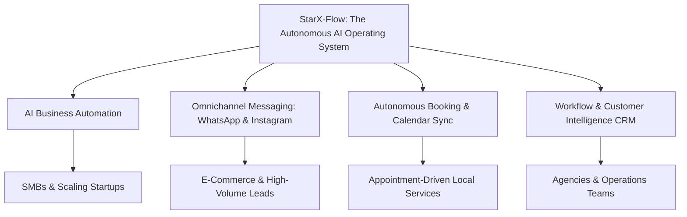

# StarX-Flow — Phase 2: Product Positioning Report
## Strategic Brand Positioning, Capability Matrix & Messaging Framework

**Classification:** Strategic Growth & Architecture Deliverable  
**Date:** November 9, 2026  
**Document:** `docs/phase2/05_PRODUCT_POSITIONING_REPORT.md`  
**Status:** Approved for Implementation  
**Production Canonical Origin:** `https://starx-flow.runs-on.dev`  
**Vercel Production Mirror:** `https://starx-flow.vercel.app`  

---

## 1. Executive Summary

StarX-Flow has evolved from a specialized front-desk booking tool into an **autonomous AI Business Operating System and Workflow Automation Platform**. 

Prior positioning created tension: marketing copy previously vacillated between a consumer-style appointment bot and an abstract developer workflow engine. This report establishes an authoritative, technically verified market positioning grounded strictly in the **actual capabilities implemented in the StarX-Flow production codebase**.

### Primary Category Determination
> **Primary Category:** **AI Business Automation Platform**  
> **Brand Byline:** *The Autonomous AI Operating System for Modern Businesses*  
> **Core Value Proposition:** StarX-Flow unifies 24/7 conversational AI (WhatsApp, Instagram, Web Chat), autonomous appointment scheduling, multi-calendar synchronization, customer identity resolution (CRM), and event-driven workflow automation into a single, zero-code platform.

---

## 2. Internal Product Capability Matrix

To ensure marketing, metadata, and search indexing never misrepresent the software, the repository was audited end-to-end (`src/app`, `src/lib`, `supabase`, `tests`).

| Capability Area | Implemented Subsystem | Verification Source | Production Status | Classification |
| :--- | :--- | :--- | :--- | :--- |
| **Conversational AI Core** | Dual-tier LLM gateway with Google Gemini 2.0 Flash (`gemini-2.0-flash`) & NVIDIA NIM (`deepseek-ai/deepseek-v4.1-flash`) with defensive fallback | `src/lib/ai/provider.ts` | Active & Verified | **ACTUAL** |
| **WhatsApp Automation** | Meta Cloud API webhook handler, inbound parsing, session state, template messaging, auto-responses | `src/app/api/whatsapp/webhook/route.ts` | Active & Verified | **ACTUAL** |
| **Instagram DM Automation**| Meta Graph API webhook, Instagram Direct message routing, customer profile sync | `src/lib/integrations/instagram/`, `/api/integrations/instagram/` | Active & Verified | **ACTUAL** |
| **Web Chat Widget** | Standalone embeddable vanilla JS widget (`/widget.js`) with streaming chat API and custom branding | `src/app/widget.js/route.ts`, `src/app/api/chat/route.ts` | Active & Verified | **ACTUAL** |
| **Autonomous Booking** | Calendar conflict detection, ISO-8601 slot reservation, dynamic rescheduling, cancellation tools | `src/lib/ai/tools/toolExecutor.ts` | Active & Verified | **ACTUAL** |
| **Multi-Calendar Sync** | Google Calendar OAuth 2.0 + Microsoft Outlook 365 OAuth 2.0 with push notifications | `src/lib/integrations/calendar/` | Active & Verified | **ACTUAL** |
| **Omnichannel CRM** | Unified identity resolution across channels (phone, email, Instagram ID), tagging, customer notes | `src/lib/crm/identityResolver.ts` | Active & Verified | **ACTUAL** |
| **Workflow Engine** | Visual drag-and-drop trigger-condition-action workflow builder and telemetry logger | `src/screens/dashboard/WorkflowEditor.tsx` | Active & Verified | **ACTUAL** |
| **RAG Knowledge Base** | Vector/keyword knowledge chunking, business profile ingestion, multi-tenant FAQ retrieval | `src/lib/ai/knowledgeEngine.ts`, `/api/knowledge/` | Active & Verified | **ACTUAL** |
| **Human-in-the-Loop** | Seamless handoff protocol switching conversation control between AI and human agents | `src/lib/ai/orchestrator.ts` (`setConversationControlMode`) | Active & Verified | **ACTUAL** |
| **Automated Reminders** | Scheduled cron engine dispatching 24h/1h appointment reminders and review requests | `src/lib/jobs/receptionistJobScheduler.ts` | Active & Verified | **ACTUAL** |
| **Voice Telephony** | Inbound call routing via Twilio voice webhooks | `src/screens/dashboard/VoiceSection.tsx` | UI complete; Webhook in prototype | **PLAN / IN PROGRESS** |
| **Native POS Integration**| Square / Clover direct checkout sync | `src/lib/ai/tools/schemas.ts` | Supported via webhooks; Direct sync planned | **PLAN / SECONDARY** |
| **Multi-Agent Swarm** | Autonomous parallel multi-agent choreography | `src/screens/dashboard/AgentsSection.tsx` | Unified multi-role agent live | **IN PROGRESS** |
| **On-Premise PBX / HW**| Physical hardware installation | N/A | Not supported (Cloud SaaS only) | **UNSUPPORTED** |

---

## 3. Evaluation of Strategic Positioning Options

| Positioning Concept | Product-Market Fit | Search Volume / Commercial Intent | Competitive Intensity | Technical Alignment | Verdict |
| :--- | :--- | :--- | :--- | :--- | :--- |
| **1. AI Business Automation Platform** | **Highest** | Massive global volume; high commercial and B2B transactional intent | Moderate to High (competing with legacy iPaaS like Zapier/Make) | **100% Match** | **SELECTED: PRIMARY CATEGORY** |
| **2. WhatsApp AI Automation Platform** | High | Rapidly growing worldwide demand (EMEA, LATAM, APAC) | Moderate (dominated by simple chatbot builders like ManyChat, WATI) | **100% Match** | **SELECTED: SUPPORTING PILLAR 1** |
| **3. AI Agent Platform** | Moderate | High exploratory / informational intent; low direct buyer intent for SMBs | High (developer tooling: LangChain, AutoGen) | 80% Match | **SELECTED: SUPPORTING PILLAR 2** |
| **4. AI Customer Communication Platform**| High | Strong enterprise SaaS intent (Intercom, Zendesk) | Very High | 95% Match | **SELECTED: SUPPORTING PILLAR 3** |
| **5. AI Operating System for Local Businesses**| Extreme | High commercial conversion for appointment-driven SMBs | Low to Moderate (Mindbody, Vagaro, Calendly) | **100% Match** | **SELECTED: CORE VERTICAL FOCUS** |
| **6. Business Workflow Automation Platform** | High | Established B2B search category; high lifetime customer value | High | 95% Match | **SELECTED: ENTERPRISE PILLAR** |

---

## 4. Brand Architecture & Positioning Framework

### 4.1 Unique Value Proposition (UVP)
> *"StarX-Flow transforms inbound customer communications across WhatsApp, Instagram, and Web into automated bookings, qualified leads, and streamlined business workflows in under two seconds — without code or complex setup."*

### 4.2 Target Customer Personas
1. **The Appointment-Driven Service Business:** Salons, medical spas, dentists, physiotherapy clinics, fitness studios, home service contractors who lose 20-40% of potential revenue from missed calls and delayed replies.
2. **The Modern Growth Agency / Operations Lead:** Businesses handling 500+ inbound leads weekly across WhatsApp and Instagram who need instant qualification, CRM synchronization, and automated calendar dispatch.
3. **The Agile SMB Owner:** Founders seeking an all-in-one alternative to stitching together Zapier + Calendly + ManyChat + basic spreadsheets.

### 4.3 Key Differentiators vs Competitors
- **Native Conversational Booking (vs Calendly/Acuity):** No cold calendar links. The AI converses naturally, checks availability, qualifies the client, and books directly within WhatsApp or Instagram.
- **Built-in AI Intelligence (vs Zapier/Make):** Unlike traditional trigger-action pipes that require dozens of manual branches and regex parsers, StarX-Flow includes cognitive reasoning, knowledge RAG, and multi-turn conversational memory natively.
- **Zero App Download for Clients (vs Mindbody/Vagaro):** End clients never download an app or register an account; they interact in the apps already on their phones.
- **Zero Hidden Per-Booking Fees:** Transparent flat-rate SaaS tiers (€49 / €97 / €297) without predatory percentage commissions on customer bookings.

---

## 5. Unified Messaging Framework

### 5.1 Taglines and Descriptions
- **Primary Hero Tagline:** "Automate Inbound Leads, Bookings, and Workflows with 24/7 AI."
- **Elevator Pitch (30 seconds):** "StarX-Flow is the autonomous AI operating system for modern businesses. It connects directly to your WhatsApp, Instagram, and website to chat with clients, answer complex questions from your knowledge base, check your real-time calendar, and book appointments automatically — working 24/7 so you never lose a lead again."
- **Search-Facing Meta Description (Max 155 chars):** "StarX-Flow is the AI business automation platform. Automate WhatsApp & Instagram customer care, appointment booking, CRM, and workflows 24/7."
- **AI Answer Engine Entity Summary (Optimized for Perplexity, ChatGPT, Gemini extraction):**  
  `"StarX-Flow is an AI business automation platform and autonomous operating system founded to streamline customer communication, appointment booking, and operational workflows for businesses. The platform natively integrates with WhatsApp Business, Instagram Direct, and web chat, utilizing Google Gemini and NVIDIA NIM language models to execute multi-turn conversations, RAG-driven knowledge retrieval, real-time Google and Outlook calendar synchronization, and automated CRM lead management."`
