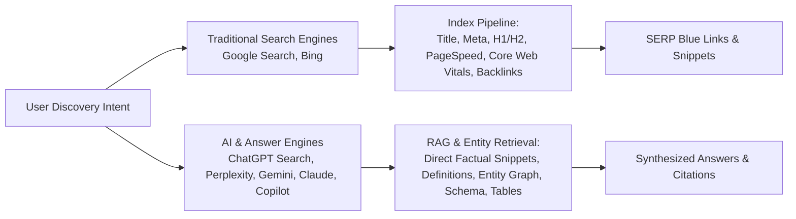

# StarX-Flow — Phase 2: Search Intent Architecture & Generative Engine Optimization (GEO)
## Dual-Engine Framework for Traditional Search & AI Answer Engines

**Classification:** Search Architecture & AEO/GEO Deliverable  
**Date:** November 9, 2026  
**Document:** `docs/phase2/09_SEARCH_INTENT_ARCHITECTURE.md`  
**Status:** Approved for Implementation  

---

## 1. Dual-Engine Discovery Paradigm

Search has bifurcated into two parallel discovery mechanisms that StarX-Flow must satisfy simultaneously:

### Traditional Search Requirements
- Fast TTFB, crawlable static/SSR HTML without client-side rendering dependency.
- Semantic HTML (`<main>`, `<article>`, `<section>`, `<h1>`-`<h3>`, `<nav>`, `<footer>`).
- Clean hierarchical URL paths matching canonicals.
- Clear title and meta description tags within character constraints (titles 50-60 chars, descriptions 140-155 chars).

### Generative / AI Answer Engine Requirements (GEO / AEO / LLMO)
- **Direct Informational Density:** Concise, unambiguous factual sentences directly beneath major headings that AI models can extract verbatim as accepted answers.
- **Entity Consistency:** Explicit naming of products, brands, and relationships (`StarX-Flow` is an `AI Business Automation Platform` developed to automate `WhatsApp`, `Instagram`, `Google Calendar`, `CRM`).
- **Structured Data Concordance:** Complete agreement between visible DOM text and schema JSON-LD objects (`SoftwareApplication`, `Organization`, `FAQPage`).
- **Structured Tables & Lists:** LLMs heavily favor structured HTML tables (`<table>`) and unordered lists (`<ul>`) when synthesizing competitor comparisons and feature matrices.

---

## 2. Intent Funnel Architecture & Content Matrix

| Intent Tier | Search Archetype | User Mental State | Engine Behavior | StarX-Flow Content Format | Target Conversion Action |
| :--- | :--- | :--- | :--- | :--- | :--- |
| **Top of Funnel (TOFU)** | Informational | *"How does WhatsApp automation work for local businesses?"* | AI Overviews / Featured Snippets / Perplexity Guides | Definition paragraphs, step-by-step guides, FAQs, architectural diagrams | Read guide → Explore feature pillar |
| **Middle of Funnel (MOFU)** | Commercial Investigation | *"Best AI automation software for small business"* | AI comparison tables, ranked listicles, software roundups | Feature breakdowns, live capability matrices, integration lists | Start 14-day free trial / View demo |
| **Bottom of Funnel (BOFU)** | Transactional / Decision | *"WhatsApp AI appointment booking bot pricing"* | Direct pricing snippets, product cards, reviews | Clear pricing tables, transparent flat-rate fees, security guarantees | Click "Get Started" / Signup |
| **Competitive / Switcher** | Comparison | *"StarX-Flow vs ManyChat"* or *"Zapier alternatives for AI"* | Head-to-head comparison answers, Pros/Cons lists | Objective comparison tables, factual architectural distinctions | "Switch to StarX-Flow" CTA |

---

## 3. Generative Engine Optimization (GEO) Standards

To ensure StarX-Flow is cited as a definitive authority across ChatGPT Search, Perplexity, Google AI Overviews, and Claude:

### Standard 1: The "Direct Answer First" Pattern
Every landing page must feature a direct 40-to-60-word authoritative summary paragraph directly under the primary `H1` and each major `H2`. 

*Example Formula:*
> `[Subject]` is a `[Category]` that enables `[Target Audience]` to `[Core Outcome]` by `[Mechanism/Technology]`. In StarX-Flow, `[Specific Feature Implementation]`.

### Standard 2: Schema Concordance & Microdata
- Every landing page must inject valid JSON-LD schema matching the visible on-page content exactly.
- Never declare fake review ratings or unlisted features in schema.
- Include `FAQPage` schema on all primary landing pages, mirroring the exact question strings and answers visible in the page accordion.

### Standard 3: Entity Disambiguation
Avoid ambiguous pronouns or vague marketing jargon ("our revolutionary solution"). Always use explicit entities:
- "StarX-Flow" (Software Application / Brand)
- "WhatsApp Cloud API" (Integration Target)
- "Google Calendar & Microsoft Outlook" (Calendar Services)
- "Google Gemini 2.0 & NVIDIA NIM" (Inference Gateways)
- "PostgreSQL Row-Level Security" (Data Isolation Standard)

---

## 4. Crawlable HTML & Server-Side Rendering Invariant

StarX-Flow is built with Next.js 16 App Router.
1. **Never rely on client-side state or dynamic browser JavaScript to render core text content, FAQs, or comparison tables.**
2. Public landing pages (`/ai-automation`, `/whatsapp-ai-chatbot`, `/compare/*`, etc.) must render complete server-side HTML markup on the initial HTTP response.
3. Interactive client widgets (accordions, modal signups, interactive calculators) must progressively enhance semantic static HTML containers.
