# StarX-Flow — Phase 2: Content Authority Architecture & 90-Day Editorial Roadmap
## Topic Cluster Strategy, Interlinking Topology & 90-Day Execution Calendar

**Classification:** Content Strategy & Domain Authority Deliverable  
**Date:** November 9, 2026  
**Document:** `docs/phase2/11_CONTENT_AUTHORITY_ROADMAP.md`  
**Status:** Approved for Implementation  

---

## 1. Topic Cluster & Pillar-Spoke Architecture

To establish topical authority in search engines and AI knowledge graphs, StarX-Flow organizes its content into 6 primary topic clusters. Each cluster consists of:
1. **Core Pillar Page (Broad Commercial & Search Intent):** Authoritative high-converting landing page.
2. **Supporting Sub-Pillars & Use Cases:** Deeper practical applications for specific segments.
3. **Informational Articles & Guides:** High-density educational guides capturing long-tail informational search intent and feeding PageRank and contextual relevance back to the pillar.

```mermaid
graph TD
    subgraph Cluster1 [Cluster 1: AI Business Automation]
        P1["/ai-automation (Pillar)"]
        S1A["Guide: How AI Business Automation Works"]
        S1B["Guide: AI Automation ROI Calculator"]
        S1C["Guide: 10 Tasks to Automate with AI"]
        S1A --> P1
        S1B --> P1
        S1C --> P1
    end

    subgraph Cluster2 [Cluster 2: WhatsApp Automation]
        P2["/whatsapp-ai-chatbot (Pillar)"]
        S2A["/use-cases/whatsapp-automation"]
        S2B["Guide: WhatsApp Business API Setup"]
        S2C["Guide: Sync WhatsApp to Google Calendar"]
        S2A --> P2
        S2B --> P2
        S2C --> P2
    end

    subgraph Cluster3 [Cluster 3: Social & Instagram]
        P3["/instagram-ai-automation (Pillar)"]
        S3A["Guide: Automate Instagram DMs for Leads"]
        S3B["Guide: Instagram Story Replies to Booking"]
        S3A --> P3
        S3B --> P3
    end

    subgraph Cluster4 [Cluster 4: AI Customer Support]
        P4["/ai-customer-support (Pillar)"]
        S4A["Guide: RAG Knowledge Bases for Support"]
        S4B["Guide: Human-in-the-Loop Handoff Best Practices"]
        S4A --> P4
        S4B --> P4
    end

    subgraph Cluster5 [Cluster 5: AI Agents]
        P5["/ai-agents (Pillar)"]
        S5A["Guide: Tool Calling and Function Execution"]
        S5B["Guide: Gemini vs DeepSeek for Business Tasks"]
        S5A --> P5
        S5B --> P5
    end

    subgraph Cluster6 [Cluster 6: Workflow Automation]
        P6["/business-workflow-automation (Pillar)"]
        S6A["Guide: Trigger-Condition-Action Architecture"]
        S6B["Guide: Automated Appointment Reminders & Retention"]
        S6A --> P6
        S6B --> P6
    end
```

---

## 2. 90-Day Editorial Execution Roadmap

The 90-day plan is split into three 30-day waves, prioritized by buyer intent, search opportunity, and conversion velocity:

### Month 1 (Days 1–30): Core Pillar Foundation & High-Intent Commercial Pages
*Objective: Deploy foundational landing pages and bottom-of-funnel comparison assets.*

| Week | Content Title / Target URL | Content Type | Target Keyword Cluster | Priority | Target Intent |
| :--- | :--- | :--- | :--- | :--- | :--- |
| **W1** | `/ai-automation` | Category Pillar Page | AI Business Automation | P0 | Commercial / Trans |
| **W1** | `/whatsapp-ai-chatbot` | Category Pillar Page | WhatsApp Automation | P0 | Commercial / Trans |
| **W2** | `/instagram-ai-automation` | Category Pillar Page | Instagram DM Automation | P1 | Commercial / Trans |
| **W2** | `/ai-customer-support` | Category Pillar Page | AI Customer Support | P1 | Commercial / Trans |
| **W3** | `/ai-agents` | Category Pillar Page | AI Agents for Business | P1 | Commercial / Info |
| **W3** | `/business-workflow-automation` | Category Pillar Page | Workflow Automation | P1 | Commercial / Trans |
| **W4** | `/compare/starx-flow-vs-manychat` | Competitor Comparison | Switcher / Evaluation | P1 | Comparison / Trans |
| **W4** | `/compare/starx-flow-vs-intercom` | Competitor Comparison | Switcher / Evaluation | P1 | Comparison / Trans |

---

### Month 2 (Days 31–60): Deep Technical Guides & High-Volume Informational Assets
*Objective: Build topical authority and capture top-of-funnel informational and AI answer queries.*

| Week | Content Title / Target URL | Content Type | Target Keyword | Priority | Target Intent |
| :--- | :--- | :--- | :--- | :--- | :--- |
| **W5** | *The Complete Guide to WhatsApp Business API Automation in 2026* | Pillar Guide / Article | `whatsapp business automation guide` | P2 | Informational |
| **W5** | *How to Connect Google Calendar to WhatsApp for Automatic Booking* | Technical Tutorial | `connect google calendar to whatsapp` | P2 | Transactional |
| **W6** | *How Generative AI Chatbots Differ From Decision-Tree Bots* | Educational / Technical | `generative ai vs chatbot` | P2 | Informational |
| **W6** | *The Ultimate Guide to Instagram DM Lead Qualification* | Practical Playbook | `instagram lead qualification guide` | P2 | Commercial |
| **W7** | *How to Build a Custom RAG Knowledge Base for Customer Support* | Technical Architecture | `rag knowledge base for support` | P2 | Informational |
| **W7** | *Automated Appointment Reminders: How to Cut No-Shows by 70%* | Industry Whitepaper | `automated appointment reminders` | P2 | Commercial |
| **W8** | `/compare/starx-flow-vs-wati` | Competitor Comparison | `wati alternative` | P2 | Comparison |
| **W8** | `/compare/starx-flow-vs-make` (Enriched) | Competitor Comparison | `make vs starx-flow` | P2 | Comparison |

---

### Month 3 (Days 61–90): Vertical Expansion & Scaling Authority
*Objective: Scale long-tail industry solutions and amplify conversion loops.*

| Week | Content Title / Target URL | Content Type | Target Keyword | Priority | Target Intent |
| :--- | :--- | :--- | :--- | :--- | :--- |
| **W9** | *AI Automation for Healthcare & Dental Practices: Compliance & Scheduling* | Industry Solution Guide | `ai booking for dental clinics` | P3 | Vertical / Trans |
| **W9** | *The Modern Salon Operating System: Cutting Front-Desk Overhead* | Industry Solution Guide | `salon booking automation` | P3 | Vertical / Trans |
| **W10**| *Home Services & Contractors: Capturing Emergency Leads on WhatsApp* | Industry Solution Guide | `plumber emergency lead automation` | P3 | Vertical / Trans |
| **W10**| *Omnichannel Identity Resolution: Unifying WhatsApp, Instagram, and Web Leads*| Architecture Deep Dive | `omnichannel customer identity crm` | P3 | Informational |
| **W11**| *AI Receptionist vs Traditional Front-Desk Staff: Cost & ROI Analysis* | Decision Whitepaper | `ai receptionist cost vs human` | P3 | Commercial / Trans |
| **W11**| *Multi-Staff Rostering & Calendar Conflict Prevention with AI* | Technical Feature Guide| `multi-staff calendar booking ai` | P3 | Commercial |
| **W12**| 90-Day Performance Review & Search Console Gap Optimization | Strategy & Analytics | SERP Gap Filling | P0 | Governance |

---

## 3. Internal Linking Rules & Anchor Text Governance

1. **Contextual In-Content Linking:** In every educational guide, embed 2–4 contextual text links pointing to related pillar pages with descriptive anchor text (e.g., *"deploy our [WhatsApp AI chatbot](https://starx-flow.runs-on.dev/whatsapp-ai-chatbot)"*, never generic *"click here"*).
2. **Reverse Linking from Pillars:** Every pillar page features an FAQ section and a "Related Resources & Implementation Guides" block linking down to specific technical articles.
3. **Breadcrumb Trails:** Every subpage must include valid breadcrumbs matching the hierarchy (`Home > AI Automation` or `Home > Industries > Plumbers`).
