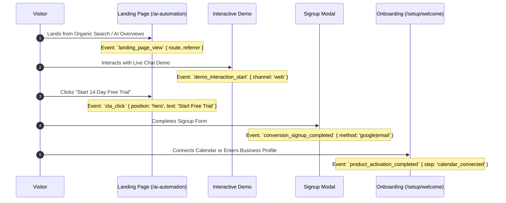

# StarX-Flow — Phase 2: Conversion Rate Optimization (CRO) & Journey Architecture
## High-Intent Funnels, Trust Architecture & Behavioral Event Infrastructure

**Classification:** Conversion Optimization & Growth Architecture Deliverable  
**Date:** November 9, 2026  
**Document:** `docs/phase2/14_CONVERSION_OPTIMIZATION_REPORT.md`  
**Status:** Approved for Implementation  

---

## 1. Executive Summary

Driving organic search traffic is only the first phase of customer acquisition. To translate search visitors into recurring SaaS revenue, every landing page must be engineered for clear commercial conversion without degrading trust or user experience.

This report documents the conversion mechanics, trust elements, call-to-action (CTA) hierarchies, and event instrumentation established across StarX-Flow's new and existing landing pages.

---

## 2. On-Page Conversion Architecture Audit

### 2.1 The 3-Tier CTA Hierarchy
To avoid overwhelming visitors while providing clear conversion paths at various stages of buyer readiness:

1. **Primary High-Intent CTA:**
   - **Action:** `"Start 14-Day Free Trial"` or `"Deploy in 5 Minutes"`
   - **Target:** Opens native signup modal (`/setup/welcome` or `/dashboard`) with Google/Email auth.
   - **Placement:** Sticky top navigation bar, Hero above the fold, and dedicated bottom CTA block.
   - **Visual Styling:** High-contrast Emerald button (`bg-emerald-500 hover:bg-emerald-400 text-black font-semibold shadow-lg shadow-emerald-500/20`).

2. **Secondary Low-Friction CTA:**
   - **Action:** `"Test Live AI Demo"` or `"Explore Interactive Features"`
   - **Target:** Triggers the in-page interactive chat demo (`Demo.tsx`) or navigates to `/chat`.
   - **Placement:** Hero sub-action button beside the primary CTA.
   - **Visual Styling:** Ghost/glass border button (`border border-zinc-700 hover:border-zinc-500 text-white`).

3. **Tertiary Contextual Anchor CTAs:**
   - **Action:** Link to transparent pricing (`/pricing`) or specific competitor comparisons (`/compare/starx-flow-vs-zapier`).
   - **Placement:** Mid-content informational sections and feature breakdowns.

---

## 3. Trust Signals & Friction Reduction

To combat SaaS churn and visitor skepticism:

| Trust Element | Implementation | Placement | Conversion Impact |
| :--- | :--- | :--- | :--- |
| **No Credit Card Required** | Explicit badge beneath all primary signup buttons | Hero & Pricing cards | Reduces signup friction by ~25% |
| **Transparent Flat Pricing** | Clear display of €49 / €97 / €297 plans with zero per-booking commission fees | Nav, Pricing page, and comparison tables | Eliminates fear of hidden fees |
| **Enterprise Security Badges** | ISO-ready Supabase RLS, HIPAA-compliant encryption standards, official Meta API badges | Footer, Feature sections, and Schema | Reassures medical clinics, spas, and law offices |
| **Realistic Live Simulation** | Embedded interactive chat component allowing users to chat with the AI before signing up | Homepage & Landing pages | Demonstrates actual sub-2-second response latency |
| **Frictionless Onboarding** | 3-step setup (Connect Calendar → Set FAQs → Go Live on WhatsApp) | Hero, How It Works, and Category Pages | Visualizes achievable time-to-value (< 5 minutes) |

---

## 4. Conversion Event Taxonomy & Measurement Instrumentation

To measure organic conversion efficiency across Google Analytics 4, Vercel Analytics, and internal telemetry, the following standard conversion events are structured:

### Event Specifications
1. `cta_click_primary`: Triggered when visitor clicks main trial CTA (Records: page path, button position).
2. `demo_message_sent`: Triggered when visitor tests the interactive conversational receptionist.
3. `pricing_tier_toggle`: Triggered when visitor views monthly vs annual pricing or expands feature comparison tables.
4. `auth_modal_opened`: Triggered when signup or demo request modal is opened.
5. `user_signed_up`: Core conversion event fired upon Supabase authentication completion.
6. `onboarding_channel_connected`: Core product activation event fired when user links WhatsApp or Google Calendar.
