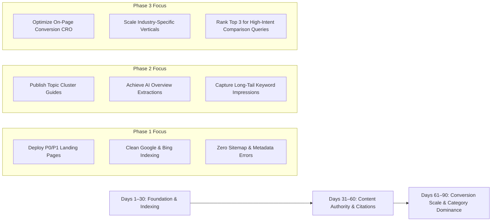

# StarX-Flow — Phase 2: 90-Day Search & Growth Measurement Framework
## KPI Scorecards, Measurement Instrumentation & Milestones (Days 1–90)

**Classification:** Growth Architecture & Performance Framework Deliverable  
**Date:** November 9, 2026  
**Document:** `docs/phase2/15_90_DAY_GROWTH_ROADMAP.md`  
**Status:** Approved for Implementation  

---

## 1. Executive Summary

Search engine optimization and AI discoverability are compounding investments that require rigorous, milestone-based measurement. This framework establishes the performance metrics, analytical tooling, attribution channels, and weekly operational review cadences governing StarX-Flow's organic growth over the next 90 days.

---

## 2. Analytics & Measurement Tooling Architecture

| Analytics Platform | Configuration Status | Primary Metrics Monitored | Strategic Purpose |
| :--- | :--- | :--- | :--- |
| **Google Search Console (GSC)** | Connected (Domain Property) | Total Impressions, Clicks, Average CTR, Average SERP Position, Index Coverage, Mobile Usability | Tracks traditional Google search ranking trajectories, crawl health, and keyword opportunities. |
| **Bing Webmaster Tools** | Connected | Crawl frequency, indexing status, keyword queries, IndexNow pings | Powers Bing organic search and Microsoft Copilot grounding data. |
| **AI Referral Tracking (GA4 / Vercel)** | Configured (UTM / Referrer Regex) | Referral sessions from `chatgpt.com`, `perplexity.ai`, `claude.ai`, `copilot.microsoft.com` | Directly quantifies generative engine citation volume and referral quality. |
| **Vercel Web Analytics** | Native Next.js 16 | Core Web Vitals (LCP, FID, CLS, INP), 75th percentile page load times | Guarantees top-tier performance signals required for high search rankings. |
| **Internal Telemetry (Supabase)**| Implemented | Organic signups, trial activations, channel connection rates | Measures true commercial return on organic search traffic. |

---

## 3. 90-Day Phased Growth Milestones

### Phase 1 (Days 1–30): Foundation, Indexing & Crawl Cleanliness
- **Target Deliverables:**
  - Complete deployment of high-intent pillar pages: `/ai-automation`, `/whatsapp-ai-chatbot`, `/instagram-ai-automation`, `/ai-customer-support`, `/ai-agents`, `/business-workflow-automation`.
  - Upgrade competitor comparison pages (`starx-flow-vs-zapier`, `starx-flow-vs-manychat`, `starx-flow-vs-intercom`, etc.).
  - 100% clean indexation in Google Search Console: 0 crawl errors, 0 duplicate metadata routes, 100% valid canonical tags.
- **KPI Target:**
  - 100% of public sitemap routes indexed.
  - Initial 5,000+ monthly impressions on long-tail and brand queries.
  - Zero indexing of private dashboard or administrative routes.

### Phase 2 (Days 31–60): Topical Authority & Generative Answer Engine Emergence
- **Target Deliverables:**
  - Publish Month 2 technical guides and implementation playbooks (Calendar sync, WhatsApp API guide, RAG setup).
  - Monitor first appearances in Google AI Overviews and Perplexity search answers.
  - Begin tracking AI referral sessions from `chatgpt.com`, `perplexity.ai`, and `claude.ai`.
- **KPI Target:**
  - 25,000+ monthly impressions in Google Search Console.
  - Top 10 rankings for 15+ target commercial long-tail keywords.
  - Documented citations in Perplexity and ChatGPT Search for *"WhatsApp AI booking software"* and *"AI receptionist for WhatsApp"*.
  - 50+ monthly organic trial signups.

### Phase 3 (Days 61–90): Conversion Optimization & Commercial Scaling
- **Target Deliverables:**
  - Launch industry-specific landing pages and localized case studies (Healthcare, Salons, Home Services).
  - Execute A/B tests on primary hero CTAs and interactive demo engagement.
  - Optimize high-impression / low-CTR pages identified in GSC query reports.
- **KPI Target:**
  - 75,000+ monthly impressions; 2,500+ monthly organic clicks.
  - Top 3 ranking for primary comparison keywords (`StarX-Flow vs ManyChat`, `WhatsApp booking bot alternative`).
  - Organic conversion rate (Visitor to Trial) > 3.5%.
  - 150+ monthly qualified organic signups and business activations.

---

## 4. Weekly Operational Review Rhythm

To maintain governance without falling into vanity metrics, the engineering and growth team maintains a weekly 30-minute review agenda:
1. **GSC Performance Report:** Review top 10 gaining and losing queries. Identify queries ranking in positions 8–20 for quick content enrichment.
2. **AI Referral Audit:** Filter analytics by `Referrer matches /chatgpt|perplexity|claude|copilot/` to track generative engine discovery trends.
3. **Index Health Audit:** Verify zero 4xx/5xx crawl errors or canonical conflicts.
4. **Conversion Funnel Review:** Compare landing page views vs trial signups across each category pillar page.
