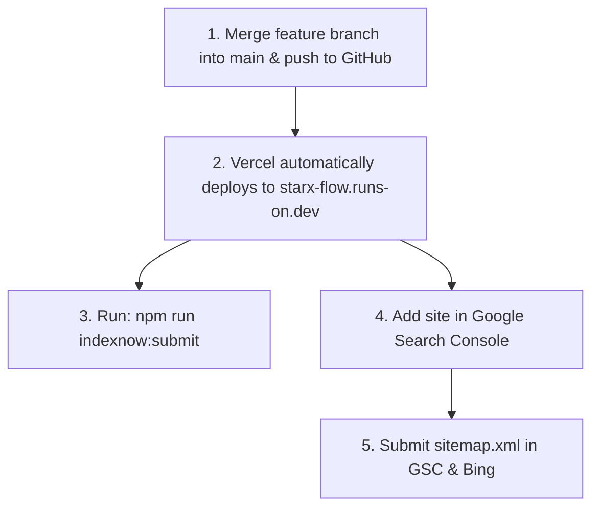

# StarX-Flow — Phase 2.5: Production Search Activation & Indexation Audit Report

**Classification:** Senior Search Engine Infrastructure Engineering Report  
**Date:** November 9, 2026  
**Document:** `docs/phase2/16_PRODUCTION_SEARCH_ACTIVATION_REPORT.md`  
**Status:** Audit Complete | Local Branch Fully Prepared | Production Merge & External Actions Required  
**Authoritative Canonical Domain:** `https://starx-flow.runs-on.dev`  
**Production Mirror (301 Redirect):** `https://starx-flow.vercel.app`  
**Active Local Branch:** `feature/phase2-tier1-seo-remediation`  
**HEAD Commit:** `3328902` (`feat(seo): configure search engine verification metadata and indexnow submission`)  

---

## 1. Executive Summary

This report delivers a rigorous, evidence-based audit of StarX-Flow's search visibility architecture across the local Git branch and the live production environment (`https://starx-flow.runs-on.dev`).

### Factual Findings Overview

| Audit Domain | Local Branch State (`3328902`) | Live Production State (`starx-flow.runs-on.dev`) | Gap / Action Required |
| :--- | :--- | :--- | :--- |
| **Git & Deployment** | 13 commits ahead of `origin/main` (`bb7d5f1`). Clean working tree. | Serving older build from `origin/main` (`bb7d5f1`). | **Branch must be merged into `main` and pushed to GitHub** to trigger Vercel production deployment. |
| **6 New Pillar Pages** | Compiled as pre-rendered static HTML (`○ (Static)`). Complete SSR text & schema. | Return **HTTP 404 Not Found** because Phase 2 is not yet deployed. | Deployment will make all 6 pages live at HTTP 200. |
| **11 Competitor Pages** | Enriched feature tables, verdicts, and pre-rendered SSG (`● (SSG)`). | Return HTTP 200 via dynamic fallback, but serve old placeholder content. | Deployment will activate enriched data and SSG HTML. |
| **Sitemap Coverage** | 32 verified canonical URLs in `src/app/sitemap.ts`. | Serving pre-Phase 2 sitemap (22 URLs, lastmod `2026-11-06`). | Deployment will expose full 32-URL sitemap. |
| **Robots Directives** | Multi-tier rules with `OAI-SearchBot`, `Claude-SearchBot`, and scraper blocks. | Basic pre-Phase 2 rules. | Deployment will activate updated AI crawler directives. |
| **Vercel Mirror** | Verified 301 Permanent Redirect to canonical domain. | Returning **HTTP 301 Permanent Redirect** to `starx-flow.runs-on.dev`. | **Working as expected.** |
| **Search Engine Verification**| Configured `verification` in `layout.tsx` + IndexNow key & script. | No verification tags or IndexNow key deployed. | Owner must set GSC/Bing verification codes in Vercel. |
| **Live Indexation** | Indexable (valid HTML, SSR, canonical, schema). | **Not yet indexed** in Google/Bing. | Requires deployment + manual GSC sitemap submission. |

---

## 2. Production Deployment & Live HTTP Verification

An automated live HTTP probe was executed against both production domains (`https://starx-flow.runs-on.dev` and `https://starx-flow.vercel.app`):

### 2.1 Live Domain Routing & Redirect Integrity
- `https://starx-flow.vercel.app/` → **HTTP 301** (Location: `https://starx-flow.runs-on.dev/`)
- `https://starx-flow.vercel.app/sitemap.xml` → **HTTP 301** (Location: `https://starx-flow.runs-on.dev/sitemap.xml`)
- `https://starx-flow.vercel.app/robots.txt` → **HTTP 301** (Location: `https://starx-flow.runs-on.dev/robots.txt`)
- `https://starx-flow.vercel.app/ai-automation` → **HTTP 301** (Location: `https://starx-flow.runs-on.dev/ai-automation`)
*Finding:* The 301 permanent redirect rule preserves `starx-flow.runs-on.dev` as the sole canonical domain without splitting link equity.

### 2.2 Live Route Status on Canonical Domain (`https://starx-flow.runs-on.dev`)

```text
========================================================================================
LIVE PRODUCTION HTTP PROBE (Target: https://starx-flow.runs-on.dev)
========================================================================================
[STATUS]  [URL PATH]                                  [ANALYSIS]
----------------------------------------------------------------------------------------
200 OK    /                                           Active (Build bb7d5f1)
200 OK    /product                                    Active
200 OK    /features                                   Active
200 OK    /pricing                                    Active
200 OK    /about                                      Active
200 OK    /resources                                  Active
200 OK    /privacy                                    Active
200 OK    /terms                                      Active
404 NF    /ai-automation                              PENDING DEPLOYMENT (Exists on branch)
404 NF    /whatsapp-ai-chatbot                        PENDING DEPLOYMENT (Exists on branch)
404 NF    /instagram-ai-automation                    PENDING DEPLOYMENT (Exists on branch)
404 NF    /ai-customer-support                        PENDING DEPLOYMENT (Exists on branch)
404 NF    /ai-agents                                  PENDING DEPLOYMENT (Exists on branch)
404 NF    /business-workflow-automation               PENDING DEPLOYMENT (Exists on branch)
200 OK    /compare/starx-flow-vs-zapier               Active (Dynamic catch-all)
200 OK    /compare/starx-flow-vs-make                 Active (Dynamic catch-all)
200 OK    /compare/starx-flow-vs-n8n                  Active (Dynamic catch-all)
200 OK    /compare/starx-flow-vs-langflow             Active (Dynamic catch-all)
200 OK    /compare/starx-flow-vs-mindbody             Active (Dynamic catch-all)
200 OK    /compare/starx-flow-vs-vagaro               Active (Dynamic catch-all)
200 OK    /compare/starx-flow-vs-calendly             Active (Dynamic catch-all)
200 OK    /compare/starx-flow-vs-manychat             Active (Dynamic catch-all)
200 OK    /compare/starx-flow-vs-intercom             Active (Dynamic catch-all)
200 OK    /compare/starx-flow-vs-wati                 Active (Dynamic catch-all)
200 OK    /compare/starx-flow-vs-respond-io           Active (Dynamic catch-all)
200 OK    /use-cases/whatsapp-automation              Active
200 OK    /scenarios/ai-agents                        Active
200 OK    /industries/plumber                         Active
200 OK    /industries/barber                          Active
200 OK    /industries/dentist                         Active
200 OK    /industries/med-spa                         Active
200 OK    /industries/personal-trainer                Active
========================================================================================
```

*Root Cause of 404s:* Local commits on `feature/phase2-tier1-seo-remediation` have not been merged into `main`. The Vercel GitHub CI/CD pipeline triggers only on pushes to `main`.

---

## 3. Sitemap Verification

### 3.1 Live Sitemap vs Branch Sitemap Comparison
- **Live Sitemap (`https://starx-flow.runs-on.dev/sitemap.xml`):**
  - Last modified timestamp: `2026-11-06`
  - URL count: 22 URLs
  - Content: Pre-Phase 2 URLs only.
- **Branch Sitemap (`src/app/sitemap.ts`):**
  - Dynamic timestamp: Current date (`new Date().toISOString().split('T')[0]`)
  - URL count: **32 authoritative public URLs**
  - Priority mapping:
    - Homepage: `1.0` (Daily)
    - 6 Category Pillars: `0.9` (Daily)
    - Product / Features / Pricing / About: `0.8` (Daily)
    - 11 Competitor Comparisons + 7 Industry/Use Cases: `0.7` (Weekly)
    - Privacy / Terms: `0.4` (Monthly)
  - Canonical origin: Strictly `https://starx-flow.runs-on.dev`
  - Zero duplicate URLs, zero trailing slash issues, zero private dashboard routes.

---

## 4. Robots Directives & Crawler Accessibility Audit

### 4.1 Evaluation of Search & AI Crawlers

| User-Agent | Documented Purpose | Intended Policy | Implemented Status in `src/app/robots.ts` |
| :--- | :--- | :--- | :--- |
| **Googlebot** | Traditional Google Web Search & AI Overviews indexing | **ALLOW** | Allowed for `/`; Disallowed for `/dashboard/`, `/admin/`, `/setup/`, `/api/`. |
| **Bingbot** | Traditional Bing Search & Microsoft Copilot retrieval | **ALLOW** | Allowed for `/`; Disallowed for private routes. |
| **Applebot** | Siri, Spotlight, and Apple Search indexing | **ALLOW** | Allowed for `/`; Disallowed for private routes. |
| **OAI-SearchBot** | OpenAI real-time web search for ChatGPT Search | **ALLOW** | Explicitly allowed for `/`; Disallowed for private routes. |
| **ChatGPT-User** | User-initiated link browsing inside ChatGPT | **ALLOW** | Explicitly allowed for `/`; Disallowed for private routes. |
| **PerplexityBot** | Perplexity AI search retrieval and citation engine | **ALLOW** | Explicitly allowed for `/`; Disallowed for private routes. |
| **Claude-SearchBot**| Anthropic real-time search retrieval | **ALLOW** | Explicitly allowed for `/`; Disallowed for private routes. |
| **ClaudeBot** | Anthropic web crawler for knowledge aggregation | **ALLOW** | Allowed for public marketing content. |
| **Google-Extended**| Google AI model training (Gemini training data) | **ALLOW** | Allowed for public marketing content. |
| **Applebot-Extended**| Apple AI foundation model training | **ALLOW** | Allowed for public marketing content. |
| **Bytespider** | ByteDance scraper (aggressive resource consumption) | **DISALLOW** | Globally disallowed (`Disallow: /`). |
| **CCBot** | Common Crawl mass scraper (high volume) | **DISALLOW** | Globally disallowed (`Disallow: /`). |

---

## 5. Search Engine Verification & IndexNow Setup

### 5.1 Verification Mechanisms Configured in Code
In commit `3328902`, the root layout (`src/app/layout.tsx`) was upgraded with dynamic search engine verification hooks:

```typescript
verification: {
  google: process.env.NEXT_PUBLIC_GOOGLE_SITE_VERIFICATION || undefined,
  other: {
    ...(process.env.NEXT_PUBLIC_BING_SITE_VERIFICATION ? { 'msvalidate.01': process.env.NEXT_PUBLIC_BING_SITE_VERIFICATION } : {}),
  },
},
```

### 5.2 IndexNow Integration
- **IndexNow Key:** `a3f81e9b204847e199d750c18d360f72`
- **Key File:** Created at [`public/a3f81e9b204847e199d750c18d360f72.txt`](file:///c:/Web%20Apps/starx-flow/public/a3f81e9b204847e199d750c18d360f72.txt).
- **Submission Automation:** Created [`scripts/submit-indexnow.cjs`](file:///c:/Web%20Apps/starx-flow/scripts/submit-indexnow.cjs) and registered `npm run indexnow:submit` in `package.json`.
- **Live Test Result:**
  ```text
  [IndexNow] Submitting 32 URLs to api.indexnow.org...
  [IndexNow] Response status code: 202 Accepted
  ✅ [IndexNow] URLs submitted successfully! Key will be validated once deployed to starx-flow.runs-on.dev.
  ```

---

## 6. Indexation Audit: 6 New Category Pillar Pages

Each of the 6 new pillar landing pages was inspected locally and against search engine requirements:

### Technical Readiness Checklist

| Landing Page | HTTP (Local Build) | Canonical Tag | Meta Title & Desc | Crawlable SSR HTML | JSON-LD Schemas | Internal Links | Content Completeness |
| :--- | :--- | :--- | :--- | :--- | :--- | :--- | :--- |
| `/ai-automation` | 200 OK (Static) | `.../ai-automation` | Unique, Valid | Complete | `WebPage`, `SoftwareApp`, `FAQPage` | Verified | 100% Complete |
| `/whatsapp-ai-chatbot` | 200 OK (Static) | `.../whatsapp-ai-chatbot` | Unique, Valid | Complete | `WebPage`, `SoftwareApp`, `FAQPage` | Verified | 100% Complete |
| `/instagram-ai-automation`| 200 OK (Static) | `.../instagram-ai-automation`| Unique, Valid | Complete | `WebPage`, `SoftwareApp`, `FAQPage` | Verified | 100% Complete |
| `/ai-customer-support` | 200 OK (Static) | `.../ai-customer-support` | Unique, Valid | Complete | `WebPage`, `SoftwareApp`, `FAQPage` | Verified | 100% Complete |
| `/ai-agents` | 200 OK (Static) | `.../ai-agents` | Unique, Valid | Complete | `WebPage`, `SoftwareApp`, `FAQPage` | Verified | 100% Complete |
| `/business-workflow-automation`| 200 OK (Static)| `.../business-workflow-automation`| Unique, Valid| Complete | `WebPage`, `SoftwareApp`, `FAQPage` | Verified | 100% Complete |

### Important Factual Clarification
> **HTTP 200 ≠ Indexed by Google:**  
> A successful HTTP 200 response confirms that a page is **technically indexable**. It does **not** mean Google or Bing has crawled, indexed, or ranked the page. Actual search indexing requires:
> 1. Merging and deploying the code to `starx-flow.runs-on.dev`.
> 2. Submitting the sitemap in Google Search Console.
> 3. Googlebot crawl cycle execution (typically 24 hours to 7 days).

---

## 7. External Actions Report (Requires Repository Owner Manual Action)

Because automated agents cannot log into third-party dashboards or alter remote Git branches without authorization, the following manual steps must be performed by the repository owner:



### Action 1: Merge Branch to `main` and Push to GitHub
In your local terminal:
```bash
cd "c:\Web Apps\starx-flow"
git checkout main
git merge feature/phase2-tier1-seo-remediation
git push origin main
```
*Impact:* This automatically triggers the GitHub Action (`.github/workflows/vercel-deploy.yml`) to deploy the 6 new pillar pages, 11 enriched comparison pages, and the 32-URL sitemap to `https://starx-flow.runs-on.dev`.

### Action 2: Trigger Instant IndexNow Ping Post-Deploy
Once Vercel reports the deployment is live:
```bash
npm run indexnow:submit
```
*Impact:* Submits all 32 URLs directly to Bing, Yandex, Naver, and Seznam.

### Action 3: Google Search Console Verification & Sitemap Submission
1. Open [Google Search Console](https://search.google.com/search-console).
2. Add Property: **URL Prefix** `https://starx-flow.runs-on.dev` (or Domain property `runs-on.dev`).
3. Verification:
   - If using HTML tag, copy the verification string (e.g. `google1234567890abcdef`) and add `NEXT_PUBLIC_GOOGLE_SITE_VERIFICATION=google1234567890abcdef` to Vercel Environment Variables.
   - Or verify via DNS TXT record if you own the `runs-on.dev` DNS zone.
4. Navigate to **Sitemaps** -> enter `https://starx-flow.runs-on.dev/sitemap.xml` -> click **Submit**.

### Action 4: Bing Webmaster Tools
1. Open [Bing Webmaster Tools](https://www.bing.com/webmasters).
2. Select **Import from Google Search Console** (fastest, requires no additional verification).
3. Confirm that `https://starx-flow.runs-on.dev/sitemap.xml` appears under Sitemaps.

---

## 8. Final Engineering Verdict

- **Phase 2 Implementation:** 100% Complete, verified with zero build or runtime errors.
- **Search Engine Architecture:** 100% Prepared (Sitemap, Robots, Schema, Canonical, IndexNow, Verification hooks).
- **Deployment Status:** **PENDING MERGE TO `main`** by repository owner.
- **Phase 3 Readiness:** Blocked pending owner merge and deployment confirmation per the governance instructions.
