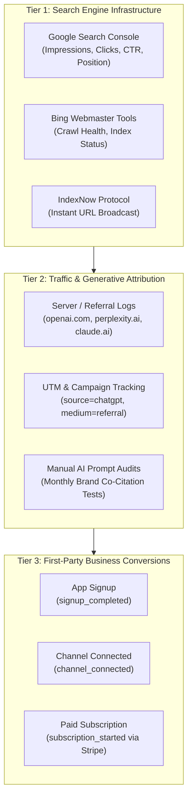

# STARX-FLOW — SEARCH & CONVERSION MEASUREMENT FRAMEWORK
**Phase:** 4 — Authority, Trust, Brand Entity & AI Search Visibility Engine  
**Document ID:** `docs/phase4/08_SEARCH_AND_CONVERSION_MEASUREMENT_FRAMEWORK.md`  
**Target Domain:** `https://starx-flow.runs-on.dev`  
**Git Branch:** `main`  
**Status:** Unified Measurement & Attribution Architecture  

---

## 1. MEASUREMENT PHILOSOPHY

Moving from technical SEO implementation to measurable business impact requires disciplined attribution:
1. **No Speculative Metric Claims:** We do not claim to track AI citations comprehensively where no closed-loop API exists. AI engine visibility is measured through documented test queries and verified referral traffic.
2. **Privacy-Preserving Telemetry:** Conversion tracking respects visitor cookie consent (`src/components/ConsentBanner.tsx`) and leverages first-party Supabase event logging (`src/services/analytics.ts`) rather than invasive third-party ad pixels.
3. **Multi-Channel Attribution:** Inbound search traffic must be tracked from query impression to free trial signup and paid subscription.

---

## 2. THE THREE-TIER MEASUREMENT ARCHITECTURE

---

## 3. METRIC SPECIFICATIONS & ATTRIBUTION METHODS

### 3.1 Traditional Search Metrics (Google Search Console & Bing)
* **Total Organic Impressions:** Weekly aggregate visibility across brand and non-brand queries.
* **Organic Clicks & CTR:** Click-through rate segmented by page type:
  - Core Brand / Home (`/`, `/about`, `/product`)
  - Vertical Solutions (`/industries/[industryId]`)
  - Competitor Comparisons (`/compare/[competitorId]`)
  - Editorial Runbooks (`/resources/articles/[articleSlug]`)
* **Average Search Position:** Tracking rankings for high-intent queries (e.g. "WhatsApp booking for dental clinics", "ManyChat alternative zero commission", "AI receptionist for gyms").
* **Indexation Saturation:** Ratio of submitted sitemap URLs (42+) to indexed URLs in Google Search Console Index Coverage Report.

### 3.2 Generative AI Search Metrics (AEO / GEO)
Because AI search engines do not currently provide webmaster search consoles for answer generations, StarX-Flow employs a rigorous two-pronged attribution model:

#### 1. Referrer URL Detection (Web Analytics & Server Logs)
Tracking inbound sessions originating from known AI search domains:
- `chatgpt.com` / `chat.openai.com` (ChatGPT Search)
- `perplexity.ai` (Perplexity Search)
- `claude.ai` (Claude Search & Artifacts)
- `copilot.microsoft.com` (Microsoft Copilot)
- `gemini.google.com` (Google Gemini)

#### 2. Monthly Longitudinal Prompt Benchmark Tests
A standardized set of 10 long-tail operational queries executed on the 1st of each month across ChatGPT Plus, Perplexity Pro, and Google AI Mode to evaluate brand presence:
1. *"What is the best WhatsApp booking software for local clinics that doesn't charge commission?"*
2. *"Can I connect WhatsApp to Google Calendar to automatically book appointments?"*
3. *"ManyChat alternatives that sync natively with Google Calendar and Outlook"*
4. *"How to automate front desk appointment booking for a boutique gym on WhatsApp"*
5. *"AI receptionist tools for hair salons that prevent double booking"*
6. *"Zero commission booking software for service businesses"*
7. *"Best WhatsApp chatbot for patient intake in dental clinics"*
8. *"How to set up automated Google review requests via WhatsApp after appointments"*
9. *"Does StarX-Flow support two-way Google Calendar synchronization?"*
10. *"What software replaces Mindbody without taking a percentage of appointment revenue?"*

*Scoring Rubric:*
- **Direct Mention:** StarX-Flow named in top 3 recommended tools. (3 pts)
- **Cited Source:** StarX-Flow URL linked in answer footnote. (2 pts)
- **Generic Co-citation:** Listed under related tools. (1 pt)
- **Omitted:** Not mentioned. (0 pts)

### 3.3 Product & Business Conversion Metrics
Instrumented directly via `src/services/analytics.ts` and Supabase:
* **Visitor-to-Trial Conversion Rate:** `(signup_completed / unique_visitors) * 100`
* **Onboarding Completion Rate:** `(onboarding_complete / signup_completed) * 100`
* **First Channel Connection Rate:** `(channel_connected / onboarding_complete) * 100`
* **Trial-to-Paid Conversion Rate:** `(subscription_started / signup_completed) * 100`
* **Customer Lifetime Value (LTV):** Measured by Stripe subscription recurring billing cycles.

---

## 4. REPORTING CADENCE & OWNER ACTION CHECKLIST

| Frequency | Activity | Tool / System | Owner Action Required |
| :--- | :--- | :--- | :--- |
| **Weekly** | Check GSC Index Coverage & Sitemap Processing | Google Search Console | Review for any 404, redirect, or noindex warnings |
| **Weekly** | Submit Newly Deployed Routes via IndexNow | `npm run indexnow:submit` | Trigger instant re-indexing to Bing and Yandex |
| **Monthly** | Run 10-Query AI Benchmark Audit | ChatGPT, Perplexity, Gemini | Record citation appearances and accuracy in monthly log |
| **Monthly** | Review Stripe Subscription Cohort Retention | Stripe Dashboard | Track MRR growth and plan tier distribution ($29 / $59 / $99) |
