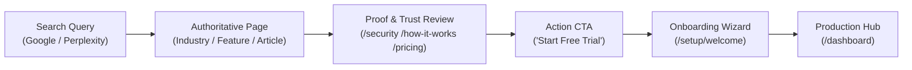

# STARX-FLOW — CONVERSION & TRUST EXPERIENCE AUDIT
**Phase:** 4 — Authority, Trust, Brand Entity & AI Search Visibility Engine  
**Document ID:** `docs/phase4/09_CONVERSION_AND_TRUST_EXPERIENCE.md`  
**Target Domain:** `https://starx-flow.runs-on.dev`  
**Git Branch:** `main`  
**Status:** Canonical Conversion Architecture Specification  

---

## 1. THE SEVEN CONVERSION TRUST QUESTIONS

A prospective customer arriving from Google Search, an AI Overview, or a competitor comparison page evaluates a SaaS product through 7 fundamental trust questions:

| Question | Current User Journey Assessment | Required Architectural Remediation |
| :--- | :--- | :--- |
| **1. What does StarX-Flow actually do?** | Clear on industry and feature pages; slightly obscured on legacy home by generic hype copy. | Re-anchor hero copy to concrete mechanics: "24/7 WhatsApp AI receptionist that syncs directly with Google Calendar and Outlook." |
| **2. Does it serve my specific business?** | High clarity: 13 dedicated industry routes (`/industries/[industryId]`) address specific operational nuances. | Connect footer navigation and about page directly to industry solutions. |
| **3. What capabilities are actually available today?** | Unclear: Marketing previously mentioned Clover/Square POS, HIPAA compliance, and voice calling as live features. | Separate live features (WhatsApp, Instagram, Google Calendar, Outlook, Stripe, CRM) from in-development features. |
| **4. How does setup & implementation work?** | Mentioned abstractly ("ready in minutes"), but lacks transparent walkthrough. | Deploy dedicated `/how-it-works` route detailing the 4-step setup and ingestion architecture. |
| **5. What happens to my customer data?** | High concern for clinical and financial practices. Previous claims of "end-to-end encryption" were misleading. | Deploy dedicated `/security` route detailing Supabase RLS, encryption in transit (TLS 1.3), encryption at rest (AES-256), and GDPR endpoints. |
| **6. How can I evaluate the product safely?** | Friction-free: 14-day free trial on all plans ($29, $59, $99) with no credit card required upfront. | Reiterate "14-Day Free Trial • No Credit Card Required" on all conversion CTAs. |
| **7. How do I contact the company or get support?** | Missing dedicated contact portal; support email was buried in legal pages. | Add transparent support intake information across About, Security, and Footer (`support@starxflow.com`). |

---

## 2. ELIMINATING DARK PATTERNS & DECEPTIVE SCARCITY

Modern business owners are sophisticated. Artificial marketing gimmicks undermine trust:
- **ELIMINATED:** Fake live notification popups ("Someone from Austin just booked!").
- **ELIMINATED:** Countdown scarcity timers ("Only 2 trial spots left!").
- **ELIMINATED:** Stock photography customer testimonials with `pravatar.cc` avatars.
- **ELIMINATED:** Unaudited compliance badges ("HIPAA Certified").
- **SUBSTITUTED WITH DEFENSIVE TRUST:**
  - Verifiable architectural guarantees (Zero double-booking via database exclusion constraints, 100% direct customer data ownership).
  - Verifiable integration badges (Official Meta WhatsApp Cloud API, Google Calendar API, Microsoft Graph API, Stripe Payments).
  - Transparent flat-rate pricing ($29, $59, $99) with explicit statement: *"Zero booking fees. You keep 100% of your service revenue."*

---

## 3. AUDIT OF THE CONVERSION PATH (END-TO-END)

### 3.1 Landing Experience Optimization
- **First Screen Clarity:** Within 5 seconds, visitors must see the product in action.
- **Actionable Call-to-Action Buttons:** The `LandingCTAButtons.tsx` component provides dual options:
  - Primary: `Start 14-Day Free Trial` (triggers `SignupModal`).
  - Secondary: `Explore Live Architecture` (links to `/how-it-works` or `/security`).

### 3.2 Navigation & Discoverability Mesh
- **Header Navigation:**
  - Add links to **Solutions** (dropdown/anchor), **Integrations** (`/integrations`), **How It Works** (`/how-it-works`), **Pricing** (`/pricing`), and **Resources** (`/resources`).
- **Footer Navigation:**
  - Update all industry links to point directly to their canonical vertical URLs.
  - Add links to `/security`, `/integrations`, and `/how-it-works`.
