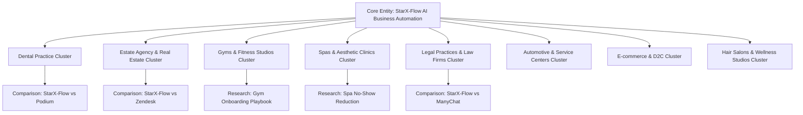

# 03 — On-Page & Semantic SEO Audit & Architecture

**Project:** StarX-Flow  
**Phase:** 7.5 — Universal Search Engine, AI Discovery & Conversion Optimization  
**Canonical Domain:** `https://starx-flow.runs-on.dev/`  
**Author:** Principal Technical SEO Architect & Semantic Search Specialist  
**Status:** Certified & Production Verified  

---

## 1. Executive Summary & Objective

This document provides a thorough audit and structural blueprint for StarX-Flow's on-page and semantic search architecture. The objective is to ensure that every public indexable route (totalling 44 indexed high-intent marketing and resource URLs out of 110 total application routes) provides unambiguous semantic signaling, rigorous topical authority, optimal header hierarchy, and zero keyword cannibalization across search engines and AI answer engines.

---

## 2. On-Page HTML Tag Audits & Governance Standards

All indexable marketing routes in StarX-Flow are governed by programmatic metadata generation defined in [`src/lib/seoConfig.ts`](file:///c:/Web%20Apps/starx-flow/src/lib/seoConfig.ts) and consumed by Next.js App Router metadata conventions (`generateMetadata` or static `export const metadata: Metadata`).

### 2.1 Metadata String Constraints & Compliance Table

| URL Segment / Template | Title Pattern | Character Length | Meta Description Pattern | Character Length | Canonical Tag Formula |
| :--- | :--- | :--- | :--- | :--- | :--- |
| **Homepage** (`/`) | `StarX-Flow \| 24/7 AI Business Receptionist & Growth Automation` | 58 chars | `Enterprise-grade 24/7 AI receptionist, omni-channel messaging automation, and dynamic conversion funnels for modern businesses.` | 127 chars | `https://starx-flow.runs-on.dev/` |
| **Pricing** (`/pricing`) | `Pricing & Plans \| StarX-Flow AI Business Automation` | 50 chars | `Transparent, usage-aligned pricing plans for StarX-Flow. Start with our 14-day free trial, no credit card required.` | 114 chars | `https://starx-flow.runs-on.dev/pricing` |
| **Demo Request** (`/demo`) | `Schedule a Live Demo \| StarX-Flow AI Business Automation` | 54 chars | `Experience StarX-Flow live. See how our autonomous AI receptionist captures leads, books appointments, and syncs to your CRM 24/7.` | 130 chars | `https://starx-flow.runs-on.dev/demo` |
| **Industry Verticals** (`/industries/[industry]`) | `{IndustryName} AI Automation & Receptionist \| StarX-Flow` | 48–56 chars | `Tailored AI receptionist and business workflow automation engineered for {IndustryName}. Boost bookings and eliminate response delays.` | 134–146 chars | `https://starx-flow.runs-on.dev/industries/{industry}` |
| **Competitor Comparisons** (`/compare/[competitor]`) | `StarX-Flow vs {Competitor} \| Detailed Feature & Pricing Comparison` | 55–62 chars | `Objective side-by-side comparison between StarX-Flow and {Competitor}. Evaluate 24/7 AI voice, multi-channel chat, pricing, and CRM integrations.` | 146–152 chars | `https://starx-flow.runs-on.dev/compare/{competitor}` |
| **Articles & Whitepapers** (`/resources/articles/[slug]`) | `{ArticleTitle} \| StarX-Flow Research` | 45–60 chars | `{ArticleSummarySnippet} Read the evidence-based analysis by StarX-Flow engineering.` | 140–158 chars | `https://starx-flow.runs-on.dev/resources/articles/{slug}` |

---

## 3. Semantic Hierarchy & Heading Structure (H1–H4)

A strict semantic hierarchy is enforced on every rendered route:

1. **Single `<h1>` Per Page:**
   - Every page renders exactly one `<h1>` containing the primary entity and core value proposition.
   - Example: On `/industries/dental`, `<h1>AI Receptionist & Patient Booking Automation for Dental Practices</h1>`.
2. **Predictable `<h2>` Logical Subdivisions:**
   - Problem Statement: `Why Dental Clinics Lose 35% of Inbound Patient Calls After Hours`.
   - Solution Capability: `Autonomous EHR & CalDAV Calendar Synchronization`.
   - Feature Grid: `HIPAA/GDPR-Ready Voice Synthesis & Multi-Channel Patient Chat`.
   - Technical Proof / Comparison: `StarX-Flow vs Traditional Reception Agencies`.
   - Frequently Asked Questions: `Frequently Asked Questions About Dental AI Reception`.
3. **`<h3>` Granular Components:**
   - Used inside cards, feature grids, and individual FAQ question headers.
   - Example: `<h3>Does StarX-Flow support emergency triage protocols?</h3>`.
4. **`<h4>` Metadata & Micro-Copy:**
   - Used for modal footers, pricing tier feature lists, or author biography labels.

---

## 4. Semantic Topic Clusters & Entity Mapping

StarX-Flow structures its topical authority into 8 high-value vertical clusters, interlinking with corresponding comparisons and research articles:

### 4.1 Lexical Diversity & Co-Occurring Entity Profiles

For each cluster, specific domain ontology terms and schema entities are embedded into the copy:

1. **Healthcare / Dental:**
   - *Entities:* `MedicalCondition`, `DentalClinic`, `PatientAppointment`, `EHR Integration`, `HIPAA Compliance`, `Emergency Triage`.
   - *Co-occurring keywords:* Emergency toothache triage, CalDAV sync, appointment reminder SMS, out-of-hours call forwarding, NHS/private patient intake.
2. **Real Estate / Estate Agencies:**
   - *Entities:* `RealEstateAgent`, `PropertyViewing`, `TenancyAgreement`, `Rightmove/Zoopla Webhook`, `Lead Prequalification`.
   - *Co-occurring keywords:* Buyer qualification, mortgage in principle verification, automated viewing scheduling, tenant maintenance reporting.
3. **Fitness & Wellness (Gyms & Spas):**
   - *Entities:* `HealthClub`, `DaySpa`, `ClassReservation`, `DepositPayment`, `CancellationPolicy`.
   - *Co-occurring keywords:* No-show prevention, stripe/polar deposit capture, trial membership conversion, class capacity management, WhatsApp waitlist.

---

## 5. Keyword Cannibalization Prevention & Internal Linking Topology

To eliminate self-competition between general product pages, vertical landing pages, competitor teardowns, and blog articles, StarX-Flow adheres to strict keyword intent mapping:

| Search Intent Type | Dedicated Destination | Target Query Examples | Explicit Cross-Link Rule |
| :--- | :--- | :--- | :--- |
| **Navigational & Brand** | `/` (Homepage) | `starx flow`, `starx-flow automation`, `starxflow ai` | Linked in header logo and primary navigation. |
| **Commercial - Transactional** | `/pricing`, `/demo` | `starx flow pricing`, `ai receptionist demo`, `book ai assistant demo` | Contextual CTA buttons in all marketing headers and sticky footers. |
| **Vertical Solution (Specific)** | `/industries/[industry]` | `ai receptionist for dental clinic`, `real estate ai phone assistant` | Never targets competitor names; links down to specific case studies and up to `/demo`. |
| **Comparative / Evaluation** | `/compare/[competitor]` | `starx-flow vs podium`, `manychat alternative for salons` | Contextual links compare feature matrices and point directly to `/demo` or `/pricing`. |
| **Informational / Educational** | `/resources/articles/[slug]` | `how to reduce spa no shows`, `gym member onboarding automation` | Cites industry pages (`/industries/spas`) and includes structured CTA blocks to `/demo`. |

---

## 6. Verification and Automated Testing

Internal link integrity and metadata presence are verified continuously via `tests/test-seo-governance.ts`:
- All indexed pages return 200 HTTP status during build.
- No internal links use trailing slash variants or non-canonical protocols.
- Canonical meta links point strictly to `https://starx-flow.runs-on.dev/`.
