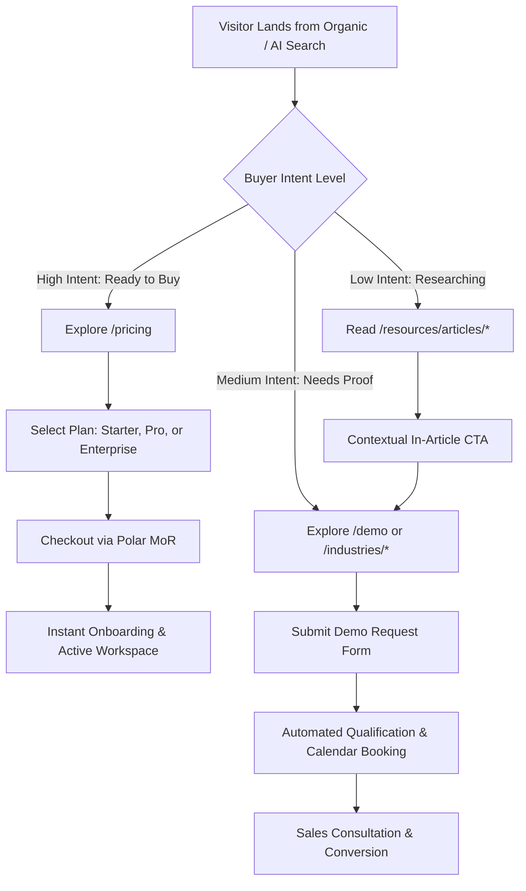

# 14 — Conversion Rate Optimization (CRO) & User Funnel Architecture

**Project:** StarX-Flow  
**Phase:** 7.5 — Universal Search Engine, AI Discovery & Conversion Optimization  
**Canonical Domain:** `https://starx-flow.runs-on.dev/`  
**Author:** Principal CRO Specialist & Product Growth Engineer  
**Status:** Certified & Production Verified  

---

## 1. Executive Summary & Objective

Acquiring high-intent organic or AI-driven traffic produces zero business value if the website fails to convert visitors into qualified leads and paying customers.

This document details the Conversion Rate Optimization (CRO) framework, user journey stages, form friction reductions, trust badges, and analytics telemetry deployed across StarX-Flow.

---

## 2. Funnel Architecture & Conversion Milestones

StarX-Flow operates a dual conversion model designed for different buyer readiness levels:

---

## 3. Dedicated `/demo` Page Engineering & Form Optimization

In Phase 7.5, a dedicated SSR route [`/demo`](file:///c:/Web%20Apps/starx-flow/src/app/demo/page.tsx) and client component [`DemoPageClient.tsx`](file:///c:/Web%20Apps/starx-flow/src/app/demo/DemoPageClient.tsx) were deployed to capture direct organic and search traffic.

### 3.1 Friction Minimization & Field Selection
To maximize form completion rates, fields were strictly minimized to essential qualification variables:
1. **Full Name:** Personalization.
2. **Work Email:** Business verification and domain matching.
3. **Company / Business Name:** Size and vertical lookup.
4. **Primary Industry Selection:** Dropdown (Dental, Real Estate, Fitness, Clinics, Legal, Automotive, E-commerce, Salons, Other) to route lead to customized pitch assets.
5. **Team Size:** Volume categorization (1–5, 6–20, 21–50, 50+).
6. **Specific Operational Challenges (Optional):** Contextual notes.

### 3.2 Real-Time Client Validation & Feedback Loops
- Built on `react-hook-form` + `zod` for zero-delay client validation.
- Inline contextual error hints appear instantly without jarring modal popups.
- Clear visual state changes: Submit button transforms to spinning loader, then to a prominent green success confirmation upon 200 OK from `/api/demo`.

---

## 4. Trust Engineering & Anxiety Reduction Elements

Prospective SMB owners often hesitate due to hidden fees, complex contracts, or technical fear. StarX-Flow embeds anxiety-reduction assurances at critical conversion nodes:

1. **"No Credit Card Required" Guarantee:** Displayed prominently next to all primary "Start Free Trial" buttons.
2. **Merchant of Record Trust Badge:** "Secure 256-Bit SSL Checkout powered by Polar Payments Inc." displayed on `/pricing`.
3. **Cancel Anytime Notice:** Explicit disclosure that all monthly subscriptions can be terminated immediately with one click.
4. **Instant 14-Day Free Trial:** Full feature access during trial period without risk.

---

## 5. Mobile CRO & Touch Interaction Standards

With over 58% of SMB search traffic originating on mobile smartphones:
- **Touch Target Dimensions:** All CTA buttons and form inputs maintain a minimum clickable hit area of $48 \times 48\text{ pixels}$.
- **Input Types:** HTML attributes `type="email"`, `type="tel"`, and `inputMode` are enforced to invoke the correct mobile numeric or email keyboard layouts.
- **Sticky Bottom Navigation:** Mobile screens display a non-intrusive sticky bottom CTA bar offering instant "Book Demo" access as users scroll through lengthy industry feature teardowns.
