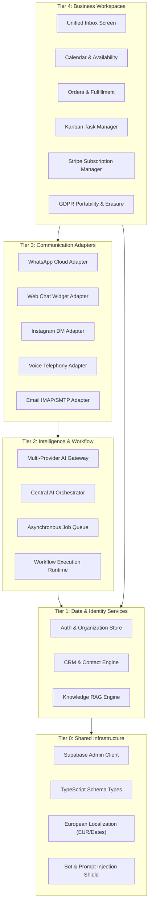
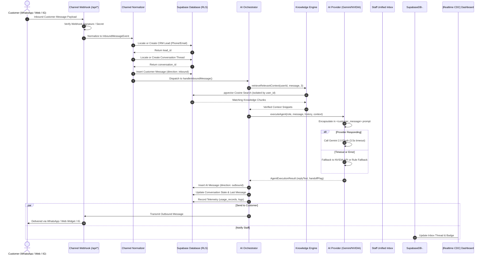
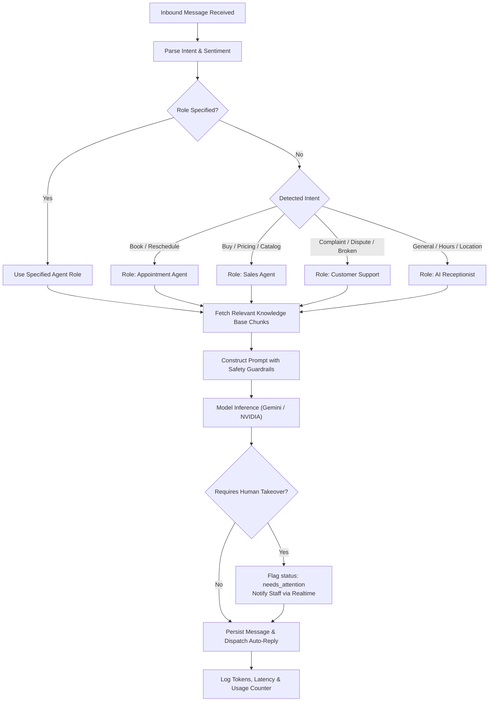
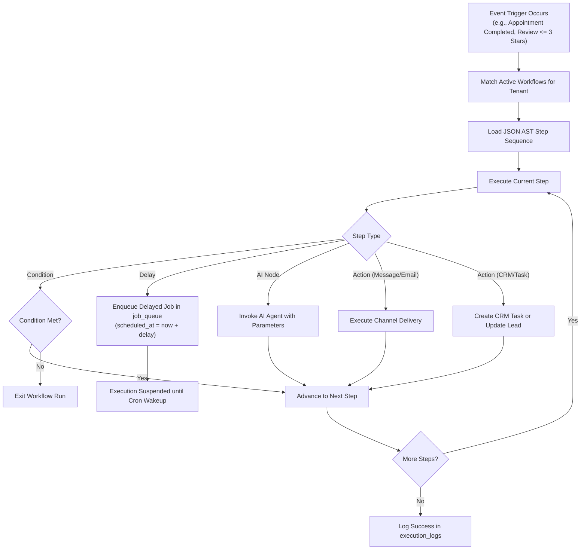
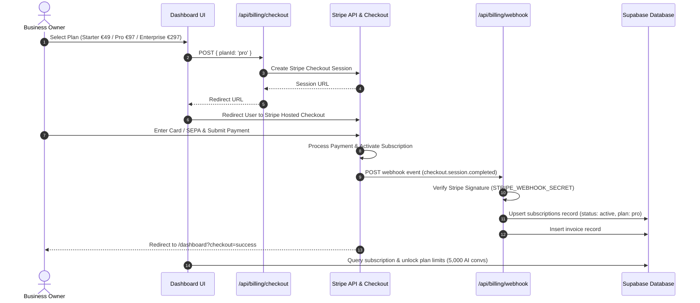
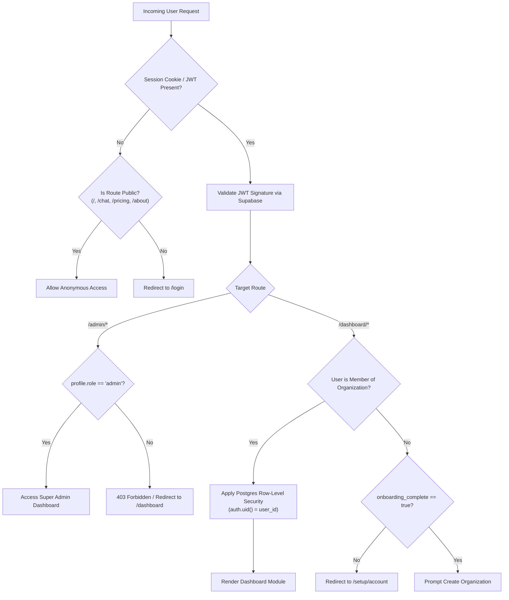
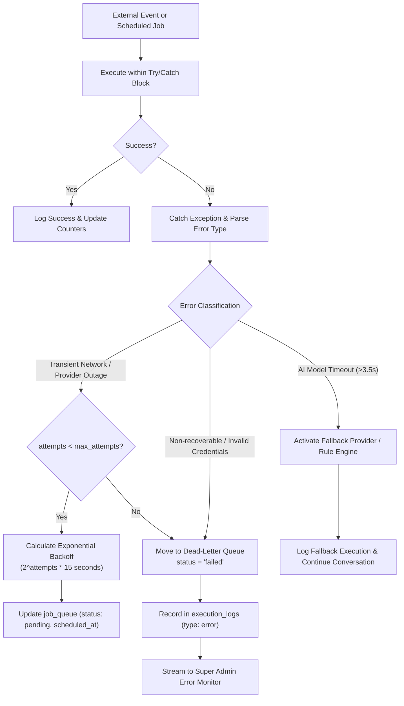

# StarX-Flow — Phase 4B.1 Blueprint
# Document 03: Master System Architecture

**Document ID:** `SXF-SYS-03`  
**Classification:** System Architecture & Integration Specification  
**Status:** Approved for Planning Baseline  
**Date:** November 1, 2026  
**Author:** Principal Software Architect & Systems Engineer  

---

## 1. High-Level System Architecture

StarX-Flow is architected as a high-performance, modular, multi-tenant platform designed to execute in European serverless environments. The system couples a **Next.js 16 App Router** frontend and API gateway with a **Supabase PostgreSQL** data tier, orchestrated by an **Autonomous AI Workforce** communicating with third-party providers via strict rate-limited and timeout-protected adapters.

### Master System Topology

```mermaid
flowchart TD
    subgraph ClientLayer ["1. Client Interaction Layer"]
        WA["WhatsApp Client (Mobile)"]
        WEB["Website Visitor (Embed Widget)"]
        IG["Instagram User (DMs)"]
        TEL["Phone Caller (Telephony)"]
        DASH["Business Owner (Web Dashboard)"]
    end

    subgraph EdgeGateway ["2. Vercel Serverless & Edge API Gateway"]
        WH_WA["/api/whatsapp/webhook"]
        WH_WEB["/api/chat"]
        WH_IG["/api/instagram/webhook"]
        WH_VOICE["/api/voice/incoming"]
        API_AUTH["/api/auth/*"]
        API_BILLING["/api/billing/*"]
        API_GDPR["/api/gdpr/*"]
        API_KNOW["/api/knowledge/*"]
    end

    subgraph CoreEngine ["3. StarX-Flow Core Application Layer"]
        ORCH["AI Orchestrator (Intent Triage)"]
        PROV["AI Provider Abstraction (Gemini / NVIDIA)"]
        RAG["Knowledge Engine (Chunker & Retriever)"]
        ROUTER["Identity & Channel Normalizer"]
        WF_ENG["Workflow Execution Engine"]
        SEC_SHIELD["StarX Shield Bot & Safety Guard"]
    end

    subgraph DataStorage ["4. Data & Persistence Tier (Supabase EU Frankfurt)"]
        DB_AUTH["Supabase Auth (JWT & Sessions)"]
        DB_CORE["PostgreSQL Relational Storage (RLS Enabled)"]
        DB_VEC["pgvector (Knowledge Base Vector Chunks)"]
        DB_QUEUE["Job Queue & Telemetry Records"]
        REALTIME["Supabase Realtime (WebSocket CDC)"]
    end

    subgraph ExternalServices ["5. External SaaS & Service Providers"]
        META["Meta Graph API v19.0 (WhatsApp & IG)"]
        GEMINI["Google Gemini 2.0 Flash API"]
        NVIDIA["NVIDIA AI Inference Gateway"]
        STRIPE["Stripe European SEPA & Card Billing"]
        TWILIO["Twilio Voice & SMS Gateway"]
        GOOGLE_CAL["Google Calendar API"]
    end

    %% Client to Edge
    WA -->|HTTPS Webhook| WH_WA
    WEB -->|HTTPS POST| WH_WEB
    IG -->|HTTPS Webhook| WH_IG
    TEL -->|Voice SIP/WebRTC| WH_VOICE
    DASH -->|HTTPS / WSS| EdgeGateway

    %% Edge to Core
    WH_WA --> ROUTER
    WH_WEB --> ROUTER
    WH_IG --> ROUTER
    WH_VOICE --> ROUTER
    ROUTER --> ORCH

    %% Core Services
    ORCH --> RAG
    ORCH --> PROV
    ORCH --> WF_ENG
    PROV --> GEMINI
    PROV --> NVIDIA
    WF_ENG --> DB_QUEUE

    %% Core to Data
    ORCH --> DB_CORE
    RAG --> DB_VEC
    EdgeGateway --> DB_AUTH
    EdgeGateway --> DB_CORE
    DB_CORE --> REALTIME
    REALTIME -.->|Real-time Updates| DASH

    %% External Callouts
    WH_WA --> META
    API_BILLING --> STRIPE
    WH_VOICE --> TWILIO
    WF_ENG --> GOOGLE_CAL
```

---

## 2. Module Dependency Matrix

The following diagram defines the directional dependencies between StarX-Flow subsystems. Lower-tier foundation services must NEVER depend on upper-tier business modules.

---

## 3. Communication & Message Ingestion Data Flow

The sequence diagram below traces an incoming customer message across any channel through normalization, CRM identity resolution, vector RAG retrieval, AI inference, and auto-reply dispatch.

---

## 4. AI Orchestration & Tool Calling Flow

---

## 5. Workflow Execution Engine Architecture

---

## 6. Subscription Billing & Usage Metering Flow

---

## 7. Authentication & Authorization Flow

---

## 8. Error Handling & Dead-Letter Queue Architecture

---

## 9. Shared Services Architecture

To eliminate duplicated logic across StarX-Flow modules, the following single-instance shared services are established:

| Shared Service Name | File Location | Responsibility | Consumers |
| :--- | :--- | :--- | :--- |
| **`SupabaseAdmin`** | [`src/lib/supabaseAdmin.ts`](file:///c:/Web%20Apps/starx-flow/src/lib/supabaseAdmin.ts) | Privileged server-side database operations bypassing RLS safely | All API Route Handlers (`/api/*`) |
| **`AIProvider`** | [`src/lib/ai/provider.ts`](file:///c:/Web%20Apps/starx-flow/src/lib/ai/provider.ts) | Provider routing (Gemini, NVIDIA, Fallback), prompt safety, latency timeouts | `AIOrchestrator`, `AIChatTester`, Voice Engine |
| **`KnowledgeEngine`** | [`src/lib/ai/knowledgeEngine.ts`](file:///c:/Web%20Apps/starx-flow/src/lib/ai/knowledgeEngine.ts) | Text chunking, token estimation, vector cosine retrieval | Ingestion API, `AIProvider`, RAG Inspector |
| **`LocaleUtils`** | [`src/lib/locale.ts`](file:///c:/Web%20Apps/starx-flow/src/lib/locale.ts) | Centralized Euro formatting (`formatEuro`), dates, timezones | Dashboard, Invoices, Orders, Analytics |
| **`ConsentService`** | [`src/services/consent.ts`](file:///c:/Web%20Apps/starx-flow/src/services/consent.ts) | Cookie and tracking consent evaluation | Analytics, Campaign Dispatcher, Web Widget |
| **`JobQueue`** | [`src/services/jobQueue.ts`](file:///c:/Web%20Apps/starx-flow/src/services/jobQueue.ts) | Asynchronous task scheduling and retry orchestration | Email Service, Campaign Follow-up, Webhooks |
