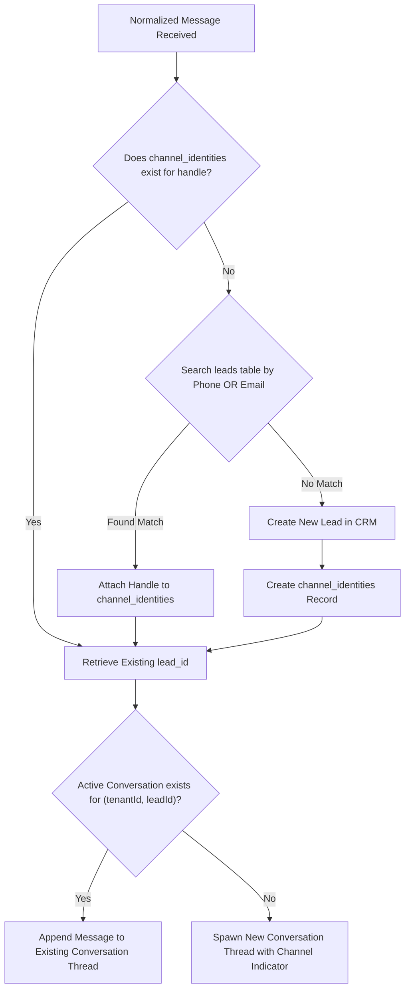
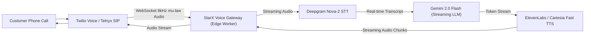
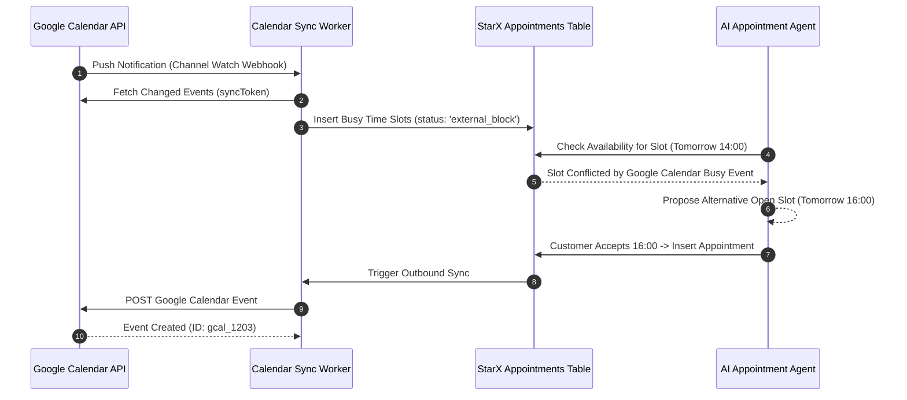

# StarX-Flow — Phase 4B.1 Blueprint
# Document 04: Feature Implementation Specifications (Modules A–N)

**Document ID:** `SXF-SPEC-04`  
**Classification:** Technical Implementation Specifications  
**Status:** Approved for Planning Baseline  
**Date:** November 1, 2026  
**Author:** Principal Software Architect & Staff Full-Stack Engineer  

---

## MODULE A — UNIFIED COMMUNICATION INBOX

### 1. Architectural Objective
Construct a genuinely unified, real-time communication platform that aggregates conversations across WhatsApp, Website Chat, Instagram DMs, SMS, and Email into a single consolidated thread per customer identity, with zero data leakage between organizations.

### 2. Channel Adapter & Message Normalization Architecture
Every external communication provider transmits payloads in disparate formats (e.g., Meta Webhook JSON, Twilio URL-encoded POST, SendGrid multipart email, Web Chat JSON). 

The **Channel Adapter Layer** normalizes all inbound events into a standardized TypeScript contract:

```typescript
export interface NormalizedInboundMessage {
  tenantId: string;
  channel: 'WhatsApp' | 'Instagram' | 'SMS' | 'Web' | 'Email';
  channelMessageId: string;
  senderIdentifier: string;       // E.g. phone (+49...), email (user@...), IG scoped ID
  senderDisplayName: string;
  recipientIdentifier: string;    // Business phone, email address, or page ID
  content: {
    text: string;
    attachments: Array<{
      type: 'image' | 'audio' | 'document' | 'video';
      url: string;
      mimeType: string;
      fileName?: string;
    }>;
  };
  rawMetadata: Record<string, any>;
  receivedAt: string;
}
```

### 3. Customer Identity Resolution Algorithm
A core challenge of unified communications is linking a customer who contacts the business on WhatsApp with an email inquiry sent by the same person days later.



### 4. Realtime Synchronization & Human Takeover
- **Realtime Pipeline:** Supabase Realtime WebSocket subscription on table `messages` filters `conversation_id = in.(active_threads)`.
- **Takeover Logic:**
  1. Staff clicks "Take Over Conversation" in `ConversationThread.tsx`.
  2. Updates `conversations.status = 'needs_attention'`, `conversations.assigned_to = auth.uid()`.
  3. `AIOrchestrator` checks `status === 'needs_attention'` on subsequent inbound messages; when flagged, AI automated responses are paused and an internal alert notification is emitted to assigned staff.
  4. Staff manual replies are dispatched directly through the respective channel adapter (Meta Graph API for WhatsApp/IG, Twilio for SMS, Resend for Email).

---

## MODULE B — EMAIL INTEGRATION

### 1. Evaluated Architectures
1. **Direct IMAP/SMTP Polling:** High latency, fragile socket state in serverless environments, complex OAuth refresh requirements for Google Workspace and Microsoft 365.
2. **Gmail & Microsoft Graph OAuth Webhooks:** Native, high security, but requires complex multi-tenant app verifications and push notification subscription renewals every 7 days.
3. **Inbound Transactional Email Webhook Routing (Recommended Commercial Baseline):** Use dedicated business email domain routing via **Resend** or **Postmark**. Inbound emails sent to `*@tenant.starx-flow.com` (or customer's custom MX records) are parsed into JSON webhooks and dispatched to `/api/email/webhook/inbound`.

### 2. Inbound & Outbound Pipeline
- **Inbound Webhook (`POST /api/email/webhook/inbound`):**
  - Parses sender, recipient, subject, plain text body, HTML body, and attachment URLs.
  - Matches sender email against `leads.email` and links conversation thread.
  - Enqueues AI draft generation: AI Support Agent generates suggested response, marked as `draft` in `messages` table.
- **Human Approval & Outbound (`POST /api/email/send`):**
  - Staff reviews the AI-generated draft in the Unified Inbox.
  - Staff clicks "Approve & Send" or edits response.
  - Outbound email dispatched via Resend REST API using verified tenant DKIM/SPF domain.

---

## MODULE C — INSTAGRAM DM INTEGRATION

### 1. Meta Application & API Requirements
- **Eligibility:** Meta Professional Account (Instagram Business or Creator) connected to a verified Facebook Page.
- **Required Meta Graph API Permissions:**
  - `instagram_basic`
  - `instagram_manage_messages`
  - `pages_show_list`
  - `pages_manage_metadata`
- **Official Policy Constraints:**
  - **24-Hour Messaging Window:** Businesses may only send automated replies within 24 hours of a customer-initiated DM. Outside 24 hours, only approved Meta Message Tags (e.g., `CONFIRMED_EVENT_UPDATE`) may be transmitted.
  - **Prohibition:** Strictly zero unofficial web scraping or headless browser automation; all interactions must route through the official Graph API `v19.0`.

### 2. Instagram Webhook Implementation
- **Verification Endpoint (`GET /api/instagram/webhook`):** Validates `hub.mode === 'subscribe'` and `hub.verify_token === process.env.META_VERIFY_TOKEN`.
- **Event Receiver (`POST /api/instagram/webhook`):**
  - Validates `X-Hub-Signature-256`.
  - Extracts `entry[].messaging[].message.text` and `sender.id` (Instagram-Scoped ID).
  - Resolves conversation via `AIOrchestrator` (channel: `'Instagram'`).
  - Dispatches AI reply via `POST https://graph.facebook.com/v19.0/me/messages` with `{ recipient: { id: ig_scoped_id }, message: { text: reply } }`.

---

## MODULE D — AI VOICE TELEPHONY

### 1. Evaluated Voice Gateway Architecture
To transition from the existing playback simulator to a true production telephony receptionist, StarX-Flow requires a real-time audio pipeline:



### 2. Detailed Call Lifecycle
1. **Call Initiation:** Customer dials leased business number. Twilio triggers webhook `POST /api/voice/incoming`.
2. **Consent & Greeting:** Twilio returns TwiML with `<Connect><Stream url="wss://starx-flow.com/api/voice/stream"/></Connect>`.
3. **Speech Recognition (STT):** Deepgram Nova-2 transcribes incoming audio with Voice Activity Detection (VAD).
4. **Barge-in / Interruption:** When customer begins speaking while AI is talking, gateway immediately halts TTS buffer playback and flushes audio pipeline.
5. **Tool Execution:** AI Voice Receptionist calls calendar tool: "Checking availability for tomorrow at 2 PM... Yes, that slot is open. Shall I confirm your booking?"
6. **Escalation / Transfer:** If caller requests human or expresses severe distress, gateway triggers TwiML `<Dial>` forwarding call to owner's mobile number.
7. **Call Completion & Wrap-up:**
   - Webhook persists recording URL, full transcript, AI summary, and sentiment into `calls` table.
   - Usage record inserted: `quantity = duration_seconds / 60` (Voice minutes counted against plan).

---

## MODULE E — LEAD MANAGEMENT AND SCORING

### 1. Scoring Engine Architecture
StarX-Flow combines two scoring layers:
1. **Deterministic Rule-Based Scoring:** Hard rules triggered by customer actions.
2. **AI Semantic Scoring:** Contextual sentiment and budget qualification evaluated by the AI Sales Agent.

```
Total Lead Score (0–100) = Base (50) + Σ(Deterministic Deltas) + (AI Intent Multiplier)
```

### 2. Scoring Rules Matrix
| Event / Trigger | Score Delta | Condition / Logic |
| :--- | :---: | :--- |
| **New Inbound Message** | `+5` | Initial contact across any channel |
| **VIP / Pricing Inquiry** | `+15` | Message contains keywords ("price", "cost", "package", "offer") |
| **Booking Slot Request** | `+25` | User asks to schedule an appointment |
| **Complaint / Negative Sentiment** | `-20` | Sentiment classified as negative or dispute |
| **Appointment Completed** | `+30` | Marked as completed in calendar |
| **Order Paid** | `+35` | Payment completed in Euro |
| **Inactivity (14 Days)** | `-10` | No customer messages recorded in 14 days |

---

## MODULE F — AUTOMATED FOLLOW-UP ENGINE

### 1. Durable Queue Architecture
Serverless functions on Vercel have execution timeouts (15s on Hobby, 60s on Pro). Long-running timers (`setTimeout`) cannot survive serverless lifecycle resets.

StarX-Flow utilizes a **Durable Database Queue** architecture:
- Table `job_queue` records:
  - `job_type`: `'follow_up_message'` | `'appointment_reminder'` | `'review_request'`
  - `payload`: JSON containing `recipientPhone`, `channel`, `templateText`, `leadId`
  - `scheduled_at`: Future timestamp (e.g. `2026-11-03T16:00:00Z`)
  - `status`: `'pending'` | `'processing'` | `'completed'` | `'failed'`

### 2. Execution Worker
- A scheduled cron endpoint `GET /api/cron/queue-worker` runs every 5 minutes (via Vercel Cron or Supabase `pg_cron`).
- Fetches jobs where `status = 'pending' and scheduled_at <= now()`.
- Atomically locks jobs (`update job_queue set status = 'processing' where id in (...)`).
- Dispatches messages via appropriate channel adapter.
- Handles retries: on transient failure, increments `attempts` and sets `scheduled_at = now() + (15 * 2^attempts seconds)`.

---

## MODULE G — APPOINTMENT AND CALENDAR INTEGRATIONS

### 1. Bi-Directional External Calendar Sync
To prevent double bookings between StarX-Flow and external tools (e.g. Google Calendar on owner's phone):



---

## MODULE H — WORKFLOW AUTOMATION BUILDER

### 1. Visual AST to Executable JSON Plan
Workflows configured in [`WorkflowEditor.tsx`](file:///c:/Web%20Apps/starx-flow/src/screens/dashboard/WorkflowEditor.tsx) serialize into a Directed Acyclic Graph (DAG) JSON representation stored in `workflows.config`:

```json
{
  "workflowId": "wf-after-hours-01",
  "trigger": { "type": "message_received", "channel": "WhatsApp" },
  "nodes": [
    {
      "id": "node-1",
      "type": "condition",
      "evaluator": "outside_business_hours",
      "branches": {
        "true": "node-2",
        "false": "node-end"
      }
    },
    {
      "id": "node-2",
      "type": "ai_agent",
      "agentRole": "receptionist",
      "instruction": "Inform customer our salon is closed until 09:00 CET and offer tomorrow's morning booking slots.",
      "next": "node-3"
    },
    {
      "id": "node-3",
      "type": "channel_action",
      "action": "send_whatsapp",
      "next": "node-end"
    }
  ]
}
```

---

## MODULE I — ANALYTICS AND REPORTING

### 1. Real-Time Telemetry Rollups
To deliver instant dashboard rendering without expensive `COUNT(*)` full-table scans across millions of messages, the system establishes a materialized aggregation worker:
- **Table `analytics_daily_rollups`:** Pre-aggregated per tenant per day:
  - `date`: Date (YYYY-MM-DD)
  - `total_messages_inbound`, `total_messages_outbound`
  - `ai_resolution_count`, `human_handoff_count`
  - `total_revenue_eur`, `new_leads_count`
  - `appointments_booked`, `orders_completed`

---

## MODULE J — SUBSCRIPTION AND USAGE BILLING

### 1. Canonical Plan Tiering Matrix
All references to pricing across the entire product must strictly reflect this single source of truth:

| Plan Tier | Price (€ EUR) | AI Conversations / Mo | Contacts Limit | Workflows | Calendar Syncs | Voice Minutes | Team Members |
| :--- | :---: | :---: | :---: | :---: | :---: | :---: | :---: |
| **Starter** | **€49** / mo | 500 | 1,000 | 5 | 1 | 30 | 2 |
| **Pro** | **€97** / mo | 5,000 | 10,000 | 25 | 5 | 150 | 5 |
| **Enterprise** | **€297** / mo | Unlimited | Unlimited | Unlimited | Unlimited | 500 | Unlimited |

### 2. Usage Enforcement Algorithm
Prior to executing AI model inference in `AIOrchestrator`:
1. Queries `usage_records` count for current billing period.
2. Compares against `subscription.plan_id` limits.
3. If usage >= limit and tier != Enterprise, returns polite fallback: *"Your business communication quota has been reached for this billing period. Please upgrade your plan in Command Center Settings."*

---

## MODULE K — BUSINESS ONBOARDING WIZARD

### 1. 10-Step Customer Journey
```
1. Registration (Email / Password)
→ 2. Organization Name & European Niche
→ 3. Business Working Hours & Timezone (Europe/Berlin default)
→ 4. AI Persona & Tone Selection
→ 5. Knowledge Base Fast-Ingestion (Paste FAQ / Website URL)
→ 6. Channel Selection (WhatsApp Meta Connect / Web Widget Embed)
→ 7. Calendar Availability Connection
→ 8. Staff / Team Member Invite
→ 9. Test Sandbox Interactive Interaction
→ 10. Activation & First Live Conversation Milestone
```

---

## MODULE L — SUPER ADMIN GOVERNANCE DASHBOARD

### 1. RBAC Separation
- **Tenant Administrator:** Profile where `role = 'user'`. Bound by RLS to own `organization_id`.
- **Platform Super Administrator:** Profile where `role = 'admin'`. Authenticated via `claim_admin_role` setup secret. Can inspect cross-tenant client volume, revenue health, error logs, and toggle tenant statuses (`Active`, `Trial`, `Suspended`).

---

## MODULE M — SUPPORT AND RELIABILITY

### 1. AI Provider Failover Circuit Breaker
- When Gemini API returns HTTP 5xx or exceeds 3,500ms timeout 3 consecutive times:
  - Circuit Breaker transitions to `OPEN`.
  - Automatically diverts traffic to NVIDIA API for 120 seconds.
  - Automatically tests health ping before returning to `CLOSED` state.

---

## MODULE N — SECURITY AND EUROPEAN READINESS

### 1. Technical Compliance Framework
- **GDPR Article 17 (Right to Erasure):** Cascade deletion route wipes `leads`, `conversations`, `messages`, `appointments`, `orders`, `knowledge_documents`, `knowledge_chunks`, and `calls` permanently.
- **GDPR Article 20 (Data Portability):** JSON archive generator compiles tenant records into machine-readable export.
- **EU AI Act Transparency (Article 50):** System prompt mandates disclosure: AI agents must identify themselves as automated assistants when initiating contact.
- **Data Sovereignty:** All database instances and vector embeddings reside strictly within EU borders (Frankfurt AWS `eu-central-1`).
