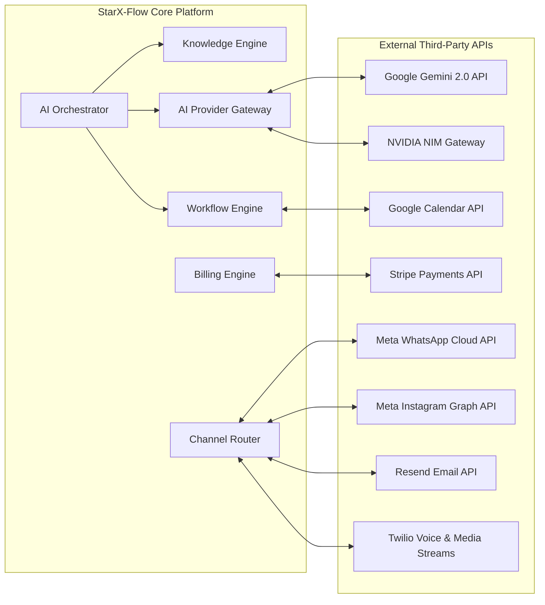
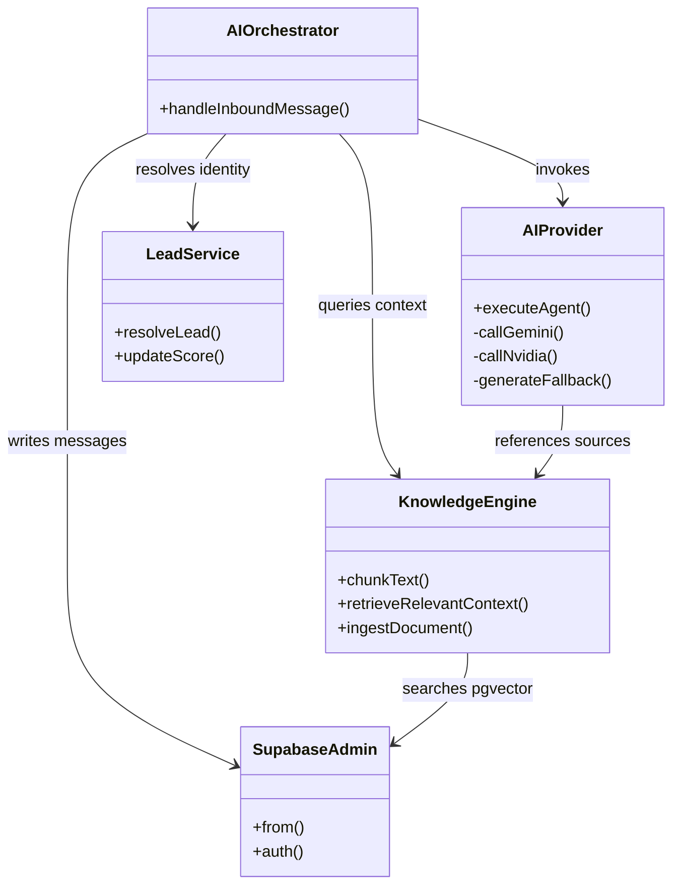

# StarX-Flow — Phase 4B.1 Blueprint
# Document 07: Integration Dependency Matrix

**Document ID:** `SXF-DEP-07`  
**Classification:** System Dependencies & External Integration Specifications  
**Status:** Approved for Planning Baseline  
**Date:** November 1, 2026  
**Author:** Principal Software Architect & Integration Engineer  

---

## 1. System Integration Topology

---

## 2. External Integration Specifications Matrix

| Service Provider | Integration Endpoint / Protocol | Primary Purpose | Required Credentials / Secrets | Failure Mode & Fallback |
| :--- | :--- | :--- | :--- | :--- |
| **Meta WhatsApp Cloud API** | `https://graph.facebook.com/v19.0/{phone_number_id}/messages` (REST + Webhook) | WhatsApp message receiving and auto-reply dispatch | `META_APP_ID`, `META_APP_SECRET`, `META_ACCESS_TOKEN`, `META_VERIFY_TOKEN` | Inbound retries buffered in Meta; outbound retried 3 times before error logged in `execution_logs`. |
| **Meta Instagram Graph API** | `https://graph.facebook.com/v19.0/me/messages` (REST + Webhook) | Instagram Direct Message receiving and AI replies | `META_APP_ID`, `META_APP_SECRET`, `instagram_manage_messages` token | Fails gracefully if outside 24-hr messaging window; alerts staff in Unified Inbox. |
| **Google Gemini 2.0 Flash** | `https://generativelanguage.googleapis.com/v1beta/models/gemini-2.0-flash:generateContent` (REST) | Primary LLM inference for all 8 workforce agents and RAG | `GEMINI_API_KEY` | 3,500ms timeout circuit breaker trips; traffic diverts to NVIDIA API or rule fallback. |
| **NVIDIA AI NIM Gateway** | `https://integrate.api.nvidia.com/v1/chat/completions` (OpenAI-compatible REST) | Secondary LLM fallback (`google/gemma-4-31b-it`) | `NVIDIA_API_KEY` | If both Gemini and NVIDIA fail, activates deterministic rule-based fallback. |
| **Stripe European Billing** | Stripe Checkout, Invoices, Webhooks (`api.stripe.com/v1`) | Subscriptions (€49 / €97 / €297), SEPA Direct Debit, cards | `STRIPE_SECRET_KEY`, `STRIPE_WEBHOOK_SECRET` | Local development automatically activates plan without failing user onboarding. |
| **Google Calendar API** | Google Calendar v3 API (OAuth2 + Webhooks) | Bi-directional appointment availability and event synchronization | `GOOGLE_CLIENT_ID`, `GOOGLE_CLIENT_SECRET` | Appointments persist locally in StarX database; sync marked as `pending_sync`. |
| **Twilio Voice / Telnyx** | WebSockets (8kHz mu-law audio streams) + TwiML REST | Real-time inbound phone call routing and spoken AI reception | `TWILIO_ACCOUNT_SID`, `TWILIO_AUTH_TOKEN`, Phone SID | If voice gateway unreachable, Twilio forwards call directly to owner's mobile number. |
| **Resend / Postmark** | Transactional Email REST (`api.resend.com/emails`) + Inbound Webhooks | Inbound customer email parsing and outbound staff replies | `RESEND_API_KEY`, Webhook Secret | Inbound emails retried by provider; outbound queued in `job_queue`. |

---

## 3. Internal Component Dependency & Coupling Matrix

### Decoupling Rules & Circular Dependency Prevention
1. **Unidirectional Control Flow:** API Route Handlers call `AIOrchestrator`. `AIOrchestrator` calls `AIProvider` and `KnowledgeEngine`. Lower layers (`KnowledgeEngine`, `AIProvider`) NEVER call `AIOrchestrator`.
2. **Store Isolation:** Frontend Zustand stores (`crmStore`, `calendarStore`, `orderStore`, `taskStore`, `knowledgeStore`) communicate with Supabase or dedicated `/api/*` endpoints independently; stores never directly import other store instances except `useAuthStore` for user session resolution.
3. **Environment Key Isolation:** Server-only credentials (`SUPABASE_SERVICE_ROLE_KEY`, `STRIPE_SECRET_KEY`, `META_APP_SECRET`, `NVIDIA_API_KEY`) are restricted strictly to files executed in the Node.js runtime (`src/app/api/*`, `src/lib/supabaseAdmin.ts`). Client code only receives public prefixed keys (`NEXT_PUBLIC_*`).

---

## 4. Failure Modes, Redundancy & Graceful Degradation Matrix

| External Failure Scenario | Detected By | System Impact | Automated Remediation / Fallback |
| :--- | :--- | :--- | :--- |
| **Google Gemini API Outage / High Latency** | `AbortSignal.timeout(3500)` in `AIProvider` | Potential AI reply latency | Automatically switches to NVIDIA NIM endpoint; if NVIDIA also fails, emits empathetic rule-based response and flags thread for human handoff. Zero dropped messages. |
| **Meta Graph API 500 / Rate Limit** | HTTP 429/5xx response in webhook dispatcher | Outbound WhatsApp message delay | Message remains in `messages` with status `'failed'`. Job enqueued in `job_queue` with exponential backoff (retry after 15s, 60s, 240s). |
| **Stripe Webhook Delivery Failure** | Stripe Webhook retry policy | Delayed subscription activation | Stripe automatically retries webhook delivery up to 72 hours. Fallback reconciliation endpoint `/api/billing/verify` available on checkout return. |
| **Twilio Media Stream Disconnection** | WebSocket `close` event | Interrupted phone call | Twilio fallback URL triggers immediate call forward (`<Dial>`) to business owner's mobile phone. |
| **Supabase Postgres High Load / Connection Pool Exhaustion** | `@supabase/supabase-js` connection error | Potential API read latency | Supabase connection pooling via Supavisor prevents exhaustion. Frontend stores retain optimistic local memory state so UI never freezes. |
