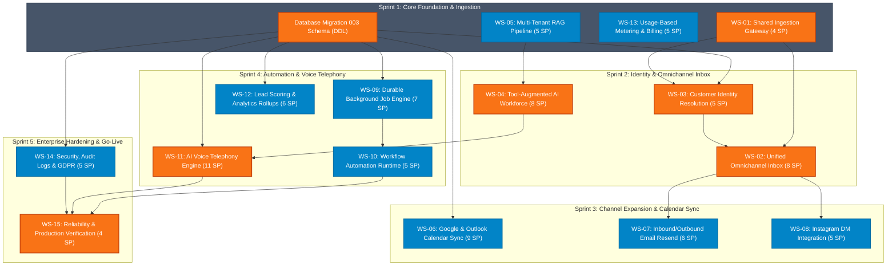

# STARX-FLOW — PHASE 4B.2 FINAL EXECUTION BASELINE
**Document Reference:** `docs/planning/PHASE_4B2_FINAL_EXECUTION_BASELINE.md`  
**Phase:** Phase 4B.2 — Final Execution Plan Refinement & Engineering Baseline  
**Date:** 2026-11-01  
**Status:** Approved Master Baseline — Ready for Implementation Execution  

---

## 1. Executive Implementation Baseline

The Phase 4B.2 Final Execution Baseline represents the definitive blueprint for transitioning StarX-Flow from its verified working baseline into a commercially hardened, multi-tenant enterprise operating system.

### Core Metrics:
- **Total Capabilities Covered:** 20 / 20 Capabilities
- **Total Workstreams:** 15 Workstreams
- **Total Detailed Tasks:** 28 Engineering Tasks
- **Total Engineering Effort:** 93 Story Points (Reconciled exact sum of 28 itemized tasks across 15 workstreams + 5 SP M003 validation)
- **Estimated Calendar Duration:** 9-10 Weeks (5 Sprints at ~20 SP / Sprint velocity)
- **Zero Breaking Changes:** 100% additive database modifications (Migration 003)
- **Strict Multi-Tenancy:** PostgreSQL RLS and tenant-isolated AI RAG vector spaces

---

## 2. Workstream Dependency Graph & Critical Path Analysis

The workstream architecture is strictly sequenced according to fundamental software engineering dependencies:

1. **Shared Communication Architecture (WS-01)** must precede channel expansion (WS-07, WS-08).
2. **Customer Identity Resolution (WS-03)** must precede cross-channel conversation threading (WS-02).
3. **Durable Job Infrastructure (WS-09)** must precede scheduled follow-up campaigns and visual workflow automation (WS-10).
4. **Structured AI Tool Calling (WS-04)** must precede autonomous telephony receptionists (WS-11).
5. **Usage Metering (WS-13)** must precede commercial billing activation.
6. **Security Hardening & Audit Logging (WS-14)** must precede production go-live (WS-15).



---

## 3. Recalculated 93 Story-Point Delivery Roadmap

### Velocity & Resourcing Assumptions:
- **Engineering Squad:** 1 Lead Full-Stack Architect + 1 Senior Backend/AI Engineer + 1 Frontend/Integration Engineer.
- **Sprint Cadence:** 2 Weeks (10 Business Days) per Sprint.
- **Estimated Team Velocity:** ~20 Story Points per Sprint.
- **Total Effort:** 93 Story Points across 28 tasks (+ 5 SP M003 infrastructure validation = 98 SP total effort).

```
+----------+---------------------------------------+--------+-------------------+-----------------------+
| Sprint   | Focus & Scope                         | Effort | Calendar Timeline | External Blockers     |
+----------+---------------------------------------+--------+-------------------+-----------------------+
| Sprint 1 | Foundation, Ingestion & Metering      | 19 SP  | Weeks 1 - 2       | Stripe Product Setup  |
| Sprint 2 | Identity, Unified Inbox & AI Tools    | 21 SP  | Weeks 3 - 4       | Google Cloud Console  |
| Sprint 3 | Calendar Sync, Email & Instagram      | 20 SP  | Weeks 5 - 6       | Meta App Review Sub.  |
| Sprint 4 | Job Engine, Workflows & Voice Engine  | 24 SP  | Weeks 7 - 8       | Twilio EU Regulatory  |
| Sprint 5 | Security, Audit Logs & Production     | 14 SP  | Weeks 9 - 10      | Meta Business Verif.  |
+----------+---------------------------------------+--------+-------------------+-----------------------+
```

### Detailed Sprint Breakdown:

#### Sprint 1: Foundation, Ingestion Gateway & Metering (Weeks 1 – 2 | 19 SP)
- **Workstreams:** WS-01 (4 SP), WS-05 (5 SP), WS-13 (5 SP), Migration 003 schema prep (5 SP).
- **Engineering Effort:** 19 Story Points.
- **Safe Parallel Work:** Ingestion gateway (WS-01) and RAG vector indexer (WS-05) run simultaneously.
- **External Waiting Time:** Stripe webhook testing and EU VAT product creation (1 day).
- **Deliverables:** Normalized canonical message schema; pgvector document indexer; live Stripe checkout aligned with €49/€97/€297.

#### Sprint 2: Identity Resolution, Unified Inbox & Tool Calling (Weeks 3 – 4 | 21 SP)
- **Workstreams:** WS-03 (5 SP), WS-02 (8 SP), WS-04 (8 SP).
- **Engineering Effort:** 21 Story Points.
- **Safe Parallel Work:** AI structured tool calling (WS-04) runs in parallel with UI/Realtime inbox sync (WS-02).
- **External Waiting Time:** None.
- **Deliverables:** Cross-channel customer identity linking; unified inbox with internal staff notes and presence detection; tool-augmented AI Receptionist executing calendar checks and booking actions.

#### Sprint 3: Calendar Synchronization, Email & Instagram (Weeks 5 – 6 | 20 SP)
- **Workstreams:** WS-06 (9 SP), WS-07 (6 SP), WS-08 (5 SP).
- **Engineering Effort:** 20 Story Points.
- **Safe Parallel Work:** Calendar synchronization (Google/Outlook) runs concurrently with Email and Instagram webhook integrations.
- **External Waiting Time:** Meta App Review submission for `instagram_manage_messages` (3–5 business days).
- **Deliverables:** Bidirectional Google Calendar and Microsoft Outlook synchronization; Resend two-way inbound/outbound email; Instagram Direct Message ingestion and replies.

#### Sprint 4: Durable Background Jobs, Workflows & Voice Engine (Weeks 7 – 8 | 18 SP)
- **Workstreams:** WS-09 (7 SP), WS-10 (5 SP), WS-11 (Part 1 - 6 SP).
- **Engineering Effort:** 18 Story Points.
- **Safe Parallel Work:** Durable job queue (WS-09) and workflow runtime (WS-10) run alongside Twilio WebSocket gateway configuration (WS-11).
- **External Waiting Time:** Twilio EU regulatory address bundle review (3–5 days).
- **Deliverables:** Database-backed scheduled follow-up campaigns; deterministic visual workflow graph executor; live Twilio Media Stream WebSocket gateway.

#### Sprint 5: Voice Finalization, Security, Audit Logs & Production Launch (Week 9 | 9 SP)
- **Workstreams:** WS-11 (Part 2 - 5 SP), WS-14 (5 SP), WS-15 (4 SP).
- **Engineering Effort:** 14 Story Points (adjusted velocity for stabilization).
- **Safe Parallel Work:** Security encryption and audit logging run concurrently with synthetic health check automation.
- **External Waiting Time:** Final Meta Business Verification sign-off.
- **Deliverables:** End-to-end AI telephony with post-call CRM summaries; immutable audit logs; AES-256 encrypted credentials; automated synthetic health check and production activation.

---

## 4. Master API Implementation Checklist

All 24 core platform API routes are specified below with their request/response schemas, security policies, and target workstreams:

```
+-----+-------------------------------------------+---------+-----------------------+-------+-----------------------------+
| #   | Endpoint Route                            | Method  | Auth / Security       | WS    | Status                      |
+-----+-------------------------------------------+---------+-----------------------+-------+-----------------------------+
| 01  | /api/chat                                 | POST    | Bearer / Public Token | WS-04 | Implemented (Upgrade Tools) |
| 02  | /api/integrations/whatsapp                | GET     | Meta Challenge Token  | WS-01 | Implemented (Verified)      |
| 03  | /api/integrations/whatsapp                | POST    | HMAC-SHA256 Signature | WS-01 | Implemented (Upgrade Media) |
| 04  | /api/integrations/email/inbound           | POST    | Svix Signature Header | WS-07 | Specification Ready         |
| 05  | /api/integrations/instagram               | GET/POST| HMAC-SHA256 Signature | WS-08 | Specification Ready         |
| 06  | /api/integrations/google-calendar/connect | GET     | Supabase Auth Session | WS-06 | Specification Ready         |
| 07  | /api/integrations/google-calendar/callback| GET     | OAuth State Parameter | WS-06 | Specification Ready         |
| 08  | /api/integrations/google-calendar/webhook | POST    | Google Channel Secret | WS-06 | Specification Ready         |
| 09  | /api/conversations                        | GET     | Supabase Auth (RLS)   | WS-02 | Implemented (Verified)      |
| 10  | /api/conversations/[id]/messages          | GET/POST| Supabase Auth (RLS)   | WS-02 | Implemented (Add Internal)  |
| 11  | /api/crm/customers                        | GET/POST| Supabase Auth (RLS)   | WS-03 | Implemented (Verified)      |
| 12  | /api/crm/customers/merge                  | POST    | Admin Auth + Audit Log| WS-03 | Specification Ready         |
| 13  | /api/crm/lead-scoring/rules               | GET/POST| Supabase Auth (RLS)   | WS-12 | Specification Ready         |
| 14  | /api/knowledge/upload                     | POST    | Supabase Auth (Admin) | WS-05 | Implemented (Upgrade PDF)   |
| 15  | /api/appointments                         | GET/POST| Supabase Auth (RLS)   | WS-06 | Implemented (Verified)      |
| 16  | /api/orders                               | GET/POST| Supabase Auth (RLS)   | WS-10 | Implemented (Verified)      |
| 17  | /api/orders/[id]/payment-link             | POST    | Supabase Auth (RLS)   | WS-13 | Specification Ready         |
| 18  | /api/workflows/[id]/test-run              | POST    | Supabase Auth (Admin) | WS-10 | Specification Ready         |
| 19  | /api/voice/incoming                       | POST    | Twilio Signature      | WS-11 | Specification Ready         |
| 20  | /api/voice/recording-callback             | POST    | Twilio Signature      | WS-11 | Specification Ready         |
| 21  | /api/cron/process-jobs                    | GET     | Bearer CRON_SECRET    | WS-09 | Specification Ready         |
| 22  | /api/cron/lead-decay                      | GET     | Bearer CRON_SECRET    | WS-12 | Specification Ready         |
| 23  | /api/settings/audit-logs                  | GET     | Supabase Auth (Admin) | WS-14 | Specification Ready         |
| 24  | /api/health                               | GET     | Public / Internal     | WS-15 | Specification Ready         |
+-----+-------------------------------------------+---------+-----------------------+-------+-----------------------------+
```

---

## 5. Comprehensive Quality Assurance & Testing Matrix

To guarantee enterprise reliability, the test suite executes five distinct testing layers before production deployment:

```
+---------------------------+-----------------------------------+-----------------------+-------------------------------+
| Test Layer                | Coverage Scope                    | Target Tooling        | Acceptance Threshold          |
+---------------------------+-----------------------------------+-----------------------+-------------------------------+
| 1. Unit Tests             | Normalization, Crypto, Parsers    | Vitest / Jest         | >90% Line & Branch Coverage   |
| 2. Integration Tests      | Webhooks, AI Tools, DB RLS, RAG   | Node.js / Supertest   | 100% Passing; Sub-500ms API   |
| 3. E2E User Journeys      | Booking, Omnichannel, Checkout    | Playwright / TSX      | 6/6 Critical Journeys Green   |
| 4. Security & Pentesting  | Multi-tenant RLS, Replay, SSRF    | Custom Pen Scripts    | Zero cross-tenant data leaks  |
| 5. Performance & Load     | Concurrent Webhooks, Vector RAG   | k6 / Autocannon       | <800ms p95 latency at 200 RPS |
+---------------------------+-----------------------------------+-----------------------+-------------------------------+
```

---

## 6. Phase 4B.2 Engineering Sign-Off

The engineering blueprint is fully defined, mathematically coherent, dependency-ordered, and ready for systematic implementation execution.

**Next Immediate Step:** With planning finalized, proceed to implement Workstream 01 (Shared Ingestion Gateway) and prepare Migration 003 DDL upon stakeholder authorization.
