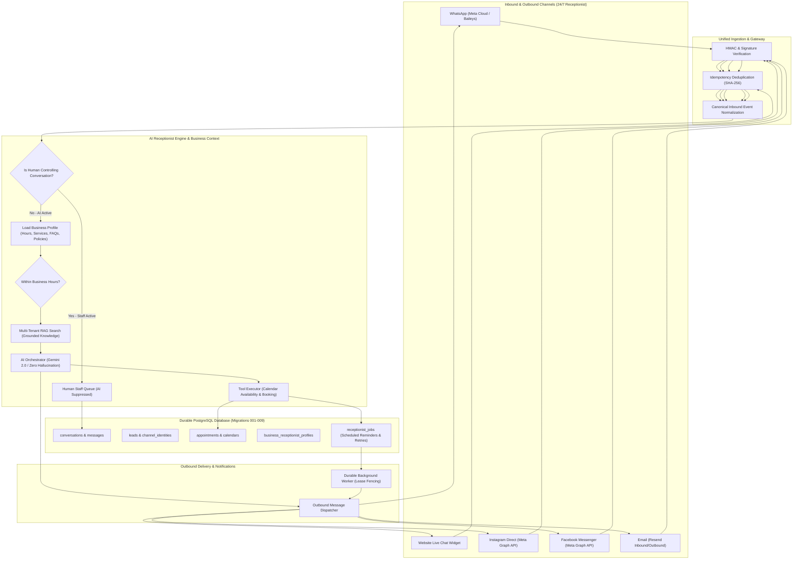

# STARX-FLOW — STAGE 0 CAPABILITY MATRIX & GAP ANALYSIS
## 24/7 Chat-Only AI Receptionist Commercial Launch

**Date:** 2026-11-03  
**Role:** Principal SaaS Architect, Staff Full-Stack Engineer, Backend Reliability Engineer & PostgreSQL Security Engineer  
**Target Product:** Multi-Tenant 24/7 AI Receptionist for European Local Businesses  
**Active Branch:** `remediation/phase-4b54-final-sprint3-security`  
**Current HEAD Commit:** `bdea7bbe23c0cd267c8f9f9390883e6fc9917eb1`  

---

## 1. REPOSITORY-GROUNDED CAPABILITY MATRIX

Every requirement from the Chat-Only 24/7 Launch Directive has been audited against actual repository source code, database migrations (001–008), test suites, and execution paths:

| Requirement Area | Status | File Paths / Execution Paths | Evidence & Gap Analysis |
| :--- | :---: | :--- | :--- |
| **A1. WhatsApp Integration** | **Complete & Verified** | [`src/app/api/whatsapp/webhook/route.ts`](file:///c:/Web%20Apps/starx-flow/src/app/api/whatsapp/webhook/route.ts) [`src/lib/ingestion/adapters/whatsappAdapter.ts`](file:///c:/Web%20Apps/starx-flow/src/lib/ingestion/adapters/whatsappAdapter.ts) | HMAC-SHA256 signature verification, webhook challenge, payload normalization, AI orchestration, outbound Meta Cloud reply. Verified in `sprint1-verification.ts` & `sprint2-verification.ts`. |
| **A2. Website Live Chat** | **Partially Implemented** | [`src/app/api/chat/route.ts`](file:///c:/Web%20Apps/starx-flow/src/app/api/chat/route.ts) [`src/components/chat/WebChatWidget.tsx`](file:///c:/Web%20Apps/starx-flow/src/components/chat/WebChatWidget.tsx) [`src/lib/ingestion/adapters/webChatAdapter.ts`](file:///c:/Web%20Apps/starx-flow/src/lib/ingestion/adapters/webChatAdapter.ts) | Working chat endpoint & widget. **Gaps:** Lacks public embed snippet generator, lacks dynamic widget config endpoint (`/api/chat/config`), lacks IP/session rate-limiting abuse protection, lacks localStorage session persistence across page reloads. |
| **A3. Instagram DMs** | **Complete & Verified** | [`src/app/api/integrations/instagram/webhook/route.ts`](file:///c:/Web%20Apps/starx-flow/src/app/api/integrations/instagram/webhook/route.ts) [`src/lib/integrations/instagram/instagramAdapter.ts`](file:///c:/Web%20Apps/starx-flow/src/lib/integrations/instagram/instagramAdapter.ts) | HMAC verification, 24h Meta messaging window enforcement, per-tenant AES-256-GCM token resolution, outbound Meta Graph API dispatch. Verified in `sprint3-verification.ts` & `sprint3-final-resend-idempotency.ts`. |
| **A4. Facebook Messenger** | **Missing / Blocked on Adapter** | New: [`src/lib/ingestion/adapters/facebookMessengerAdapter.ts`](file:///c:/Web%20Apps/starx-flow/src/lib/ingestion/adapters/facebookMessengerAdapter.ts) [`src/app/api/integrations/facebook/webhook/route.ts`](file:///c:/Web%20Apps/starx-flow/src/app/api/integrations/facebook/webhook/route.ts) | Meta webhook architecture is in place for Instagram, but Facebook Messenger (`payload.object === 'page'`) needs its dedicated channel adapter, 24h window enforcement, and outbound Graph API dispatcher. |
| **A5. Inbound/Outbound Email** | **Complete & Verified** | [`src/app/api/integrations/email/webhook/route.ts`](file:///c:/Web%20Apps/starx-flow/src/app/api/integrations/email/webhook/route.ts) [`src/lib/integrations/email/resendEmailAdapter.ts`](file:///c:/Web%20Apps/starx-flow/src/lib/integrations/email/resendEmailAdapter.ts) | Svix signature verification, subaddress tenant routing, thread isolation, atomic claim with pre-dispatch lease fencing, deterministic `Idempotency-Key` headers. 20/20 tests passed in `sprint3-final-resend-idempotency.ts`. |
| **B. AI Receptionist Engine** | **Partially Implemented** | [`src/lib/ai/orchestrator.ts`](file:///c:/Web%20Apps/starx-flow/src/lib/ai/orchestrator.ts) [`src/lib/ai/provider.ts`](file:///c:/Web%20Apps/starx-flow/src/lib/ai/provider.ts) [`src/lib/ai/tools/toolExecutor.ts`](file:///c:/Web%20Apps/starx-flow/src/lib/ai/tools/toolExecutor.ts) | Gemini 2.0 Flash with prompt injection defense, tool calling, and RAG context. **Gaps:** `generateFallback` has hardcoded prices ("€47") and hours ("09:00 to 18:00 CET") violating the zero-hallucination directive; fallback must query business facts or ask for clarification/handoff. |
| **C. Business Knowledge** | **Partially Implemented** | [`src/lib/rag/multiTenantRAG.ts`](file:///c:/Web%20Apps/starx-flow/src/lib/rag/multiTenantRAG.ts) [`src/app/api/knowledge/ingest/route.ts`](file:///c:/Web%20Apps/starx-flow/src/app/api/knowledge/ingest/route.ts) | RAG document parsing, chunking, and similarity search are verified. **Gap:** Lacks structured business profile table (`business_receptionist_profiles`) for opening hours, service price catalogs, booking rules, and custom receptionist prompt configuration. |
| **D. Lead & CRM Management** | **Complete & Verified** | [`src/lib/crm/identityResolver.ts`](file:///c:/Web%20Apps/starx-flow/src/lib/crm/identityResolver.ts) [`src/store/crmStore.ts`](file:///c:/Web%20Apps/starx-flow/src/store/crmStore.ts) | E.164 phone and email normalization, multi-channel identity mapping (`channel_identities`), duplicate detection, safe merging with audit logging. Verified in `sprint2-verification.ts`. |
| **E. Appointment Management** | **Complete & Verified** | [`src/lib/integrations/calendar/`](file:///c:/Web%20Apps/starx-flow/src/lib/integrations/calendar/) [`src/lib/ai/tools/toolExecutor.ts`](file:///c:/Web%20Apps/starx-flow/src/lib/ai/tools/toolExecutor.ts) | Google & Outlook calendar OAuth, delta sync, real-time availability checks, double-booking prevention, caller ownership authorization. Verified in `sprint3-verification.ts`. |
| **F. Human Handoff** | **Partially Implemented** | [`src/lib/inbox/inboxService.ts`](file:///c:/Web%20Apps/starx-flow/src/lib/inbox/inboxService.ts) [`src/app/api/conversations/[id]/messages/route.ts`](file:///c:/Web%20Apps/starx-flow/src/app/api/conversations/[id]/messages/route.ts) | Flags `needs_attention` on handoff request. Internal notes (`is_internal: true`) privacy is verified. **Gaps:** `AIOrchestrator` does NOT suppress AI responses when staff explicitly controls a thread (`status === 'human_takeover'`); staff replies in `InboxService.postMessage` do not dispatch outbound to the customer's external channel. |
| **G. Follow-ups & Reminders** | **Missing** | New: [`src/lib/jobs/receptionistJobScheduler.ts`](file:///c:/Web%20Apps/starx-flow/src/lib/jobs/receptionistJobScheduler.ts) New Migration 009 | No background scheduler exists for automated appointment reminders (24h/2h before), lead follow-ups, or delivery retries. Needs lightweight, durable PostgreSQL job queue with lease fencing. |
| **H. Security & Multi-Tenancy** | **Complete & Verified** | Migrations 001–008 [`src/lib/auth/serverAuth.ts`](file:///c:/Web%20Apps/starx-flow/src/lib/auth/serverAuth.ts) | Multi-tenant RLS on all tables, immutable audit logs, constant-time OAuth session binding, AES-256-GCM token encryption, tenant account collision prevention. |
| **I. Billing & Metering** | **Partially Implemented** | [`src/lib/usage/usageService.ts`](file:///c:/Web%20Apps/starx-flow/src/lib/usage/usageService.ts) [`src/lib/usage/types.ts`](file:///c:/Web%20Apps/starx-flow/src/lib/usage/types.ts) | Meters `ai_requests`, `whatsapp_messages`, `email_messages`, `instagram_messages`. **Gap:** Needs `messenger_messages`, `web_chat_messages`, and `receptionist_jobs` metric tracking. |
| **J. Customer Dashboard** | **Partially Implemented** | [`src/components/dashboard/DashboardSidebar.tsx`](file:///c:/Web%20Apps/starx-flow/src/components/dashboard/DashboardSidebar.tsx) [`src/screens/dashboard/`](file:///c:/Web%20Apps/starx-flow/src/screens/dashboard/) | UI exists for overview, inbox, CRM, calendar, knowledge, settings. **Gaps:** Sidebar displays unfinished placeholder tabs (`voice`, `os`); needs clean focus on 24/7 AI Receptionist with voice marked as "Coming Soon (Post-Launch)". |
| **K. Customer Onboarding** | **Partially Implemented** | [`src/app/setup/`](file:///c:/Web%20Apps/starx-flow/src/app/setup/) [`src/store/onboardingStore.ts`](file:///c:/Web%20Apps/starx-flow/src/store/onboardingStore.ts) | Multi-step setup wizard exists. **Gap:** Needs business hours, services/prices, and live AI receptionist testing aligned with the 24/7 receptionist product flow. |

---

## 2. TARGET ARCHITECTURE & DATA FLOW

---

## 3. IMPLEMENTATION PLAN (STAGES 1 TO 5)

### Stage 1 — 24/7 Reliability Foundation & Schema Upgrades
1. **Migration 009 (`009_receptionist_chat_operations.sql`):**
   - Create `business_receptionist_profiles` table for structured business info (services, prices, hours, FAQs, policies, receptionist instructions).
   - Create `receptionist_jobs` table for durable background reminders, follow-ups, and delivery retries with atomic claiming (`claim_receptionist_jobs`) using `FOR UPDATE SKIP LOCKED`.
   - Update `conversations` table to add `control_mode` (`'ai' | 'human'`) and `handoff_reason`.
2. **Durable Receptionist Job Scheduler (`src/lib/jobs/receptionistJobScheduler.ts`):**
   - Scheduled appointment reminders (24h/2h before).
   - Lead follow-ups (unconverted inquiries).
   - Outbound delivery retries with exponential backoff and lease fencing.

### Stage 2 — Multi-Channel Receptionist Completion
1. **Facebook Messenger Channel Adapter (`src/lib/ingestion/adapters/facebookMessengerAdapter.ts` & `/api/integrations/facebook/webhook`):**
   - Meta webhook challenge + HMAC verification.
   - Normalization of `object: 'page'` Messenger payloads.
   - 24-hour customer window management.
   - Outbound dispatch via Graph API `/me/messages`.
2. **Website Live Chat Embeddable Architecture:**
   - Public widget config API: `/api/chat/config?organizationId=...` (sanitized theme, greeting, business name).
   - Embed snippet generator for business websites.
   - Rate limiting on `/api/chat` (in-memory sliding window).
   - `WebChatWidget.tsx` upgraded with `localStorage` session persistence (`sessionId`, `conversationId`) and responsive mobile drawer.
3. **Outbound Dispatcher (`src/lib/inbox/outboundDispatcher.ts`):**
   - Unifies outbound dispatch across WhatsApp, Instagram, Messenger, Email, and Web Chat when human staff replies from the dashboard.

### Stage 3 — AI Receptionist & Zero-Hallucination Guardrails
1. **Dynamic Business Profile Loader (`src/lib/ai/businessProfileService.ts`):**
   - Injects opening hours, services catalog, and pricing into AI context.
   - Eradicates hardcoded fallback hallucinated prices ("€47") and opening hours from `provider.ts`.
   - Strictly enforces: If a price or service is not in the official catalog, the AI states it is not listed and offers to connect with staff.
2. **Human Handoff Suppression & Return to AI:**
   - In `AIOrchestrator.handleInboundMessage`: Checks if conversation has `control_mode === 'human'` or `status === 'human_takeover'`. If true, AI generation is suppressed and staff is notified.
   - Adds toggle in Unified Inbox to take over (`control_mode = 'human'`) and return to AI (`control_mode = 'ai'`).

### Stage 4 — Business Operations (Leads, Appointments & Follow-ups)
1. **Appointment Reminder Pipeline:**
   - When an appointment is confirmed, automatically schedules a reminder job in `receptionist_jobs` for 24 hours prior to appointment time.
   - Checks `appointments.reminder_sent` to prevent duplicate reminders.
2. **Lead Capture & Channel Attribution:**
   - Tags captured leads with exact origin channel (`whatsapp`, `instagram`, `messenger`, `web_chat`, `email`).

### Stage 5 — Commercial Readiness, Dashboard & Onboarding
1. **Dashboard Polish:**
   - Update `DashboardSidebar.tsx` to streamline 24/7 AI Receptionist navigation.
   - Mark `voice` as "Coming Soon (Post-Launch)".
   - Clean up placeholder buttons.
2. **AI Receptionist Settings Screen (`src/screens/dashboard/ReceptionistSettingsSection.tsx`):**
   - Manage business description, services/products, pricing, opening hours, greeting, and custom instructions.
3. **Usage Metering Extension:**
   - Add `messenger_messages`, `web_chat_messages`, `receptionist_jobs` to `UsageService.ts`.
4. **End-to-End Test Suite (`tests/chat-receptionist-launch.ts`):**
   - Validates all 10 customer journeys mandated in Section 10 of the Directive.
