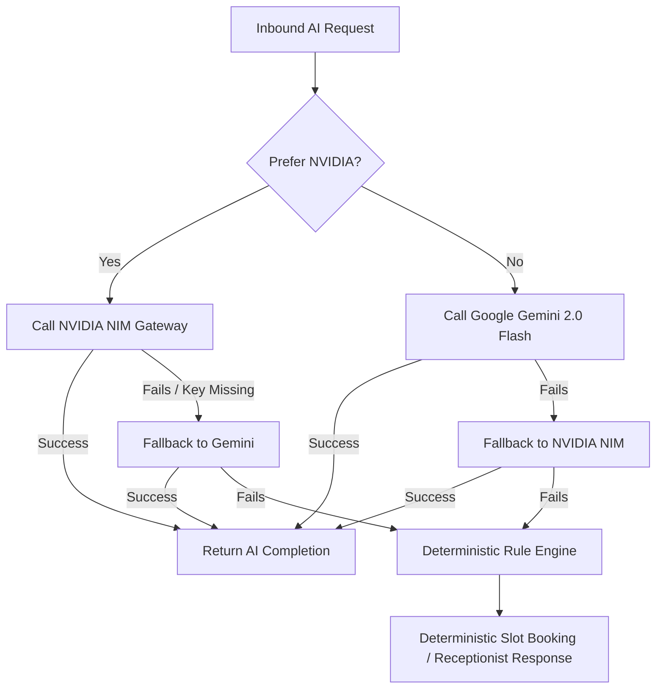
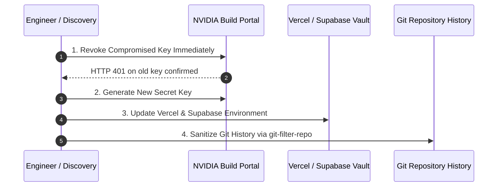

# StarX-Flow — NVIDIA NIM Integration Security Guide

**Document:** `docs/security/NVIDIA_INTEGRATION_SECURITY_GUIDE.md`  
**Classification:** Engineering Security Standard & Operational Runbook  
**Target Audience:** Core Developers, DevOps, Platform Engineers, Security Reviewers  
**Status:** Active  
**Version:** 1.0.0  

---

## 1. Executive Summary & Purpose

StarX-Flow integrates with the **NVIDIA AI NIM Gateway** (`https://integrate.api.nvidia.com/v1/chat/completions`) as an enterprise LLM engine providing high-throughput inference (e.g., DeepSeek v4.1 / Gemma 4).

Because API credentials grant direct billed compute access to NVIDIA Cloud infrastructure, strict credential isolation and operational hygiene are mandatory. This guide defines how NVIDIA API keys must be procured, configured, rotated, and protected against exposure in the StarX-Flow codebase and development lifecycle.

---

## 2. Multi-Provider LLM Fallback Architecture

StarX-Flow employs a resilient multi-tier LLM gateway implemented in `src/lib/ai/provider.ts` and `supabase/functions/ai-processor/index.ts`.

### Fallback Hierarchy



### Defensive Credential Guards

In `src/lib/ai/provider.ts`, the runtime inspects the key defensively:
```typescript
const NVIDIA_API_KEY = process.env.NVIDIA_API_KEY || '';

// Execution is only attempted if key is present AND not a placeholder
if (preferNvidia && NVIDIA_API_KEY && !NVIDIA_API_KEY.includes('your-')) {
  // Dispatches to NVIDIA NIM
}
```

**Key Architectural Invariant:**
If `NVIDIA_API_KEY` is empty, omitted, or set to placeholder text (e.g. `nvapi-your-key-here`), the system **does not throw a fatal exception or crash**. Instead, it automatically logs a graceful warning and routes requests to Gemini 2.0 Flash or the deterministic fallback booking agent.

---

## 3. Secure Configuration & Environment Management

API credentials must **never** be hardcoded in application logic, committed to source control, or embedded in client-side bundles.

### 3.1 Local Development Environment

1. Copy the template:
   ```bash
   cp .env.example .env.local
   ```
2. Populate `.env.local` with your personal or team development credential:
   ```env
   NVIDIA_API_KEY=nvapi-your-key-here
   ```
3. Verify git status:
   ```bash
   git status
   ```
   `.env.local` must remain completely untracked. `.gitignore` explicitly ignores `.env*` while preserving only `.example` files:
   ```gitignore
   .env*
   !.env.example
   !.env.backend.example
   !.env.frontend.example
   !.env.supabase.example
   ```

### 3.2 Staging & Production Environments

- **Vercel Deployment:**
  Set `NVIDIA_API_KEY` in the Vercel Project Settings under **Environment Variables** (check Production and Preview scopes).
  *Do NOT prefix with `NEXT_PUBLIC_`.*
- **Supabase Edge Functions:**
  Inject the secret via Supabase Secrets:
  ```bash
  supabase secrets set NVIDIA_API_KEY=nvapi-your-key-here
  ```

### 3.3 Example Files & Documentation Policy

All tracked repository files (`.env.example`, `.env.supabase.example`, markdown documentation, test mocks) must strictly use non-operational placeholder values:
```env
NVIDIA_API_KEY=nvapi-your-key-here
```
Any placeholder must contain `your-`, `here`, or `placeholder` to ensure secret scanners and runtime guards recognize it as inactive.

---

## 4. Secret Scanning & Pre-Commit Protection

To eliminate human error, StarX-Flow includes an automated secret scanner at `scripts/scan-secrets.cjs`.

### 4.1 Running the Scanner

To scan all tracked files across the repository:
```bash
npm run scan:secrets
```

To scan only staged changes prior to committing:
```bash
node scripts/scan-secrets.cjs --staged
```

### 4.2 Monitored Secret Signatures

The scanner evaluates tracked and staged files against strict signatures:
- **NVIDIA NIM Tokens:** `nvapi-[A-Za-z0-9_\-]{20,}`
- **OpenAI Keys:** `sk-(?:proj-)?[A-Za-z0-9_\-]{32,}`
- **Anthropic Keys:** `sk-ant-[A-Za-z0-9_\-]{32,}`
- **Stripe Secret Keys:** `sk_live_[0-9a-zA-Z]{24,}`
- **Private Key Blocks:** PEM header format (`-----BEGIN [TYPE] PRIVATE KEY-----`)

### 4.3 Redaction Guarantee

The scanning tool and CI pipelines strictly redact all detected strings, displaying only the first 6 and last 4 characters (`nvapi-...xxxx`). Secret values are never echoed to terminal logs, CI artifacts, or error dumps.

---

## 5. Incident Response: Accidental Credential Exposure Playbook

If a valid `NVIDIA_API_KEY` is accidentally pushed or discovered in git history, execute the following four-step protocol immediately:



### Step 1: Immediate Revocation on NVIDIA Build Portal
1. Navigate to [https://build.nvidia.com/](https://build.nvidia.com/).
2. Log in with organization credentials.
3. Go to **API Keys** -> locate the compromised key.
4. Click **Delete / Revoke Key**.
5. Validate revocation from terminal:
   ```bash
   curl -s -o /dev/null -w "%{http_code}" -H "Authorization: Bearer <REVOKED_KEY>" https://integrate.api.nvidia.com/v1/models
   ```
   *Expected result: `401 Unauthorized`.*

### Step 2: Key Generation & Distribution
1. Generate a new API key on the NVIDIA Build portal.
2. Update Vercel environment variables for `production` and `preview`.
3. Update Supabase Edge Function secrets if applicable.
4. Distribute the new key to authorized developers via secure password manager (1Password / Bitwarden). Never transmit keys over Slack, Discord, or email.

### Step 3: Git History Sanitization (`git-filter-repo`)
If the key was committed to any commit in Git history:
1. Create a mirror backup: `git clone --mirror . ../starx-flow-backup.git`.
2. Construct a replacement expression mapping the raw token to `nvapi-your-key-here`.
3. Execute `git-filter-repo --replace-text expressions.txt`.
4. Run `npm run scan:secrets` to confirm zero occurrences.
5. Notify all collaborators to pull the rewritten refs with rebase.

### Step 4: Verification & Post-Incident Documentation
File an incident record in `docs/security/` detailing the exposure window, revocation timestamp, new key ID, and remediation confirmation.
